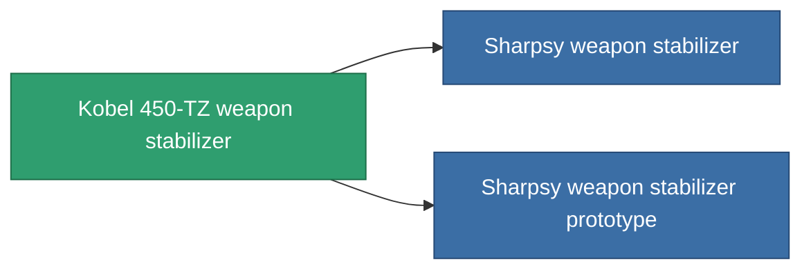

<!-- Generated by tools/generate from the live database (source: entitydefaults definition 3382, aggregatevalues via aggregatefields).
     Do not edit by hand; regenerate instead. -->

# Kobel 450-TZ weapon stabilizer

|  |  |
|---|---|
| Definicja | `def_named1_weapon_stabilizer` |
| Poziom | T2 |
| Zdrowie | 100 |
| Objętość | 1 |
| Masa | 450 |
| Kategoria | Modules / Weapons |
| Tier line | [Standard weapon stabilizer](/pl/content/items/standard-weapon-stabilizer/) (T1) → **Kobel 450-TZ weapon stabilizer** (T2) → [Sharpsy weapon stabilizer](/pl/content/items/named2-weapon-stabilizer/) (T3) → [Kobel 300-XZ weapon stabilizer](/pl/content/items/named3-weapon-stabilizer/) (T4) |

## Statystyki

| Pole | Wartość |
|---|---|
| accuracy_modifier | 0.9 |
| cpu_usage | 32 |
| explosion_radius_modifier | 0.9 |
| massiveness | -0.05 |
| powergrid_usage | 18 |

<!-- production:generated -->
## Produkcja

**Produkcja z 5 komponentów, poziom badań 5** — zmontuj komponenty, aby go zbudować (pełna lista w [Przepisy](/pl/content/recipes/)):

**Nakładka:** [Kobel 450-TZ weapon stabilizer CT](/content/items/named1-weapon-stabilizer-cprg/)

<svg class="prod-card-icon" aria-hidden="true"><use href="#mi-grid"/></svg><a class="prod-card-name" href="/pl/content/items/axicol/">Cryoperine</a>

wymagane: <b>350</b>

<svg class="prod-card-icon" aria-hidden="true"><use href="#mi-grid"/></svg><a class="prod-card-name" href="/pl/content/items/axicoline/">Axicoline</a>

wymagane: <b>150</b>

<svg class="prod-card-icon" aria-hidden="true"><use href="#mi-crystal"/></svg><a class="prod-card-name" href="/pl/content/items/robotshard-common-basic/">Damaged common fragment</a>

wymagane: <b>30</b>

<svg class="prod-card-icon" aria-hidden="true"><use href="#mi-robots"/></svg><a class="prod-card-name" href="/pl/content/items/standard-weapon-stabilizer/">Standard weapon stabilizer</a>

wymagane: <b>1</b>

<svg class="prod-card-icon" aria-hidden="true"><use href="#mi-grid"/></svg><a class="prod-card-name" href="/pl/content/items/titanium/">Titanium</a>

wymagane: <b>150</b>

## Użyte w produkcji

**Komponentem 2 przedmiotów** — wszystko, co go używa w produkcji:

