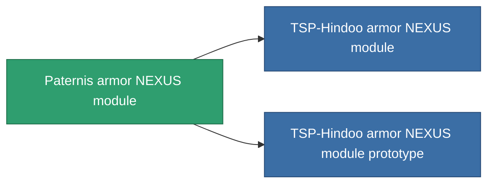

<!-- Generated by tools/generate from the live database (source: entitydefaults definition 2581, aggregatevalues via aggregatefields).
     Do not edit by hand; regenerate instead. -->

# Paternis armor NEXUS module

|  |  |
|---|---|
| Definicja | `def_named2_gang_assist_defense_module` |
| Poziom | T3 |
| Zdrowie | 100 |
| Objętość | 0.2 |
| Masa | 10 |
| Kategoria | Modules / Enhancements |
| Tier line | [Standard armor NEXUS module](/pl/content/items/standard-gang-assist-defense-module/) (T1) → [Starodix armor NEXUS module](/pl/content/items/named1-gang-assist-defense-module/) (T2) → **Paternis armor NEXUS module** (T3) → [TSP-Hindoo armor NEXUS module](/pl/content/items/named3-gang-assist-defense-module/) (T4) |
| Uwaga | armor hp 1% /ext lvl |

## Statystyki

| Pole | Wartość |
|---|---|
| core_usage | 36 |
| cpu_usage | 88 |
| cycle_time | 10k |
| default_effect_range | 100 |
| effect_armor_max_modifier | 1.05 |
| powergrid_usage | 36 |

<!-- production:generated -->
## Produkcja

**Produkcja z 10 komponentów, poziom badań 6** — zmontuj komponenty, aby go zbudować (pełna lista w [Przepisy](/pl/content/recipes/)):

**Nakładka:** [Paternis armor NEXUS module CT](/content/items/named2-gang-assist-defense-module-cprg/)

<svg class="prod-card-icon" aria-hidden="true"><use href="#mi-grid"/></svg><a class="prod-card-name" href="/pl/content/items/alligior/">Alligior</a>

wymagane: <b>50</b>

<svg class="prod-card-icon" aria-hidden="true"><use href="#mi-grid"/></svg><a class="prod-card-name" href="/pl/content/items/espitium/">Espitium</a>

wymagane: <b>250</b>

<svg class="prod-card-icon" aria-hidden="true"><use href="#mi-grid"/></svg><a class="prod-card-name" href="/pl/content/items/metachropin/">Metachropin</a>

wymagane: <b>50</b>

<svg class="prod-card-icon" aria-hidden="true"><use href="#mi-tree"/></svg><a class="prod-card-name" href="/pl/content/items/named1-gang-assist-defense-module/">Starodix armor NEXUS module</a>

wymagane: <b>1</b>

<svg class="prod-card-icon" aria-hidden="true"><use href="#mi-grid"/></svg><a class="prod-card-name" href="/pl/content/items/prilumium/">Prilumium</a>

wymagane: <b>250</b>

<svg class="prod-card-icon" aria-hidden="true"><use href="#mi-crystal"/></svg><a class="prod-card-name" href="/pl/content/items/robotshard-pelistal-advanced/">Functional pelistal fragment</a>

wymagane: <b>10</b>

<svg class="prod-card-icon" aria-hidden="true"><use href="#mi-crystal"/></svg><a class="prod-card-name" href="/pl/content/items/robotshard-pelistal-basic/">Damaged pelistal fragment</a>

wymagane: <b>10</b>

<svg class="prod-card-icon" aria-hidden="true"><use href="#mi-crystal"/></svg><a class="prod-card-name" href="/pl/content/items/robotshard-thelodica-advanced/">Functional thelodica fragment</a>

wymagane: <b>10</b>

<svg class="prod-card-icon" aria-hidden="true"><use href="#mi-crystal"/></svg><a class="prod-card-name" href="/pl/content/items/robotshard-thelodica-basic/">Damaged thelodica fragment</a>

wymagane: <b>10</b>

<svg class="prod-card-icon" aria-hidden="true"><use href="#mi-grid"/></svg><a class="prod-card-name" href="/pl/content/items/titanium/">Titanium</a>

wymagane: <b>50</b>

## Użyte w produkcji

**Komponentem 2 przedmiotów** — wszystko, co go używa w produkcji:

