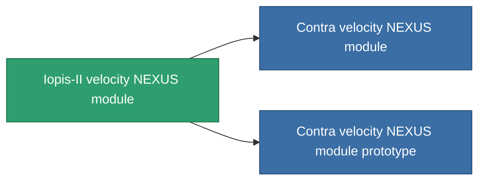

<!-- Generated by tools/generate from the live database (source: entitydefaults definition 2569, aggregatevalues via aggregatefields).
     Do not edit by hand; regenerate instead. -->

# Iopis-II velocity NEXUS module

|  |  |
|---|---|
| Definicja | `def_named2_gang_assist_speed_module` |
| Poziom | T3 |
| Zdrowie | 100 |
| Objętość | 0.2 |
| Masa | 10 |
| Kategoria | Modules / Enhancements |
| Tier line | [Standard velocity NEXUS module](/pl/content/items/standard-gang-assist-speed-module/) (T1) → [Jubatus velocity NEXUS module](/pl/content/items/named1-gang-assist-speed-module/) (T2) → **Iopis-II velocity NEXUS module** (T3) → [Contra velocity NEXUS module](/pl/content/items/named3-gang-assist-speed-module/) (T4) |
| Uwaga | speed 0.5% / extension lvl   |

## Statystyki

| Pole | Wartość |
|---|---|
| core_usage | 36 |
| cpu_usage | 88 |
| cycle_time | 10k |
| default_effect_range | 100 |
| effect_speed_max_modifier | 1.05 |
| powergrid_usage | 36 |

<!-- production:generated -->
## Produkcja

**Produkcja z 8 komponentów, poziom badań 6** — zmontuj komponenty, aby go zbudować (pełna lista w [Przepisy](/pl/content/recipes/)):

**Nakładka:** [Iopis-II velocity NEXUS module CT](/content/items/named2-gang-assist-speed-module-cprg/)

<svg class="prod-card-icon" aria-hidden="true"><use href="#mi-grid"/></svg><a class="prod-card-name" href="/pl/content/items/chollonin/">Chollonin</a>

wymagane: <b>300</b>

<svg class="prod-card-icon" aria-hidden="true"><use href="#mi-grid"/></svg><a class="prod-card-name" href="/pl/content/items/espitium/">Espitium</a>

wymagane: <b>300</b>

<svg class="prod-card-icon" aria-hidden="true"><use href="#mi-panel"/></svg><a class="prod-card-name" href="/pl/content/items/named1-gang-assist-speed-module/">Jubatus velocity NEXUS module</a>

wymagane: <b>1</b>

<svg class="prod-card-icon" aria-hidden="true"><use href="#mi-crystal"/></svg><a class="prod-card-name" href="/pl/content/items/robotshard-nuimqol-advanced/">Functional nuimqol fragment</a>

wymagane: <b>10</b>

<svg class="prod-card-icon" aria-hidden="true"><use href="#mi-crystal"/></svg><a class="prod-card-name" href="/pl/content/items/robotshard-nuimqol-basic/">Damaged nuimqol fragment</a>

wymagane: <b>10</b>

<svg class="prod-card-icon" aria-hidden="true"><use href="#mi-crystal"/></svg><a class="prod-card-name" href="/pl/content/items/robotshard-pelistal-advanced/">Functional pelistal fragment</a>

wymagane: <b>10</b>

<svg class="prod-card-icon" aria-hidden="true"><use href="#mi-crystal"/></svg><a class="prod-card-name" href="/pl/content/items/robotshard-pelistal-basic/">Damaged pelistal fragment</a>

wymagane: <b>10</b>

<svg class="prod-card-icon" aria-hidden="true"><use href="#mi-grid"/></svg><a class="prod-card-name" href="/pl/content/items/titanium/">Titanium</a>

wymagane: <b>50</b>

## Użyte w produkcji

**Komponentem 2 przedmiotów** — wszystko, co go używa w produkcji:

