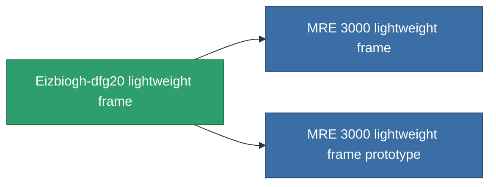

<!-- Generated by tools/generate from the live database (source: entitydefaults definition 1403, aggregatevalues via aggregatefields).
     Do not edit by hand; regenerate instead. -->

# Eizbiogh-dfg20 lightweight frame

|  |  |
|---|---|
| Definicja | `def_named2_mass_reductor` |
| Poziom | T3 |
| Zdrowie | 100 |
| Objętość | 0.5 |
| Masa | 2 |
| Kategoria | Modules / Enhancements |
| Tier line | [Standard lightweight frame](/pl/content/items/standard-mass-reductor/) (T1) → [MR1000-Boogey lightweight frame](/pl/content/items/named1-mass-reductor/) (T2) → **Eizbiogh-dfg20 lightweight frame** (T3) → [MRE 3000 lightweight frame](/pl/content/items/named3-mass-reductor/) (T4) |

## Statystyki

| Pole | Wartość |
|---|---|
| armor_max_modifier | 0.725 |
| cpu_usage | 6 |
| massiveness | -0.25 |
| powergrid_usage | 3 |
| speed_max_modifier | 1.2 |

<!-- production:generated -->
## Produkcja

**Produkcja z 8 komponentów, poziom badań 5** — zmontuj komponenty, aby go zbudować (pełna lista w [Przepisy](/pl/content/recipes/)):

**Nakładka:** [Eizbiogh-dfg20 lightweight frame CT](/content/items/named2-mass-reductor-cprg/)

<svg class="prod-card-icon" aria-hidden="true"><use href="#mi-grid"/></svg><a class="prod-card-name" href="/pl/content/items/alligior/">Alligior</a>

wymagane: <b>175</b>

<svg class="prod-card-icon" aria-hidden="true"><use href="#mi-grid"/></svg><a class="prod-card-name" href="/pl/content/items/axicol/">Cryoperine</a>

wymagane: <b>25</b>

<svg class="prod-card-icon" aria-hidden="true"><use href="#mi-grid"/></svg><a class="prod-card-name" href="/pl/content/items/espitium/">Espitium</a>

wymagane: <b>25</b>

<svg class="prod-card-icon" aria-hidden="true"><use href="#mi-grid"/></svg><a class="prod-card-name" href="/pl/content/items/named1-mass-reductor/">MR1000-Boogey lightweight frame</a>

wymagane: <b>1</b>

<svg class="prod-card-icon" aria-hidden="true"><use href="#mi-grid"/></svg><a class="prod-card-name" href="/pl/content/items/plasteosine/">Plasteosine</a>

wymagane: <b>175</b>

<svg class="prod-card-icon" aria-hidden="true"><use href="#mi-crystal"/></svg><a class="prod-card-name" href="/pl/content/items/robotshard-common-advanced/">Functional common fragment</a>

wymagane: <b>20</b>

<svg class="prod-card-icon" aria-hidden="true"><use href="#mi-crystal"/></svg><a class="prod-card-name" href="/pl/content/items/robotshard-common-basic/">Damaged common fragment</a>

wymagane: <b>20</b>

<svg class="prod-card-icon" aria-hidden="true"><use href="#mi-grid"/></svg><a class="prod-card-name" href="/pl/content/items/titanium/">Titanium</a>

wymagane: <b>200</b>

## Użyte w produkcji

**Komponentem 2 przedmiotów** — wszystko, co go używa w produkcji:

