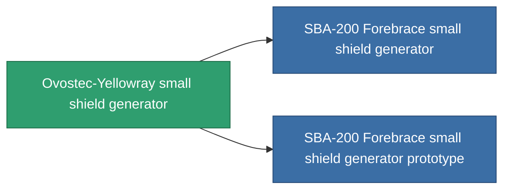

<!-- Generated by tools/generate from the live database (source: entitydefaults definition 724, aggregatevalues via aggregatefields).
     Do not edit by hand; regenerate instead. -->

# Ovostec-Yellowray small shield generator

|  |  |
|---|---|
| Definicja | `def_named2_small_shield_generator` |
| Poziom | T3 |
| Zdrowie | 100 |
| Objętość | 0.3 |
| Masa | 210 |
| Kategoria | Modules / Shield |
| Tier line | [Standard small shield generator](/pl/content/items/standard-small-shield-generator/) (T1) → [Parsvaal-IP small shield generator](/pl/content/items/named1-small-shield-generator/) (T2) → **Ovostec-Yellowray small shield generator** (T3) → [SBA-200 Forebrace small shield generator](/pl/content/items/named3-small-shield-generator/) (T4) |
| Uwaga | damage to core = shield_absorbtion * shield_absorbtion_modifier  amig ez a modul fut addig nincs damage, csak a core-bol von le.  |

## Statystyki

| Pole | Wartość |
|---|---|
| core_usage | 1 |
| cpu_usage | 47 |
| cycle_time | 2.25k |
| powergrid_usage | 53 |
| shield_absorbtion | 2.2 |
| shield_radius | 4.5 |

<!-- production:generated -->
## Produkcja

**Produkcja z 8 komponentów, poziom badań 4** — zmontuj komponenty, aby go zbudować (pełna lista w [Przepisy](/pl/content/recipes/)):

**Nakładka:** [Ovostec-Yellowray small shield generator CT](/pl/content/items/named2-small-shield-generator-cprg/)

<svg class="prod-card-icon" aria-hidden="true"><use href="#mi-grid"/></svg><a class="prod-card-name" href="/pl/content/items/alligior/">Alligior</a>

wymagane: <b>200</b>

<svg class="prod-card-icon" aria-hidden="true"><use href="#mi-grid"/></svg><a class="prod-card-name" href="/pl/content/items/espitium/">Espitium</a>

wymagane: <b>100</b>

<svg class="prod-card-icon" aria-hidden="true"><use href="#mi-grid"/></svg><a class="prod-card-name" href="/pl/content/items/isopropentol/">Isopropentol</a>

wymagane: <b>200</b>

<svg class="prod-card-icon" aria-hidden="true"><use href="#mi-tree"/></svg><a class="prod-card-name" href="/pl/content/items/named1-small-shield-generator/">Parsvaal-IP small shield generator</a>

wymagane: <b>1</b>

<svg class="prod-card-icon" aria-hidden="true"><use href="#mi-crystal"/></svg><a class="prod-card-name" href="/pl/content/items/robotshard-common-advanced/">Functional common fragment</a>

wymagane: <b>20</b>

<svg class="prod-card-icon" aria-hidden="true"><use href="#mi-crystal"/></svg><a class="prod-card-name" href="/pl/content/items/robotshard-common-basic/">Damaged common fragment</a>

wymagane: <b>20</b>

<svg class="prod-card-icon" aria-hidden="true"><use href="#mi-grid"/></svg><a class="prod-card-name" href="/pl/content/items/titanium/">Titanium</a>

wymagane: <b>100</b>

<svg class="prod-card-icon" aria-hidden="true"><use href="#mi-grid"/></svg><a class="prod-card-name" href="/pl/content/items/vitricyl/">Vitricyl</a>

wymagane: <b>100</b>

## Użyte w produkcji

**Komponentem 2 przedmiotów** — wszystko, co go używa w produkcji:

