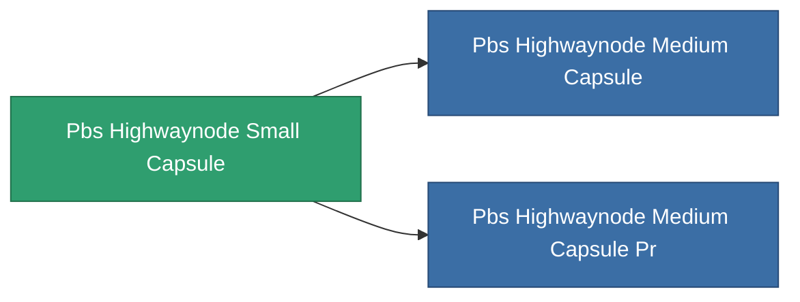

<!-- Generated by tools/generate from the live database (source: entitydefaults definition 5367, aggregatevalues via aggregatefields).
     Do not edit by hand; regenerate instead. -->

# Pbs Highwaynode Small Capsule

|  |  |
|---|---|
| Definicja | `def_pbs_highwaynode_small_capsule` |
| Poziom | T1 |
| Zdrowie | 100 |
| Objętość | 20 |
| Masa | 150000 |
| Kategoria | Special & other / Miscellaneous |

## Statystyki

| Pole | Wartość |
|---|---|
| armor_max | 10k |
| core_max | 3k |
| core_recharge_time | 345.6k |
| resist_chemical | 150 |
| resist_explosive | 150 |
| resist_kinetic | 150 |
| resist_thermal | 150 |
| signature_radius | 50 |
| stealth_strength | 50 |

<!-- production:generated -->
## Produkcja

**Produkcja z 6 komponentów** — zmontuj komponenty, aby go zbudować (pełna lista w [Przepisy](/pl/content/recipes/)):

**Nakładka:** [Standard accelerator strip foundation CT](/content/items/pbs-highwaynode-small-capsule-cprg/)

<svg class="prod-card-icon" aria-hidden="true"><use href="#mi-grid"/></svg><a class="prod-card-name" href="/pl/content/items/axicol/">Cryoperine</a>

wymagane: <b>500</b>

<svg class="prod-card-icon" aria-hidden="true"><use href="#mi-grid"/></svg><a class="prod-card-name" href="/pl/content/items/axicoline/">Axicoline</a>

wymagane: <b>250</b>

<svg class="prod-card-icon" aria-hidden="true"><use href="#mi-grid"/></svg><a class="prod-card-name" href="/pl/content/items/espitium/">Espitium</a>

wymagane: <b>500</b>

<svg class="prod-card-icon" aria-hidden="true"><use href="#mi-grid"/></svg><a class="prod-card-name" href="/pl/content/items/hydrobenol/">Hydrobenol</a>

wymagane: <b>250</b>

<svg class="prod-card-icon" aria-hidden="true"><use href="#mi-grid"/></svg><a class="prod-card-name" href="/pl/content/items/titanium/">Titanium</a>

wymagane: <b>250</b>

<svg class="prod-card-icon" aria-hidden="true"><use href="#mi-grid"/></svg><a class="prod-card-name" href="/pl/content/items/unimetal/">Briochit</a>

wymagane: <b>250</b>

## Użyte w produkcji

**Komponentem 2 przedmiotów** — wszystko, co go używa w produkcji:

