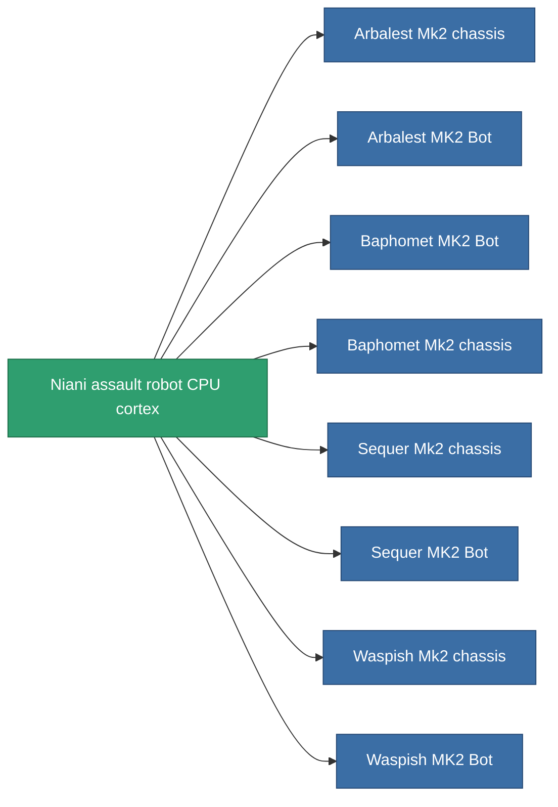

<!-- Generated by tools/generate from the live database (source: entitydefaults definition 2944, aggregatevalues via aggregatefields).
     Do not edit by hand; regenerate instead. -->

# Niani assault robot CPU cortex

|  |  |
|---|---|
| Definicja | `def_reactore_core_assault` |
| Poziom | – |
| Zdrowie | 100 |
| Objętość | 1 |
| Masa | 2000 |
| Kategoria | Materials |

_Brak statystyk — ten przedmiot nie niesie żadnych wartości agregowanych._

<!-- production:generated -->
## Użyte w produkcji

**Komponentem 8 przedmiotów** — wszystko, co go używa w produkcji:

