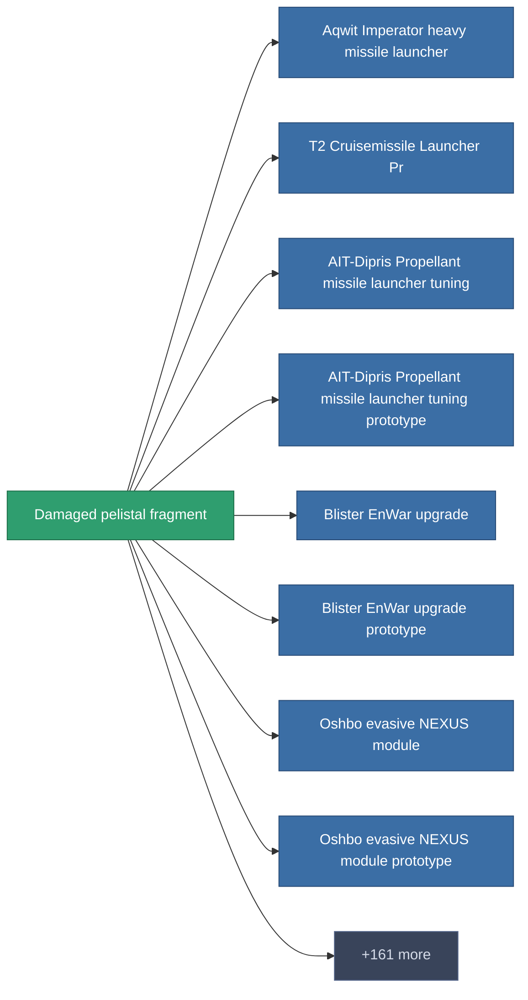

<!-- Generated by tools/generate from the live database (source: entitydefaults definition 1989, aggregatevalues via aggregatefields).
     Do not edit by hand; regenerate instead. -->

# Damaged pelistal fragment

|  |  |
|---|---|
| Definicja | `def_robotshard_pelistal_basic` |
| Poziom | – |
| Zdrowie | 100 |
| Objętość | 0.01 |
| Masa | 1 |
| Kategoria | Materials |

_Brak statystyk — ten przedmiot nie niesie żadnych wartości agregowanych._

<!-- production:generated -->
## Produkcja

**Produkcja z 3 komponentów** — zmontuj komponenty, aby go zbudować (pełna lista w [Przepisy](/pl/content/recipes/)):

<svg class="prod-card-icon" aria-hidden="true"><use href="#mi-grid"/></svg><a class="prod-card-name" href="/pl/content/items/isopropentol/">Isopropentol</a>

wymagane: <b>1</b>

<svg class="prod-card-icon" aria-hidden="true"><use href="#mi-grid"/></svg><a class="prod-card-name" href="/pl/content/items/phlobotil/">Phlobotil</a>

wymagane: <b>1</b>

<svg class="prod-card-icon" aria-hidden="true"><use href="#mi-grid"/></svg><a class="prod-card-name" href="/pl/content/items/vitricyl/">Vitricyl</a>

wymagane: <b>1</b>

## Użyte w produkcji

**Komponentem 169 przedmiotów** — przykład tego, co można z niego wyprodukować (pełna lista w [Przepisy](/pl/content/recipes/)).

