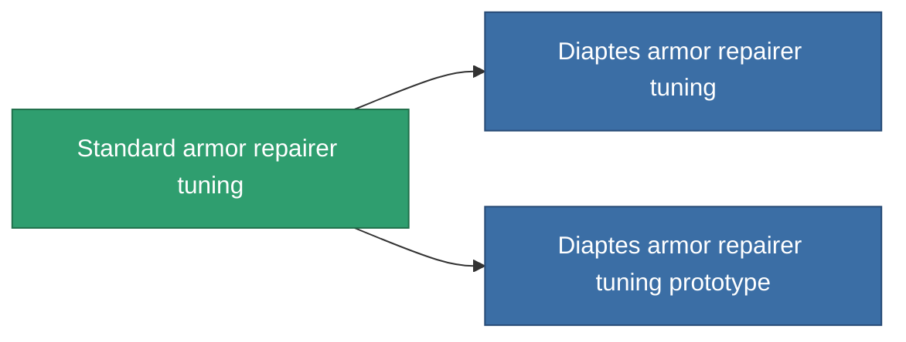

<!-- Generated by tools/generate from the live database (source: entitydefaults definition 1060, aggregatevalues via aggregatefields).
     Do not edit by hand; regenerate instead. -->

# Standard armor repairer tuning

|  |  |
|---|---|
| Definicja | `def_standard_armor_repairer_upgrade` |
| Poziom | T1 |
| Zdrowie | 100 |
| Objętość | 0.5 |
| Masa | 300 |
| Kategoria | Modules / Repair |
| Tier line | **Standard armor repairer tuning** (T1) → [Diaptes armor repairer tuning](/pl/content/items/named1-armor-repairer-upgrade/) (T2) → [WPG3000 armor repairer tuning](/pl/content/items/named2-armor-repairer-upgrade/) (T3) → [Apogenion armor repairer tuning](/pl/content/items/named3-armor-repairer-upgrade/) (T4) |

## Statystyki

| Pole | Wartość |
|---|---|
| armor_repair_amount_modifier | 1.08 |
| armor_repair_cycle_time_modifier | 0.96 |
| cpu_usage | 35 |
| powergrid_usage | 25 |

<!-- production:generated -->
## Produkcja

**Produkcja z 5 komponentów, poziom badań 3** — zmontuj komponenty, aby go zbudować (pełna lista w [Przepisy](/pl/content/recipes/)):

**Nakładka:** [Standard armor repairer tuning CT](/content/items/standard-armor-repairer-upgrade-cprg/)

<svg class="prod-card-icon" aria-hidden="true"><use href="#mi-grid"/></svg><a class="prod-card-name" href="/pl/content/items/axicol/">Cryoperine</a>

wymagane: <b>50</b>

<svg class="prod-card-icon" aria-hidden="true"><use href="#mi-grid"/></svg><a class="prod-card-name" href="/pl/content/items/chollonin/">Chollonin</a>

wymagane: <b>50</b>

<svg class="prod-card-icon" aria-hidden="true"><use href="#mi-grid"/></svg><a class="prod-card-name" href="/pl/content/items/plasteosine/">Plasteosine</a>

wymagane: <b>150</b>

<svg class="prod-card-icon" aria-hidden="true"><use href="#mi-grid"/></svg><a class="prod-card-name" href="/pl/content/items/statichnol/">Statichnol</a>

wymagane: <b>150</b>

<svg class="prod-card-icon" aria-hidden="true"><use href="#mi-grid"/></svg><a class="prod-card-name" href="/pl/content/items/titanium/">Titanium</a>

wymagane: <b>100</b>

## Użyte w produkcji

**Komponentem 2 przedmiotów** — wszystko, co go używa w produkcji:

