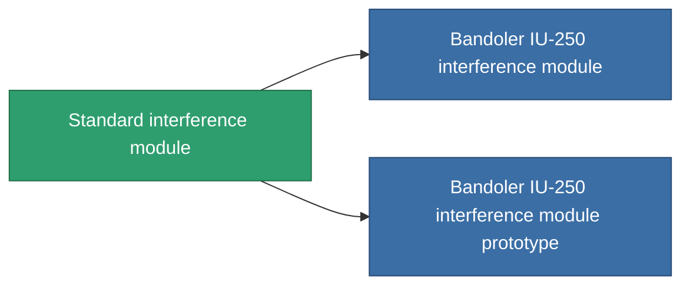

<!-- Generated by tools/generate from the live database (source: entitydefaults definition 2846, aggregatevalues via aggregatefields).
     Do not edit by hand; regenerate instead. -->

# Standard interference module

|  |  |
|---|---|
| Definicja | `def_standard_blob_emission_modulator` |
| Poziom | T1 |
| Zdrowie | 100 |
| Objętość | 0.5 |
| Masa | 150 |
| Kategoria | Modules / Enhancements |
| Tier line | **Standard interference module** (T1) → [Bandoler IU-250 interference module](/pl/content/items/named1-blob-emission-modulator/) (T2) → [Bandoler IV-500 interference module](/pl/content/items/named2-blob-emission-modulator/) (T3) → [Omini interference module](/pl/content/items/named3-blob-emission-modulator/) (T4) |

## Statystyki

| Pole | Wartość |
|---|---|
| blob_emission_modifier | 1 |
| blob_emission_radius_modifier | 1 |
| core_usage | 50 |
| cpu_usage | 85 |
| cycle_time | 5k |
| optimal_range | 30 |
| powergrid_usage | 150 |

<!-- production:generated -->
## Produkcja

**Produkcja z 3 komponentów, poziom badań 5** — zmontuj komponenty, aby go zbudować (pełna lista w [Przepisy](/pl/content/recipes/)):

**Nakładka:** [Standard interference module CT](/content/items/standard-blob-emission-modulator-cprg/)

<svg class="prod-card-icon" aria-hidden="true"><use href="#mi-grid"/></svg><a class="prod-card-name" href="/pl/content/items/axicol/">Cryoperine</a>

wymagane: <b>250</b>

<svg class="prod-card-icon" aria-hidden="true"><use href="#mi-grid"/></svg><a class="prod-card-name" href="/pl/content/items/axicoline/">Axicoline</a>

wymagane: <b>100</b>

<svg class="prod-card-icon" aria-hidden="true"><use href="#mi-grid"/></svg><a class="prod-card-name" href="/pl/content/items/titanium/">Titanium</a>

wymagane: <b>50</b>

## Użyte w produkcji

**Komponentem 2 przedmiotów** — wszystko, co go używa w produkcji:

