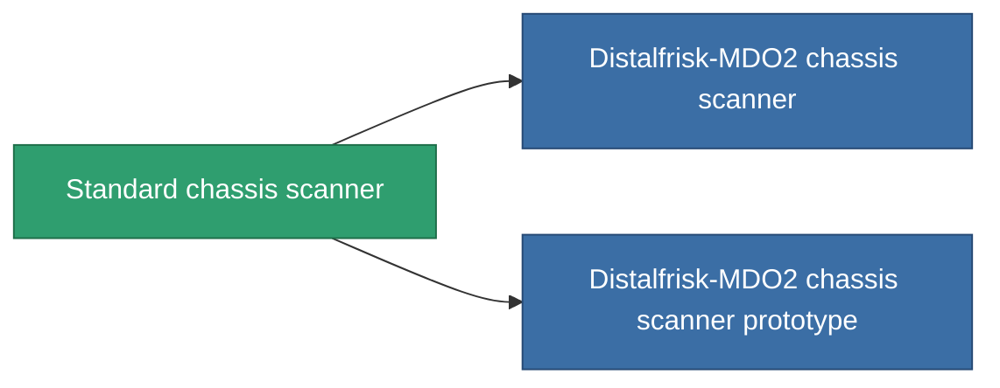

<!-- Generated by tools/generate from the live database (source: entitydefaults definition 46, aggregatevalues via aggregatefields).
     Do not edit by hand; regenerate instead. -->

# Standard chassis scanner

|  |  |
|---|---|
| Definicja | `def_standard_chassis_scanner` |
| Poziom | T1 |
| Zdrowie | 100 |
| Objętość | 0.5 |
| Masa | 200 |
| Kategoria | Modules / Sensors & scanning |
| Tier line | **Standard chassis scanner** (T1) → [Distalfrisk-MDO2 chassis scanner](/pl/content/items/named1-chassis-scanner/) (T2) → [Stalis CS3 chassis scanner](/pl/content/items/named2-chassis-scanner/) (T3) → [sy-D-930 chassis scanner](/pl/content/items/named3-chassis-scanner/) (T4) |

## Statystyki

| Pole | Wartość |
|---|---|
| core_usage | 20 |
| cpu_usage | 15 |
| cycle_time | 7.5k |
| falloff | 10 |
| optimal_range | 30 |
| powergrid_usage | 5 |

<!-- production:generated -->
## Produkcja

**Produkcja z 2 komponentów, poziom badań 3** — zmontuj komponenty, aby go zbudować (pełna lista w [Przepisy](/pl/content/recipes/)):

**Nakładka:** [Standard chassis scanner CT](/content/items/standard-chassis-scanner-cprg/)

<svg class="prod-card-icon" aria-hidden="true"><use href="#mi-grid"/></svg><a class="prod-card-name" href="/pl/content/items/axicol/">Cryoperine</a>

wymagane: <b>250</b>

<svg class="prod-card-icon" aria-hidden="true"><use href="#mi-grid"/></svg><a class="prod-card-name" href="/pl/content/items/titanium/">Titanium</a>

wymagane: <b>50</b>

## Użyte w produkcji

**Komponentem 2 przedmiotów** — wszystko, co go używa w produkcji:

