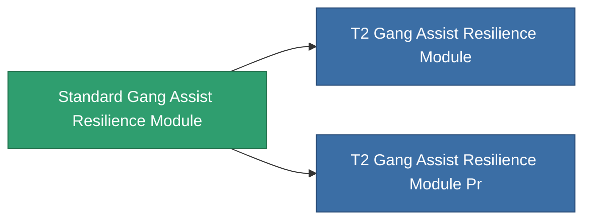

<!-- Generated by tools/generate from the live database (source: entitydefaults definition 2560, aggregatevalues via aggregatefields).
     Do not edit by hand; regenerate instead. -->

# Standard Gang Assist Resilience Module

|  |  |
|---|---|
| Definicja | `def_standard_gang_assist_resilience_module` |
| Poziom | T1 |
| Zdrowie | 100 |
| Objętość | 0.2 |
| Masa | 50 |
| Kategoria | Modules / Enhancements |
| Tier line | **Standard Gang Assist Resilience Module** (T1) → [T2 Gang Assist Resilience Module](/pl/content/items/named1-gang-assist-resilience-module/) (T2) → [T3 Gang Assist Resilience Module](/pl/content/items/named2-gang-assist-resilience-module/) (T3) → [T4 Gang Assist Resilience Module](/pl/content/items/named3-gang-assist-resilience-module/) (T4) |
| Uwaga | shield absorbtion ratiot javit |

## Statystyki

| Pole | Wartość |
|---|---|
| core_usage | 35 |
| cpu_usage | 85 |
| cycle_time | 10k |
| default_effect_range | 100 |
| effect_devastate_resilience_modifier | 1.02 |
| powergrid_usage | 35 |

<!-- production:generated -->
## Użyte w produkcji

**Komponentem 2 przedmiotów** — wszystko, co go używa w produkcji:

