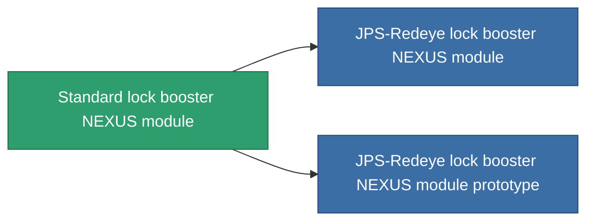

<!-- Generated by tools/generate from the live database (source: entitydefaults definition 2551, aggregatevalues via aggregatefields).
     Do not edit by hand; regenerate instead. -->

# Standard lock booster NEXUS module

|  |  |
|---|---|
| Definicja | `def_standard_gang_assist_shared_dataprocessing_module` |
| Poziom | T1 |
| Zdrowie | 100 |
| Objętość | 0.2 |
| Masa | 50 |
| Kategoria | Modules / Enhancements |
| Tier line | **Standard lock booster NEXUS module** (T1) → [JPS-Redeye lock booster NEXUS module](/pl/content/items/named1-gang-assist-shared-dataprocessing-module/) (T2) → [Tersung lock booster NEXUS module](/pl/content/items/named2-gang-assist-shared-dataprocessing-module/) (T3) → [JPS-Greeneye lock booster NEXUS module](/pl/content/items/named3-gang-assist-shared-dataprocessing-module/) (T4) |
| Uwaga | locking timet csokkent |

## Statystyki

| Pole | Wartość |
|---|---|
| core_usage | 35 |
| cpu_usage | 85 |
| cycle_time | 10k |
| default_effect_range | 100 |
| effect_locking_time_modifier | 0.98 |
| powergrid_usage | 35 |

<!-- production:generated -->
## Produkcja

**Produkcja z 5 komponentów, poziom badań 4** — zmontuj komponenty, aby go zbudować (pełna lista w [Przepisy](/pl/content/recipes/)):

**Nakładka:** [Standard lock booster NEXUS module CT](/pl/content/items/standard-gang-assist-shared-dataprocessing-module-cprg/)

<svg class="prod-card-icon" aria-hidden="true"><use href="#mi-grid"/></svg><a class="prod-card-name" href="/pl/content/items/axicol/">Cryoperine</a>

wymagane: <b>250</b>

<svg class="prod-card-icon" aria-hidden="true"><use href="#mi-grid"/></svg><a class="prod-card-name" href="/pl/content/items/axicoline/">Axicoline</a>

wymagane: <b>50</b>

<svg class="prod-card-icon" aria-hidden="true"><use href="#mi-grid"/></svg><a class="prod-card-name" href="/pl/content/items/phlobotil/">Phlobotil</a>

wymagane: <b>50</b>

<svg class="prod-card-icon" aria-hidden="true"><use href="#mi-grid"/></svg><a class="prod-card-name" href="/pl/content/items/titanium/">Titanium</a>

wymagane: <b>50</b>

<svg class="prod-card-icon" aria-hidden="true"><use href="#mi-grid"/></svg><a class="prod-card-name" href="/pl/content/items/vitricyl/">Vitricyl</a>

wymagane: <b>250</b>

## Użyte w produkcji

**Komponentem 2 przedmiotów** — wszystko, co go używa w produkcji:

