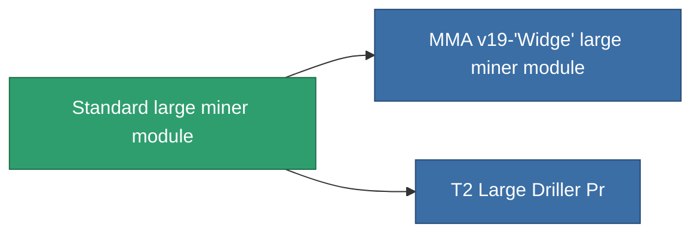

<!-- Generated by tools/generate from the live database (source: entitydefaults definition 8678, aggregatevalues via aggregatefields).
     Do not edit by hand; regenerate instead. -->

# Standard large miner module

|  |  |
|---|---|
| Definicja | `def_standard_large_driller` |
| Poziom | T1 |
| Zdrowie | 100 |
| Objętość | 2.5 |
| Masa | 2000 |
| Kategoria | Modules / Enhancements |
| Tier line | **Standard large miner module** (T1) → [MMA v19-'Widge' large miner module](/pl/content/items/named1-large-driller/) (T2) → [Sublimator Hi-D large miner module](/pl/content/items/named2-large-driller/) (T3) → [Pellex large miner module](/pl/content/items/named3-large-driller/) (T4) |

## Statystyki

| Pole | Wartość |
|---|---|
| core_usage | 165 |
| cpu_usage | 450 |
| cycle_time | 12k |
| powergrid_usage | 1.35k |

<!-- production:generated -->
## Produkcja

**Produkcja z 2 komponentów, poziom badań 5** — zmontuj komponenty, aby go zbudować (pełna lista w [Przepisy](/pl/content/recipes/)):

**Nakładka:** [Standard Large Driller Cprg](/pl/content/items/standard-large-driller-cprg/)

<svg class="prod-card-icon" aria-hidden="true"><use href="#mi-grid"/></svg><a class="prod-card-name" href="/pl/content/items/axicol/">Cryoperine</a>

wymagane: <b>1.6k</b>

<svg class="prod-card-icon" aria-hidden="true"><use href="#mi-grid"/></svg><a class="prod-card-name" href="/pl/content/items/titanium/">Titanium</a>

wymagane: <b>2.4k</b>

## Użyte w produkcji

**Komponentem 2 przedmiotów** — wszystko, co go używa w produkcji:

