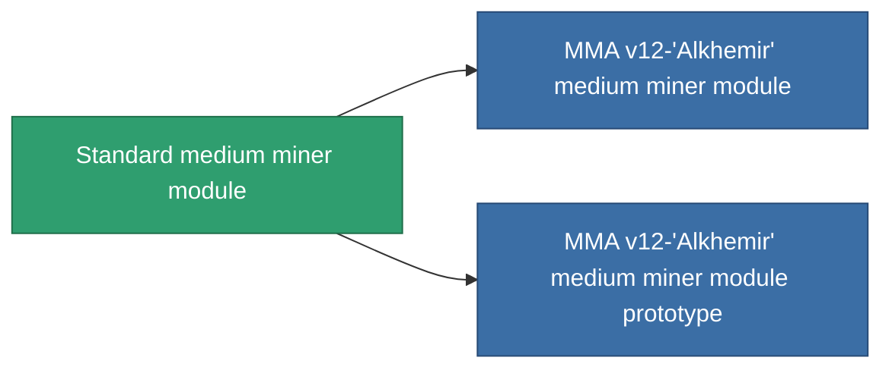

<!-- Generated by tools/generate from the live database (source: entitydefaults definition 54, aggregatevalues via aggregatefields).
     Do not edit by hand; regenerate instead. -->

# Standard medium miner module

|  |  |
|---|---|
| Definicja | `def_standard_medium_driller` |
| Poziom | T1 |
| Zdrowie | 100 |
| Objętość | 1.5 |
| Masa | 1000 |
| Kategoria | Modules / Enhancements |
| Tier line | **Standard medium miner module** (T1) → [MMA v12-'Alkhemir' medium miner module](/pl/content/items/named1-medium-driller/) (T2) → [Sublimator Mid-D medium miner module](/pl/content/items/named2-medium-driller/) (T3) → [Ovostec-Edger medium miner module](/pl/content/items/named3-medium-driller/) (T4) |

## Statystyki

| Pole | Wartość |
|---|---|
| core_usage | 55 |
| cpu_usage | 50 |
| cycle_time | 12k |
| optimal_range | 3 |
| powergrid_usage | 150 |

<!-- production:generated -->
## Produkcja

**Produkcja z 2 komponentów, poziom badań 3** — zmontuj komponenty, aby go zbudować (pełna lista w [Przepisy](/pl/content/recipes/)):

**Nakładka:** [Standard medium miner module CT](/pl/content/items/standard-medium-driller-cprg/)

<svg class="prod-card-icon" aria-hidden="true"><use href="#mi-grid"/></svg><a class="prod-card-name" href="/pl/content/items/axicol/">Cryoperine</a>

wymagane: <b>100</b>

<svg class="prod-card-icon" aria-hidden="true"><use href="#mi-grid"/></svg><a class="prod-card-name" href="/pl/content/items/titanium/">Titanium</a>

wymagane: <b>300</b>

## Użyte w produkcji

**Komponentem 2 przedmiotów** — wszystko, co go używa w produkcji:

