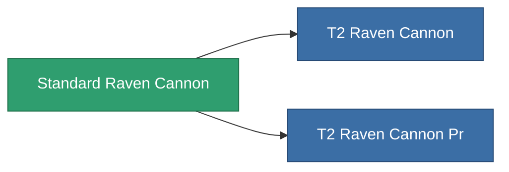

<!-- Generated by tools/generate from the live database (source: entitydefaults definition 1005, aggregatevalues via aggregatefields).
     Do not edit by hand; regenerate instead. -->

# Standard Raven Cannon

|  |  |
|---|---|
| Definicja | `def_standard_raven_cannon` |
| Poziom | T1 |
| Zdrowie | 100 |
| Objętość | 1.8 |
| Masa | 1400 |
| Kategoria | Modules / Weapons |
| Tier line | **Standard Raven Cannon** (T1) → [T2 Raven Cannon](/pl/content/items/named1-raven-cannon/) (T2) → [T3 Raven Cannon](/pl/content/items/named2-raven-cannon/) (T3) → [T4 Raven Cannon](/pl/content/items/named3-raven-cannon/) (T4) |

## Statystyki

| Pole | Wartość |
|---|---|
| accuracy | 46 |
| core_usage | 1.8 |
| cpu_usage | 66.5 |
| cycle_time | 17k |
| damage_modifier | 1.65 |
| falloff | 40 |
| optimal_range | 38 |
| powergrid_usage | 285 |

<!-- production:generated -->
## Produkcja

**Produkcja z 6 komponentów** — zmontuj komponenty, aby go zbudować (pełna lista w [Przepisy](/pl/content/recipes/)):

**Nakładka:** [Standard Raven Cannon Cprg](/content/items/standard-raven-cannon-cprg/)

<svg class="prod-card-icon" aria-hidden="true"><use href="#mi-grid"/></svg><a class="prod-card-name" href="/pl/content/items/alligior/">Alligior</a>

wymagane: <b>100</b>

<svg class="prod-card-icon" aria-hidden="true"><use href="#mi-grid"/></svg><a class="prod-card-name" href="/pl/content/items/axicol/">Cryoperine</a>

wymagane: <b>200</b>

<svg class="prod-card-icon" aria-hidden="true"><use href="#mi-grid"/></svg><a class="prod-card-name" href="/pl/content/items/biotichrin/">Biotichrin</a>

wymagane: <b>100</b>

<svg class="prod-card-icon" aria-hidden="true"><use href="#mi-grid"/></svg><a class="prod-card-name" href="/pl/content/items/espitium/">Espitium</a>

wymagane: <b>50</b>

<svg class="prod-card-icon" aria-hidden="true"><use href="#mi-grid"/></svg><a class="prod-card-name" href="/pl/content/items/specimen-sap-item-flux/">Specimen Sap Item Flux</a>

wymagane: <b>10</b>

<svg class="prod-card-icon" aria-hidden="true"><use href="#mi-grid"/></svg><a class="prod-card-name" href="/pl/content/items/titanium/">Titanium</a>

wymagane: <b>100</b>

## Użyte w produkcji

**Komponentem 2 przedmiotów** — wszystko, co go używa w produkcji:

