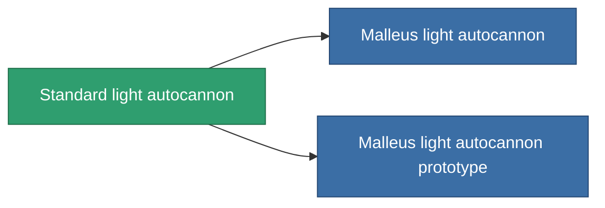

<!-- Generated by tools/generate from the live database (source: entitydefaults definition 60, aggregatevalues via aggregatefields).
     Do not edit by hand; regenerate instead. -->

# Standard light autocannon

|  |  |
|---|---|
| Definicja | `def_standard_small_autocannon` |
| Poziom | T1 |
| Zdrowie | 100 |
| Objętość | 0.6 |
| Masa | 250 |
| Kategoria | Modules / Weapons |
| Tier line | **Standard light autocannon** (T1) → [Malleus light autocannon](/pl/content/items/named1-small-autocannon/) (T2) → [Senner Carbine light autocannon](/pl/content/items/named2-small-autocannon/) (T3) → [Astoc M45 light autocannon](/pl/content/items/named3-small-autocannon/) (T4) |

## Statystyki

| Pole | Wartość |
|---|---|
| accuracy | 6 |
| core_usage | 1 |
| cpu_usage | 5 |
| cycle_time | 3.2k |
| damage_modifier | 1.2 |
| falloff | 12.5 |
| least_optimal | 2 |
| optimal_range | 7.5 |
| powergrid_usage | 15 |

<!-- production:generated -->
## Produkcja

**Produkcja z 2 komponentów, poziom badań 1** — zmontuj komponenty, aby go zbudować (pełna lista w [Przepisy](/pl/content/recipes/)):

**Nakładka:** [Standard light autocannon CT](/pl/content/items/standard-small-autocannon-cprg/)

<svg class="prod-card-icon" aria-hidden="true"><use href="#mi-grid"/></svg><a class="prod-card-name" href="/pl/content/items/axicoline/">Axicoline</a>

wymagane: <b>100</b>

<svg class="prod-card-icon" aria-hidden="true"><use href="#mi-grid"/></svg><a class="prod-card-name" href="/pl/content/items/titanium/">Titanium</a>

wymagane: <b>50</b>

## Użyte w produkcji

**Komponentem 2 przedmiotów** — wszystko, co go używa w produkcji:

