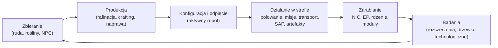

# Co możesz zrobić w grze

Każde działanie gracza, zorganizowane według systemów. Nazwa komendy to identyfikator
po stronie serwera — klient prezentuje te działania we własnym interfejsie.
Opisy poszczególnych działań znajdują się na stronach poszczególnych systemów.

Gra w jednym cyklu: zarabiaj i wydawaj, aby awansować po drabince poziomów.

## Systemy

| System | Strona | Zakres |
|---|---|---|
| Pierwsze kroki | [getting-started](/pl/features/getting-started/) | tworzenie/wybór postaci, pierwszy robot, podstawy konta |
| Ruch | [movement](/pl/features/movement/) | strefy, dokowanie, kolejka, teleporty, skoki iskier, bramy |
| Zbieranie | [gathering](/pl/features/gathering/) | skanowanie, zbieranie, pozyskiwanie zasobów |
| Walka | [combat](/pl/features/combat/) | walka, typy obrażeń, zakłócenia, alarmy, raporty z zabójstw, SOS |
| NPC i polowanie PVE | [npcs](/pl/features/npcs/) | rangi i frakcje NPC, słabości, typy spawnu, TAP, taktyka |
| Eksploracja | [exploration](/pl/features/exploration/) | artefakty i relikwie |
| Roboty i konfiguracja | [robots](/pl/features/robots/) | wybór robotów, moduły, amunicja, presety, kolory |
| Moduły i konfiguracja | [modules](/pl/features/modules/) | rodziny modułów i zasady konfiguracji |
| Iskry | [sparks](/pl/features/sparks/) | autoryzacja iskier, przełączanie, bonusy zdolności |
| Badania | [research](/pl/features/research/) | rozszerzenia (drzewko umiejętności), EP, drzewko technologiczne |
| Postać | [character](/pl/features/character/) | okno postaci: zakładka rozszerzeń (drzewko umiejętności) i iskry |
| Produkcja | [production](/pl/features/production/) | linie produkcyjne, rafinacja, naprawa, przeróbka, prototypy, CPRG |
| Rynek i handel | [market](/pl/features/market/) | zlecenia rynkowe, bezpośrednie transakcje, sklep z przedmiotami, kredyty |
| Grupy | [groups](/pl/features/groups/) | korporacje, aliansy, gangi (floty) |
| Stacje baz mocy | [pbs](/pl/features/pbs/) | struktury PBS, terytoria, połączenia |
| Misje | [missions](/pl/features/missions/) | misje terenowe, agenci, terminale |
| Transport | [transport](/pl/features/transport/) | wysyłanie przedmiotów między bazami |
| Przedmioty i ekwipunek | [items](/pl/features/items/) | kontenery, stosowanie, nazwy przedmiotów, kody, pakiety upominkowe |
| Społeczność | [social](/pl/features/social/) | poczta, kanały, przyjaciele, renomy, żółte strony, wiadomości, ankiety |
| Intruzja | [intrusion](/pl/features/intrusion/) | tryb szturmowania obiektów NPC |
| Zaawansowane bazy i SAP | [outposts](/pl/features/outposts/) | własność baz, stabilność, cztery typy SAP |
| Proksymiczne sondy | [probes](/pl/features/probes/) | sondy monitoringu stref |
| Serwer i referencje | [server](/pl/features/server/) | informacje o serwerze, najlepsze wyniki, dane referencyjne, zakupy |
| FAQ | [faq](/pl/features/faq/) | tutorial, wybór frakcji, pierwsze kroki, żargon |
| Lore | [lore](/pl/features/lore/) | setting: Nia, Nianie, Syndykat |
| Klient i konfiguracja PC | [client-setup](/pl/features/client-setup/) | uruchamianie klienta, multi-boxing, skalowanie UI |

### Referencje

| Strona | Zakres |
|---|---|
| [Przegląd UI klienta](/pl/features/ui/) | Interfejs w stylu EVE: górny pasek, przycisk Deploy/Dock, kategorie działań, panel statusu po odpięciu oraz konwencje używane w tej wiki |

Tabele statystyk encji znajdują się w generowanej sekcji [Content](/content/).

## Pełna lista działań

### Pierwsze kroki i konto

| Działanie | Komenda |
|---|---|
| Utwórz postać | `characterCreate` |
| Wybierz (graj jako) postać | `characterSelect` |
| Usuń postać | `characterDelete` |
| Zmień nazwę postaci | `characterRename` |
| Sprawdź, czy nazwa jest dostępna | `characterCheckNick` |
| Poproś o robota startowego | `requestStarterRobot` |
| Poproś o pudełko startowe | `requestInfiniteBox` |
| Dane konfiguracji nowej postaci | `characterWizardData` |
| Wyświetl mój profil | `characterGetMyProfile` |
| Wyświetl profile innych postaci | `characterGetProfiles` |
| Szukaj postaci | `characterSearch` |
| Lista postaci | `characterList` |
| Pobierz/ustaw ustawienia postaci | `characterSettingsGet`, `characterSettingsSet` |
| Ustaw awatar | `characterSetAvatar` |
| Ustaw wiadomość nastroju | `characterSetMoodmessage` |
| Ustaw prywatną notatkę na postaci | `characterSetNote` / `characterGetNote` |
| Ustaw / wyczyść bazę domową | `characterSetHomeBase`, `characterClearHomeBase` |
| Przenieś kredyty między własnymi postaciami | `characterTransferCredit` |
| Zablokuj/zezwól na handel na postaci | `characterSetBlockTrades` |
| Zmień e-mail / hasło konta | `changeSessionEmail`, `changeSessionPassword` |
| Wyświetl historię EP za aktywność | `accountEpForActivityHistory` |
| Wyświetl historię transakcji konta | `accountGetTransactionHistory` |
| Wyloguj / zarządzanie połączeniem | `signOut`, `connectionStart`, `connectionEnd`, `ping`, `quit`, `isOnline`, `transferData`, `welcome` |
| Kto jest online | `getCharactersOnline`, `getAccountsWithCharacters` |
| Historie postaci | `characterNickHistory`, `characterCorporationHistory`, `characterTransactionHistory`, `characterListNpcDeath` |

### Ruch i strefy

| Działanie | Komenda |
|---|---|
| Zadokuj w bazie / PBS | `dock` |
| Odepnij | `undock` |
| Wymuś dokowanie (awaryjne) | `forceDock` |
| Sprawdź kolejkę wejścia do strefy | `zoneGetQueueInfo` |
| Ustaw preferowaną długość kolejki | `zoneSetQueueLength` |
| Anuluj oczekiwanie w kolejce | `zoneCancelEnterQueue` |
| Pobierz informacje o strefie | `getZoneInfo` |
| Lista sektorów strefy | `zoneSectorList` |
| Lista budynków w strefie | `zoneGetBuildings` |
| Wyślij SOS (wezwanie pomocy) | `zoneSOS` |
| Lista dostępnych teleportów | `teleportList` |
| Użyj teleportu | `teleportUse` |
| Teleportuj do obiektu w strefie | `teleportToZoneObject` |
| Lista kanałów teleportów | `teleportGetChannelList` |
| Zapytaj o kanały teleportów na świecie | `teleportQueryWorldChannels` |
| Lista ładunków iskier | `sparkList` |
| Zmień aktywną iskrę | `sparkChange` |
| Usuń iskrę | `sparkRemove` |
| Odblokuj iskrę | `sparkUnlock` |
| Lista / ustaw / użyj / usuń teleporty iskier | `sparkTeleportList`, `sparkTeleportSet`, `sparkTeleportUse`, `sparkTeleportDelete` |
| Zmień nazwę bramy | `gateSetName` |
| Informacje o bazie / własność / udogodnienia / moje przedmioty w bazie | `baseGetInfo`, `baseGetOwnershipInfo`, `baseListFacilities`, `baseGetMyItems` |
| Ustaw prawa dokowania bazy | `baseSetDockingRights` |

### Zbieranie i skanowanie

| Działanie | Komenda |
|---|---|
| Zeskanuj strefę (skan rudy/rośliny/deployowalny) | `zoneUploadScanResult` |
| Lista moich wyników skanowania minerałów | `mineralScanResultList` |
| Utwórz przedmiot z wyniku skanowania | `mineralScanResultCreateItem` |
| Usuń wynik skanowania | `mineralScanResultDelete` |
| Przenieś wyniki skanowania między kontenerami | `mineralScanResultMove` |
| Wgraj dane skanowania z przedmiotu | `mineralScanResultUploadFromItem` |
| Zlicz przedmioty w strefie (sprawdzenie widoczności) | `itemCountOnZone`, `itemCount` |
| Kiosk: wyświetl / złóż przedmioty | `kioskInfo`, `kioskSubmitItem` |
| Użyj przedmiotu (ogólne — w tym zbieralne) | `useItem` |

### Walka

| Działanie | Komenda |
|---|---|
| Włącz / wyłącz alarm bojowy | `alarmStart` (zakończenie alarmu sterowane przez serwer) |
| Wyświetl moje raporty z zabójstw | `getMyKillReports` |
| Wyświetl moje najlepsze wyniki | `getMyHighScores` |
| Wyświetl najlepsze wyniki serwera | `getHighScores` |

### Roboty i konfiguracja

| Działanie | Komenda |
|---|---|
| Wybierz aktywnego robota | `selectActiveRobot` |
| Opróżnij robota (wyładuj wszystko) | `robotEmpty` |
| Pobierz informacje o robocie | `getRobotInfo` |
| Pobierz informacje o konfiguracji robota | `getRobotFittingInfo` |
| Załóż moduł | `equipModule` |
| Zdejmij moduł | `removeModule` |
| Zamień moduły | `changeModule` |
| Załóż amunicję | `equipAmmo` |
| Zamień amunicję | `changeAmmo` |
| Zdejmij amunicję | `unEquipAmmo` |
| Ustaw kolor robota | `setRobotTint` |
| Zapisz / lista / zastosuj / usuń presety konfiguracji | `fittingPresetSave`, `fittingPresetList`, `fittingPresetApply`, `fittingPresetDelete` |

### Badania (rozszerzenia i drzewko technologiczne)

| Działanie | Komenda |
|---|---|
| Lista kategorii rozszerzeń | `extensionCategoryList` |
| Pobierz wszystkie rozszerzenia | `extensionGetAll` |
| Lista opanowanych rozszerzeń | `extensionLearntList` |
| Lista wymagań wstępnych | `extensionPrerequireList` |
| Kup rozszerzenie punktami | `extensionBuyForPoints` |
| Kup boost EP | `extensionBuyEpBoost` |
| Pobierz dostępne punkty | `extensionGetAvailablePoints` |
| Pobierz parametry punktów | `extensionGetPointParameters` |
| Historia rozszerzeń | `extensionHistory` |
| Usuń jeden poziom rozszerzenia | `extensionRemoveLevel` |
| Zresetuj rozszerzenia postaci | `extensionResetCharacter` |
| Zwolnij zablokowane EP | `extensionFreeLockedEp` |
| Wyświetl dzienny log EP za aktywność | `epForActivityDailyLog` |
| Pobierz poziomy badań | `getResearchLevels` |
| Drzewko technologiczne: zbadaj węzeł | `techTreeResearch` |
| Drzewko technologiczne: odblokuj węzeł | `techTreeUnlock` |
| Drzewko technologiczne: daruj | `techTreeDonate` |
| Drzewko technologiczne: informacje / logi | `techTreeInfo`, `techTreeGetLogs` |

### Produkcja

| Działanie | Komenda |
|---|---|
| Lista linii produkcyjnych | `productionLineList` |
| Uruchom linię | `productionLineStart` |
| Skalibruj linię | `productionLineCalibrate` |
| Ustaw rundy na linii | `productionLineSetRounds` |
| Usuń linię | `productionLineDelete` |
| Zapytaj o następną rundę linii | `productionQueryLineNextRound` |
| Anuluj produkcję | `productionCancel` |
| Rafinacja (zapytanie + uruchomienie) | `productionRefine`, `productionRefineQuery` |
| Naprawa (zapytanie + uruchomienie) | `productionRepair`, `productionRepairQuery` |
| Przeróbka (zapytanie + uruchomienie) | `productionReprocess`, `productionReprocessQuery` |
| Badania komponentów (zapytanie + uruchomienie) | `productionResearch`, `productionResearchQuery` |
| Prototyp (uruchomienie + zapytanie) | `productionPrototypeStart`, `productionPrototypeQuery` |
| Scalanie zestawów badawczych (uruchomienie + zapytanie) | `productionMergeResearchKitsMulti`, `productionMergeResearchKitsMultiQuery` |
| Kucie CPRG (uruchomienie + zapytanie) | `productionCPRGForge`, `productionCPRGForgeQuery` |
| Informacje o CPRG | `productionCPRGInfo` |
| Pobierz CPRG z linii (pobierz + zapytanie) | `productionGetCPRGFromLine`, `productionGetCPRGFromLineQuery` |
| Ubezpieczenie produkcji: kup / lista / zapytanie / usuń | `productionInsuranceBuy`, `productionInsuranceList`, `productionInsuranceQuery`, `productionInsuranceDelete` |
| Lista komponentów produkcyjnych | `productionComponentsList` |
| Informacje / opis udogodnienia | `productionFacilityInfo`, `productionFacilityDescription` |
| Co jest w toku (moje / korporacji) | `productionInProgress`, `productionInProgressCorporation` |
| Historia produkcji | `productionHistory` |
| Informacje o serwerze produkcji | `productionServerInfo` |

### Rynek i handel

| Działanie | Komenda |
|---|---|
| Utwórz zlecenie sprzedaży | `marketCreateSellOrder` |
| Utwórz zlecenie kupna | `marketCreateBuyOrder` |
| Zmień zlecenie | `marketModifyOrder` |
| Anuluj przedmiot / zlecenie | `marketCancelItem` |
| Kup przedmiot bezpośrednio | `marketBuyItem` |
| Lista przedmiotów na rynku | `marketItemList` |
| Lista przedmiotów dostępnych dla mnie | `marketAvailableItems` |
| Lista przedmiotów w zakresie | `marketItemsInRange` |
| Lista moich przedmiotów na rynku | `marketGetMyItems` |
| Informacje o rynku | `marketGetInfo` |
| Średnie ceny (rynek / definicja / globalne) | `marketGetAveragePrices`, `marketGetDefinitionAveragePrice`, `marketGlobalAveragePrices` |
| Zmień podatek rynkowy / wyświetl log podatków | `marketTaxChange`, `marketTaxLogList` |
| Rozpocznij handel | `tradeBegin` |
| Ustaw / wycofaj moją ofertę | `tradeSetOffer`, `tradeRetractOffer` |
| Przyjmij handel | `tradeAccept` |
| Anuluj handel | `tradeCancel` |
| Handel zakończony / stan | `tradeFinished`, `tradeState` |
| Sklep z przedmiotami: lista / kup | `itemShopList`, `itemShopBuy` |
| Przenieś kredyty do innej postaci | `characterTransferCredit` |

### Grupy (korporacje, aliansy, gangi)

| Działanie | Komenda |
|---|---|
| Utwórz korporację | `corporationCreate` |
| Złóż podanie / zaprosz do korporacji | `corporationApply`, `corporationCharacterInvite` |
| Przyjmij podanie / lista podań | `corporationAcceptApplication`, `corporationListApplications` |
| Moje podania: lista / usuń | `corporationListMyApplications`, `corporationDeleteMyApplication` |
| Usuń podanie (oficer) | `corporationDeleteApplication` |
| Odpowiedz na zaproszenie | `corporationInviteReply` |
| Opuść / anuluj wyjście | `corporationLeave`, `corporationCancelLeave` |
| Usuń członka / ustaw rolę członka | `corporationRemoveMember`, `corporationSetMemberRole` |
| Zrzeknij się wszystkich moich ról | `corporationDropRoles` |
| Ustaw członków jako neutralnych | `corporationSetMembersNeutral` |
| Informacje o korporacji / moje informacje / wyszukiwanie | `corporationInfo`, `corporationGetMyInfo`, `corporationSearch` |
| Renomy / reputacja korporacji | `corporationGetMyStandings`, `corporationGetReputation` |
| Daruj / wypłać z korporacji | `corporationDonate`, `corporationPayOut` |
| Przenieś kredyty korporacji | `corporationTransfer` |
| Zmień nazwę / ustaw kolor / ustaw informacje | `corporationRename`, `corporationSetColor`, `corporationSetInfo` |
| Pobierz delegatów | `corporationGetDelegates` |
| Status przejęcia CEO / zgłoś się na CEO | `corporationCEOTakeOverStatus`, `corporationVolunteerForCEO` |
| Głosowania korporacji: rozpocznij / ustaw temat / lista / oddaj głos / usuń | `corporationVoteStart`, `corporationVoteSetTopic`, `corporationVoteList`, `corporationVoteCast`, `corporationVoteDelete` |
| Tablica ogłoszeń: rozpocznij / lista / nowe wpisy / opublikuj / moderuj / usuń | `corporationBulletinStart`, `corporationBulletinList`, `corporationBulletinNewEntries`, `corporationBulletinEntry`, `corporationBulletinModerate`, `corporationBulletinDelete`, `corporationBulletinEntryDelete`, `corporationBulletinDetails` |
| Hangar: wynajmij / zapłać czynsz / cena najmu / zamknij | `corporationRentHangar`, `corporationHangarPayRent`, `corporationHangarRentPrice`, `corporationHangarClose` |
| Hangar: lista (wszystkie / w bazie) | `corporationHangarListAll`, `corporationHangarListOnBase` |
| Hangar: foldery (utwórz / usuń) | `corporationHangarFolderCreate`, `corporationHangarFolderDelete` |
| Hangar: ustaw dostęp / ustaw nazwę | `corporationHangarSetAccess`, `corporationHangarSetName` |
| Logi hangaru: lista / ustaw / wyczyść | `corporationHangarLogList`, `corporationHangarLogSet`, `corporationHangarLogClear` |
| Dokumenty korporacji: konfiguracja / utwórz / lista / otwórz / usuń / przenieś / wynajmij / monitoruj / przestań monitorować / zaktualizuj treść / lista rejestrów / ustaw rejestr | `corporationDocumentConfig`, `corporationDocumentCreate`, `corporationDocumentList`, `corporationDocumentOpen`, `corporationDocumentDelete`, `corporationDocumentTransfer`, `corporationDocumentRent`, `corporationDocumentMonitor`, `corporationDocumentUnmonitor`, `corporationDocumentUpdateBody`, `corporationDocumentRegisterList`, `corporationDocumentRegisterSet` |
| Historie: log / role członków / role korporacji / role / nazwa / transakcje | `corporationLogHistory`, `corporationMemberRoleHistory`, `corporationRoleHistory`, `corporationNameHistory`, `corporationTransactionHistory` |
| Informacje o aliansie / domyślne / historia ról | `allianceGetMyInfo`, `allianceGetDefaults`, `allianceRoleHistory` |
| Gang (flota): utwórz / usuń / informacje | `gangCreate`, `gangDelete`, `gangInfo` |
| Gang: zaprosz / odpowiedz / wyrzuć / opuść | `gangInvite`, `gangInviteReply`, `gangKick`, `gangLeave` |
| Gang: ustaw lidera / ustaw rolę | `gangSetLeader`, `gangSetRole` |

### Stacje baz mocy (PBS) i terytoria

| Działanie | Komenda |
|---|---|
| Pobierz sieć PBS | `PBSGetNetwork` |
| Informacje o węźle PBS | `PBSNodeInfo` |
| Zmień nazwę węzła PBS | `PBSRenameNode` |
| Utwórz / zerwij połączenie PBS | `PBSMakeConnection`, `PBSBreakConnection` |
| Ustaw wagę połączenia | `PBSSetConnectionWeight` |
| Ustaw stan online PBS | `PBSSetOnline` |
| Ustaw efekt PBS | `PBSSetEffect` |
| Sprawdź wdrożenie (czy mogę tu wdrożyć?) | `PBSCheckDeployment` |
| Lista moich terytoriów | `PBSGetTerritories` |
| Ustaw widoczność terytorium | `PBSSetTerritoryVisibility` |
| Ustaw limit renomy | `PBSSetStandingLimit` |
| Ustaw offset wzmocnienia | `PBSSetReinforceOffset` |
| Pobierz / ustaw informacje o zwrocie | `PBSGetReimburseInfo`, `PBSSetReimburseInfo` |
| Zasil PBS przedmiotami | `PBSFeedableInfo`, `PBSFeedItems` |
| Ustaw dekonstrukcję bazy | `PBSSetBaseDeconstruct` |
| Logi PBS | `PBSGetLog` |

### Misje

| Działanie | Komenda |
|---|---|
| Rozpocznij misję | `missionStart` |
| Rozpocznij misję ze strefy | `missionStartFromZone` |
| Przerwij misję | `missionAbort` |
| Dostarcz (dostawa misji) | `missionDeliver` |
| Dane misji / opcje / zaopatrzenie | `missionData`, `missionGetOptions`, `missionGetSupply` |
| Lista agentów misji | `missionListAgents` |
| Lista moich aktywnych misji | `missionListRunning` |
| Log misji | `missionLogList` |
| Dodaj uczestnika do misji | `missionPlayerAddsParticipant` |
| Informacje o terminalu terenowym | `fieldTerminalInfo` |

### Transport (wysyłanie przedmiotów)

| Działanie | Komenda |
|---|---|
| Złóż transport | `transportAssignmentSubmit` |
| Przyjmij transport (jako przewoźnik) | `transportAssignmentTake` |
| Lista transportów | `transportAssignmentList` |
| Lista zawartości transportu | `transportAssignmentListContent` |
| Informacje o kontenerze transportu | `transportAssignmentContainerInfo` |
| Dostarcz transport | `transportAssignmentDeliver` |
| Odbierz mój transport | `transportAssignmentRetrieve` |
| Anuluj / zrzeknij się transportu | `transportAssignmentCancel`, `transportAssignmentGiveUp` |
| Czy transport jest aktywny? | `transportAssignmentRunning` |
| Log transportu | `transportAssignmentLog` |

### Przedmioty i ekwipunek

| Działanie | Komenda |
|---|---|
| Lista kontenera | `listContainer` |
| Spakuj przedmioty (do torby/pudełka) | `packItems` |
| Rozpakuj przedmioty | `unpackItems` |
| Stosuj przedmioty | `stackItems`, `stackTo`, `stackSelection` |
| Rozdziel ilość ze stosu | `unStackAmount` |
| Przenieś przedmioty między kontenerami | `relocateItems` |
| Wytnij przedmioty | `trashItems` |
| Zmień nazwę przedmiotu | `setItemName` |
| Użyj przedmiotu | `useItem` |
| Użyj przedmiotu loteryjnego | `useLotteryItem` |
| Kody: lista / wymień / aktywuj | `redeemableItemList`, `redeemableItemRedeem`, `redeemableItemActivate` |
| Pakiety upominkowe: lista / wymień | `goodiePackList`, `goodiePackRedeem` |
| Otwórz prezent | `giftOpen` |
| Zwrot przedmiotu | `ReimburseItem` |

### Społeczność

| Działanie | Komenda |
|---|---|
| Poczta: lista / otwórz / wyślij / usuń / liczba nowych / użyte foldery / przenieś do folderu / usuń folder | `mailList`, `mailOpen`, `mailSend`, `mailDelete`, `mailNewCount`, `mailUsedFolders`, `mailMoveToFolder`, `mailDeleteFolder` |
| Poczta masowa (korporacja): wyślij / lista / otwórz / usuń / liczba nowych | `massMailSend`, `massMailList`, `massMailOpen`, `massMailDelete`, `massMailNewCount` |
| Przyjaciele: wyślij / odpowiedz / potwierdź / usuń / zablokuj / lista | `socialFriendRequest`, `socialFriendRequestReply`, `socialConfirmPendingFriendRequest`, `socialDeleteFriend`, `socialBlockFriend`, `socialGetMyList` |
| Kanały czatu: utwórz / dołącz / opuść / pisz | `channelCreate`, `channelJoin`, `channelLeave`, `channelTalk` |
| Kanały: lista (wszystkie / moje) | `channelList`, `channelMyList`, `channelListAll` |
| Kanały: wyrzuć / zbanuj / odbanuj / role / wycisz / hasło / temat / powiadomienie | `channelKick`, `channelBan`, `channelRemoveBan`, `channelModifyMemberRole`, `channelGlobalMute`, `channelGetMutedCharacters`, `channelGetBannedMembers`, `channelSetPassword`, `channelSetTopic`, `channelNotification` |
| Czat bezpośredni | `chat` |
| Renomy: lista / historia | `standingList`, `standingHistory` |
| Ustaw renomy (gdzie dozwolone) | `setStanding` |
| Domyślne renomy (alianse / korporacje) | `getStandingForDefaultAlliances`, `getStandingForDefaultCorporations` |
| Żółte strony: pobierz / złóż / usuń / szukaj | `yellowPagesGet`, `yellowPagesSubmit`, `yellowPagesDelete`, `yellowPagesSearch` |
| Wiadomości: kategorie / lista / liczba nowych | `newsCategory`, `getNews`, `freshNewsCount` |
| Ankiety: wyświetl / odpowiedz | `pollGet`, `pollAnswer` |

### Intruzja

| Działanie | Komenda |
|---|---|
| Złóż przedmiot SAP | `intrusionSAPSubmitItem` |
| Pobierz informacje o przedmiocie SAP | `intrusionSAPGetItemInfo`, `intrusionSAPItemInfo` |
| Ustaw próg obrony | `intrusionSetDefenseThreshold` |
| Ustaw bonus efektu obiektu | `intrusionSiteSetEffectBonus` |
| Ulepsz udogodnienie | `intrusionUpgradeFacility` |
| Informacje o obiekcie | `getIntrusionSiteInfo` |
| Logi: moje / publiczne / moje obiekty / stabilność | `getIntrusionLog`, `getIntrusionPublicLog`, `getIntrusionMySitesLog`, `getIntrusionStabilityLog` |
| Progi bonusów stabilności | `getStabilityBonusThresholds` |
| Ustaw wiadomość obiektu | `setIntrusionSiteMessage` |

### Proksymiczne sondy

| Działanie | Komenda |
|---|---|
| Lista moich sond | `proximityProbeList` |
| Informacje o rejestracji sondy | `proximityProbeGetRegistrationInfo` |
| Ustaw rejestrację na sondzie | `proximityProbeRegisterSet` |
| Usuń rejestrację sondy | `proximityProbeRemove` |
| Nazwij sondę | `proximityProbeSetName` |

### Serwer i referencje

| Działanie | Komenda |
|---|---|
| Informacje o serwerze | `serverInfoGet`, `systemInfo` |
| Najlepsze wyniki (serwer / moje) | `getHighScores`, `getMyHighScores` |
| Lista rozdarć | `getRifts` |
| Dane referencyjne: efekty / wyliczenia / domyślne encje / pola agregowane / konfiguracja definicji / odległości | `getEffects`, `getEnums`, `getEntityDefaults`, `getAggregateFields`, `getDefinitionConfigUnits`, `getDistances` |
| Podsumowanie przedmiotu (dane referencyjne klienta) | `getItemSummary` |
| Lista komend serwera (referencja po stronie klienta) | `getCommands` |
| Sklep: lista produktów / rozpocznij / zakończ transakcję | `steamGetProducts`, `steamStartTransaction`, `steamFinishTransaction` |