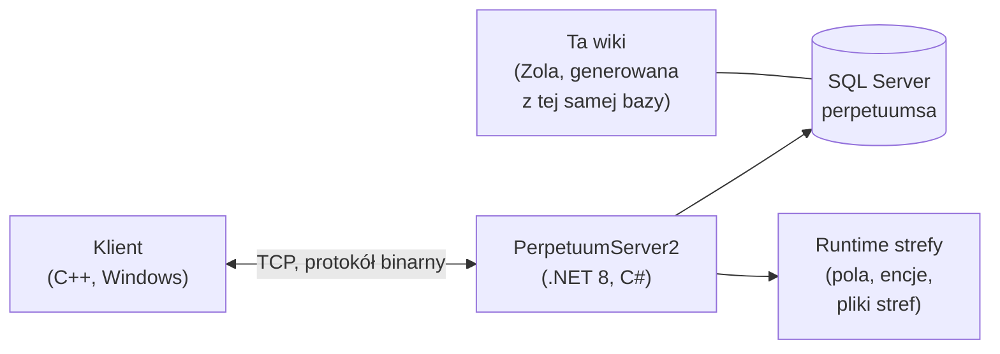

# Strona dewelopera

Wysokopoziomowy przegląd działania gry z perspektywy dewelopera/devops.
Dedykowane strony z szczegółowym omówieniem są w przygotowaniu — na razie to strona orientacyjna.

## Składniki

- **Klient** — klient gry Perpetuum (Windows; patrz [Konfiguracja klienta i PC](/pl/features/client-setup/) w celu uruchomienia, w tym na Linuxie). Komunikuje się z serwerem przez binarny protokół TCP; każda akcja gracza to nazwana *komenda* (te same nazwy, których ta wiki używa w [inwentarzu akcji](/pl/features/#pelna-lista-dzialan)).
- **Serwer (PerpetuumServer2)** — kod w C#/.NET 8. Jeden proces uruchamia cały serwer: warstwę połączeń, logikę gry (roboty, strefy, misje, rynek, produkcja, badania) oraz runtime strefy, który obsługuje cykle świata pól każdej strefy (teren, encje, teleporty).
- **Baza danych** — SQL Server, baza `perpetuumsa`. Statyczna zawartość gry (domyślne wartości encji, receptury, rozszerzenia, drzewko technologiczne, sklep, opisy teleportów) oraz cały stan dynamiczny (postacie, roboty, kontenery, rynek, stan stref).
- **Pliki stref** — strefy to siatki pól (warstwy wysokości i kontroli, 2 bajty/pole) dostarczane w archiwach `.gbf` i edytowalne per strefa; patrz [format plików stref](/pl/formats/zone-files/).
- **Dane referencyjne** — klient pobiera tabele statystyk z serwera przy starcie (patrz [Serwer i dane referencyjne](/pl/features/server/)).

## Uruchamianie

- Serwer działa w Docker Compose obok SQL Server (projekt `perpetuumserver2`); kontener bazy danych to źródło, z którego generator tej wiki odczytuje dane.
- Statyczna zawartość jest walidowana względem plików reguł **plantrules**; generator C# wiki (`make generate`) działa w tym samym ekosystemie i odczytuje tę samą bazę danych, więc każda wygenerowana tabela na tej stronie odzwierciedla dane na żywo z serwera.
- Mapy teleportów stref na tej wiki są renderowane z tych samych warstw wysokości, których używa sama gra.

## Co dalej

- **[Formaty](/pl/formats/)** — deweloperski przewodnik po polach: jak każde pole statystyk jest przechowywane (kolumna bazy, klucz pliku reguł, bajt warstwy binarnej) i konsumowane, z przykładami.
- **[Serwer i dane referencyjne](/pl/features/server/)** — systemy meta: informacje o serwerze, tabele wyników, dane referencyjne pobierane przez klienta oraz sklep w grze.

> Więcej stron deweloperskich (protokół, cykl życia strefy, wdrożenie) jest planowane — ta strona jest punktem startowym dla nich.