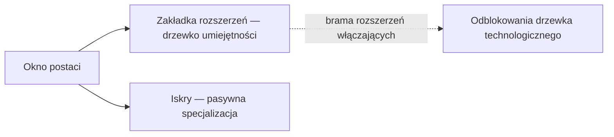

# Postać

W **oknie postaci** (górny pasek → **Postać**, lewy górny róg) znajduje się postęp Twojej postaci: profil, kredyty, **rozszerzenia** (umiejętności) oraz ustawienia.
Wszystko na tej stronie dotyczy konkretnej postaci — konto może zawierać kilka postaci, każda z własnym drzewkiem. Lokalizacje w interfejsie zgodnie z [przeglądem interfejsu klienta](/pl/features/ui/).

## Rozszerzenia

Zakładka **rozszerzeń** to drzewko umiejętności postaci: poziomy umiejętności przypisane do konkretnej postaci, które odblokowują elementy rozgrywki i dostosowują atrybuty — najważniejsze są **rozszerzenia włączające** wymagane do pilotowania klasy robota. Poziom 1 kosztuje kredyty, każdy kolejny poziom kosztuje Punkty Rozszerzeń (EP), a wymagania wstępne blokują ścieżkę.

- [Główne kategorie](/content/extensions/#categories) — 15 kategorii w skrócie:
  które kategorie otwierają które (kliknij pole, aby przejść do jego kart)
- [Rozszerzenia według kategorii](/content/extensions/#table) — każde rozszerzenie:
  rang, cena, bonus, wymagania wstępne
- Jak działają EP i drzewko technologiczne: [Badania](/pl/features/research/)

## Iskry

Twoja **iskra** to specjalizacja nanobotów zainstalowana na postaci — podczas gdy jest aktywna, jej bonusy stosują się do każdego robota, którym pilotujesz. Przełączanie iskier ma swoją cenę; autoryzacja blokuje wyższe linie. Szczegóły w [Iskry](/pl/features/sparks/).