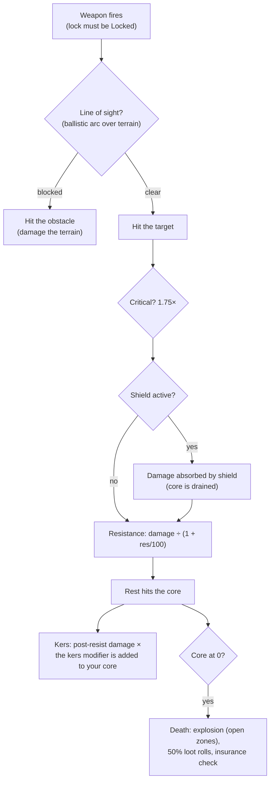

# Walka

Walka toczy się **w strefach**, z użyciem aktywnego robota. Walczysz z innymi graczami (PvP),
NPC-ami oraz wrogimi strukturami. Ta strona obejmuje mechaniki potwierdzone po stronie
serwera; szczegółowe interakcje obrażeń i konfiguracji znajdują się w sekcji
[roboty i konfiguracja](/pl/features/robots/).

> Lokalizacje w interfejsie odpowiadają [przeglądowi interfejsu klienta](/pl/features/ui/):
> **tarcza/pancerz/poszycie robota oraz energia** są wyświetlane na panelu statusu
> poza dokowaniem. Celowanie i sterowanie bronią w trakcie walki nie zostały jeszcze
> szczegółowo udokumentowane.

## Wchodzenie w walkę

- Możesz walczyć wyłącznie **poza dokowaniem** — jesteś swoim aktywnym robotem.
- Ostrzał wrogiej broni ofensywnej w kierunku innego gracza w otwartej (PvP) strefie
  nadaje atakującemu **flagę PvP**. Odpowiedzenie ogniem lub użycie modułu wspierającego
  na już oznaczonym graczu nadaje ją również Tobie. Flaga trwa **5 minut**
  (definicja `effect_pvp`, 300 000 ms) i jest odświeżana przy każdym nowym akcie
  agresji.
- Podczas gdy flaga jest aktywna:
  - **nie możesz używać teleportów** (w tym mobilnych), a
  - **nie możesz dokować normalnie** — jedynym wyjściem jest **przymusowe dokowanie**,
    które celowo nie jest blokowane przez flagę.

## Z czym możesz walczyć

- **Roboty innych graczy** (PvP).
- **NPC-e** — NPC-e w strefach są organizowane w **stada** (grupy o wspólnym zachowaniu).
- **Wrogie struktury / jednostki rozkładane** w strefie.

## Gdy Twój robot zostaje zniszczony

Twój robot zostaje **zniszczony**, a w miejscu jego śmierci pojawia się **kontener z łupem**.
Łup jest losowany dla każdego przedmiotu osobno, z 50% szansą:

| Co | Los |
|---|---|
| Każdy zamontowany **moduł** | 50% szansy na upadek w stanie **uszkodzonym** (naprawialnym); w przeciwnym razie zniszczony |
| Amunicja każdego modułu | 50% szansy na upadek (tylko jeśli moduł upadł) |
| **Ładunek** (paczki/skrzynie) | zawartość wypada jako łup, sama paczka jest zniszczona |
| Inne **przedmioty stosowalne** w ładunku | 50% szansy na upadek, z losowo zmniejszoną ilością (reszta jest zniszczona) |
| Twoje **malowanie/kolor** | 50% szansy na upadek jako przedmiot malowania |
| Sam **robot** | zniszczony — chyba że miał aktywne **ubezpieczenie**, w którym case wypłata trafia do Ciebie w kredytach (robot nadal znika) |

**Ubezpieczenie** (kupowane w placówce ubezpieczeniowej bazy, podczas dokowania — zobacz
[produkcja → ubezpieczenie](/pl/features/production/)) obejmuje robota przez **15 dni** (plus
dni bonusowe z przedłużenia). Każdy robot ma zdefiniowaną w treści **opłatę** i **wypłatę**
(tabela `insuranceprices` — 67 definicji robotów); opłatę można zmniejszyć bonusem
przedłużenia i opłacić z portfela korp. Roboty startowe nie mogą być ubezpieczone. Możesz
mieć ubezpieczenie na 1 + (bonus przedłużenia) robotach.

Po zniszczeniu zostajesz **bez aktywnego robota**. Aby wrócić do gry, możesz:

- **wybrać innego robota**, którego posiadasz i który ma wymagane rozszerzenia włączające, lub
- **zawnioskować o robota startowego** podczas dokowania — ale po zniszczeniu obowiązuje
  krótki blokada: **3 minuty, jeśli zabił Cię gracz, 1 minuta, jeśli NPC**. Jeśli to **NPC**
  Cię zniszczył, baza automatycznie dostarcza Ci **darmowego robota startowego** po powrocie.

## Ucieczka

Gdy walka idzie źle:

- **Przymusowe dokowanie** — awaryjne wyjście. Wyciąga Cię ze strefy i natychmiast dokuje
  w bazie głównej (TMA), nawet w trakcie walki.
- **SOS** — alternatywne wyjście: dokuje Cię w bieżącej bazie po normalnym
  (7-sekundowym) opóźnieniu od dokowania.

Oba są Twoimi sieciami bezpieczeństwa; przymusowe dokowanie to przycisk „za chwilę umrę".

## Blokada celu, zasięg i trafienie

- **Najpierw blokada.** Broń strzela wyłącznie do *zablokowanego* celu — i dopiero gdy
  blokada się wypełni. Blokowanie celu zajmuje **czas blokady** Twojego robota (statystyka
  w ms); strzał podczas trwającej blokady jest odrzucany. Możesz utrzymywać kilka blokad
  jednocześnie (ograniczonych statystyką **maksymalna liczba zablokowanych celów**), ale
  tylko jedna jest *główna*, a niektóre bronie strzelają wyłącznie do celu głównego.
- **Optymalny zasięg + spadek.** Wewnątrz **optymalnego zasięgu** broni zadajesz pełne
  obrażenia. Poza nim obrażenia płynnie maleją wzdłuż odległości **spadku** —
  mniej więcej połowa obrażeń w połowie spadku, zero na jego krawędzi. Poza
  optymalnym zasięgiem + spadkiem nie zadajesz żadnych obrażeń.
- **Rozmiar wybuchu vs. rozmiar celu.** Działa nie „przegapiają": statystyka **celności**
  działa jako promień wybuchu, a cel o **sygnaturze** mniejszej niż ten promień
  otrzymuje proporcjonalnie mniejsze obrażenia. Rakietom *może* się nie udać trafić
  (szansa na pudło pochodzi ze statystyki celności rakiet robota), ale gdy trafią,
  eksplodują z **promieniem wybuchu** — i, podobnie jak przy działach, mały cel
  otrzymuje mniej obrażeń od wybuchu.
- **Trafienia krytyczne.** Każdy strzał losuje Twoją **szansę na trafienie krytyczne**;
  trafienie krytyczne mnoży całe trafienie przez 1,75×, a każde trafienie dodatkowo
  losowo waha się o ±10%.
- **Linia widzenia.** Pociski lecą po linii prostej, a teren, przeszkody i rośliny je
  blokują. Rakietom lecą łukiem i mogą przelatywać nad niskim osłonami — ale łuk jest
  ograniczony, więc wysokie tereny nadal blokują.
- **Twoja własna tarcza blokuje Twoją własną broń.** Podczas gdy Twoja tarcza jest
  aktywna, Twoja broń nie będzie strzelać.

### Typy obrażeń

Amunicja niesie obrażenia: każda amunicja ma wartość dla jednego lub więcej typów
obrażeń — zwykle jeden dominujący typ plus mniejszy typ wtórny (amunicja rakietowa to
wybuchowe plus kinetyczne lub chemiczne, kryształy laserowe to termiczne plus chemiczne,
naboje do dział szynowych to kinetyczne plus termiczne). Typy:

| Typ | Uwagi |
|---|---|
| **Chemiczne** | Wspólny składnik amunicji do dział i laserów |
| **Kinetyczne** | Działa szynowe, amunicja pociskowa i rakietowa |
| **Termiczne** | Lasery, niektóre amunicje pociskowe |
| **Wybuchowe** | Rakiet |
| **Toksyczne** | Niektóre amunicje do dział; zadają obrażenia wyłącznie roślinom i terenowi |
| **Elektryczne** | Efekty specjalne (np. scorcher) — **przenikają tarcze** |

Przychodzące obrażenia są redukowane per typ przez **odporność** celu na dany typ:
odporność 50% redukuje obrażenia o 50/(50+100) ≈ 33%. Odporności działają wyłącznie na to,
co *przechodzi* przez tarczę — tarcza pochłania pierwsza i jest opłacana z energii
tarczy: im mocniejsze trafienie, tym więcej energii kosztuje. Moduły **kers** pozwalają
części obrażeń danego typu wypalać energię tarczy bezpośrednio nawet po odporności.
[Adaptacyjny stop](/pl/features/modules/#rodziny-modulow)
redystrybuje Twoje odporności w kierunku tego, co faktycznie Cię uderza.

## Detekcja, maskowanie i prędkość

- **Detekcja vs. maskowanie.** Możesz zobaczyć jednostkę w zasięgu, który rośnie z Twoją
  statystyką **detekcji** i maleje ze statystyką **maskowania** celu — mniej więcej
  100 m × detekcja ÷ maskowanie. Jednostka, która Cię zablokowała, jest zawsze
  widoczna dla Ciebie, niezależnie od jej maskowania. Moduły ukrycia tymczasowo podnoszą
  Twoje własne maskowanie (zobacz [moduły](/pl/features/modules/)); miny używają dedykowanego
  zasięgu detekcji.
- **Blob.** Niektóre jednostki i struktury emitują pole *blob*. Podczas gdy stoisz w
  promieniu emitera, poziom blob na Twojej jednostce rośnie; między dwoma progami blob
  **zwiększa Twój czas blokady** (do 6× wartości bazowej) i **zmniejsza Twój zasięg
  blokady i moc sensorów** (do połowy).
- **Prędkość.** Prędkość maksymalna maleje z masą: prędkość = baza × (masa projektowa ÷
  masa rzeczywista) — każda tona dodatkowych modułów, pancerza i ładunku, którą
  zamontujesz, spowalnia Cię.
- **Demobilizacja („demob").** Efekt pajęczynkarza spowalnia prędkość maksymalną celu.
  Siła efektu skaluje się z **masowością** celu — cięższe jednostki są mocniej
  demobilizowane, więc duże, wolne cele odczuwają to najbardziej.

## Alarmy

**Alarm** jest uruchamiany w strefie przez **przełącznik alarmu** (struktura
związaną z misją). Po uruchomieniu:

- Działa przez stały **okres alarmu** (ustalony przez misję; krótki domyślnie).
- Musisz **zostać w zasięgu przełącznika** przez cały okres — jest sprawdzany co kilka
  sekund, a oddalenie anuluje alarm.
- Możesz mieć tylko **jeden aktywny alarm naraz**.

Alarmy są związane z treścią misji — zobacz [misje](/pl/features/missions/).

## Raporty bojowe

Twoja historia bojowa jest dostępna jako **raporty bojowe**:

- Filtrowanie po **oknie czasowym**.
- Filtrowanie po **roli**: jako **ofiara**, **atakujący** lub **zabójca**.

Używaj ich, aby przejrzeć, jak zginąłeś lub kogo zniszczyłeś.

## Najwyższe wyniki

- **Serwerowe najwyższe wyniki** — najlepsze wyniki na serwerze.
- **Moje najwyższe wyniki** — Twoje osobiste rekordy.

## Praktyczne uwagi

- **Nie umieraj lekkomyślnie** — zniszczony robot oznacza czas przestoju podczas
  ponownej konfiguracji lub ponownego wniosku.
- **Przymusowe dokowanie jest natychmiastowe** — jeśli jesteś w gorszej sytuacji,
  udaj się do TMA teraz; możesz skonfigurować później.
- **PvP blokuje teleporty** — planuj ucieczki; nie możesz zniknąć z walki.
- **Alarmy to sygnał** — aktywny alarm oznacza, że w tym obszarze trwa wydarzenie misji.

<!--
Developer notes: rewritten 2026 from backend sources; no community-wiki text reused.
Verified against:
- Locking: Zones/Locking/LockHandler.cs (locking time in ms from
  AggregateField.locking_time; MaxLockedTargetsProperty; one primary lock;
  lock states Inprogress -> Locked), Zones/Locking/Locks/Lock.cs,
  Zones/Locking/LockValidator.cs (dead/not-lockable/out-of-range validation);
  ZoneSession.cs (weapons take an existing lock id; firing a weapon whose lock is
  not fully Locked raises LockIsInProgress — there is NO auto-lock on fire).
- Damage: Modules/Weapons/Damage.cs (CalculateDamages: crit = attacker.
  CriticalHitChance, CRITICALHIT_MOD 1.75, random 0.9-1.1; falloff =
  cos(x*PI)/2+0.5 with x=(distance-optimal)/falloff; zero beyond optimal+falloff;
  explosion modifier = target.SignatureRadius/explosionRadius clamped 0..1;
  toxic excluded from unit damage), Modules/Weapons/WeaponAmmo.cs (damage values
  per type live on the ammo: damage_chemical/thermal/kinetic/explosive/toxic;
  firearm adds damage_toxic to plants).
- Weapons: Modules/Weapons/FirearmWeaponModule.cs (CheckAccuracy always false —
  firearms never miss; WithExplosionRadius(Accuracy) — accuracy IS the blast
  radius), Modules/Weapons/MissileWeaponModule.cs (miss when rnd >
  robot.MissileHitChance; missile_miss property), WeaponModule.cs (shield active
  => ShieldIsActive error; LOS check before firing).
- Resistances: Units/Unit.cs GetResistByDamageType = resist/(resist+100);
  Zones/DamageProcessors/DamageProcessor.cs (shield absorbs first, paid from
  core: coreDamage = damage * AbsorbtionModifier; Electric damage penetrates as
  coreDamage; kers = damage * type kers modifier, scaled by
  (sin(core/coreMax*PI)/2)+0.5, added to target core);
  EffectModules/ShieldGeneratorModule.cs (AbsorbtionModifier =
  max(SigRadius/shieldRadius,1)/shieldAbsorbtion).
- Damage types: Modules/Weapons/DamageType.cs — Chemical, Kinetic, Thermal,
  Explosive, Toxic, Electric (no "seismic"; missile damage is Explosive).
  Electric is only produced by ScorcherModule.cs in this backend.
- Detection: Units/Unit.Visibility.cs (IsDetected: range = 100/max(1,
  target.StealthStrength)*max(1, DetectionStrength); locked-on-you always
  visible; mine detection range separate); stealth_strength property includes
  effect_stealth_strength_modifier (stealth modules raise masking).
- Speed: Units/UnitProperties/SpeedMaxProperty.cs (speed_max * Mass/ActualMass;
  dreadnought => 0.05; massiveness/drone/highway effect modifiers).
- Demob: Modules/EffectModules/WebberModule.cs (effect_demobilizer; effect
  property = module value + target.Massiveness, clamped at 1.0 — heavier targets
  get the full effect; longrange webbers additionally require LOS; accuracy
  check via optimal-range modifier).
- Blob: Zones/Blobs/BlobHandler.cs (emitters raise blob level inside
  BlobEmissionRadius; between blob_level_low/high the multiplier scales:
  locking_time modifier -5, i.e. lock time x(1+5*m) — up to 6x base at full blob, max_targeting_range *0.5,
  sensor_strength *0.5).
- LOS: Zones/LineOfSight.cs (raycast vs terrain blocks incl. Plant flag;
  ballistic arc for missiles: max amplitude 16 m over 40 m);
  Zones/Terrains/BlockingFlags.cs (Obstacle/Plant/Decor/Island block).
Corrections vs ingested page: "seismic" damage type does not exist (explosive
does); "firearms lose damage instead of missing" verified (accuracy = explosion
radius); auto-lock on fire NOT in backend (lock must be created and completed
first); "interference" (emission/minimum/peak, emitters, anomaly degradation)
has NO equivalent in this backend — only a comment in Services/RiftSystem/Rift.cs
— section removed; shield "absorbs" is core-energy based, and Electric damage
penetrates it.
Developer files: Zones/Locking/*; Zones/Locks via Zones/Locking/Locks/*;
Modules/Weapons/*.cs; Zones/DamageProcessors/*.cs; Units/Unit.Visibility.cs;
Units/Unit.cs; Units/UnitProperties/SpeedMaxProperty.cs;
Modules/EffectModules/ShieldGeneratorModule.cs, WebberModule.cs,
StealthModule.cs; Modules/ScorcherModule.cs; Zones/Blobs/*.cs;
Zones/LineOfSight.cs; Zones/ZoneSession.cs (lock/fire packet handling).
Previously verified (kept as-is): PvP flag = effect_pvp 300000 ms
(effect_pvp definition), raised by attack/aggro/support (Player.cs
ApplyPvPEffect); blocks teleport + normal dock (CantDockThisState), ForceDock.cs
has no PvP check; death loot 50% rolls (Player.cs OnUnitDeath,
Services/Looting/LootHelper.cs DROP_CHANCE 0.5); insurance (InsuraceFacility.cs,
InsuranceHelper.cs, insuranceprices 67 defs); starter-robot lock 3 min PvP /
1 min NPC; alarms (Zone/AlarmStart.cs, AlarmSwitch.cs); kill reports
(GetMyKillReports.cs); high scores (GetHighScores.cs / GetMyHighScores.cs).
-->