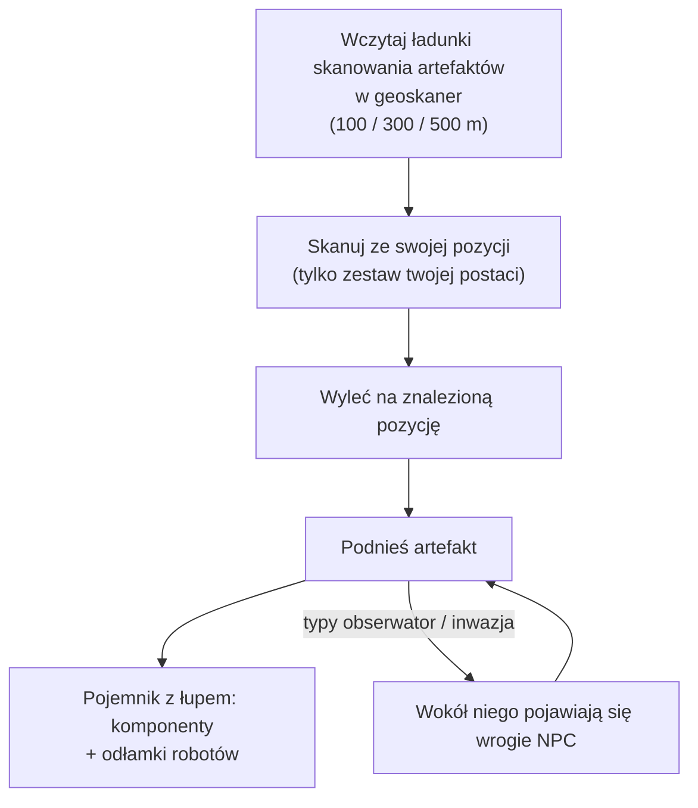

# Eksploracja (artefakty i relikwie)

Eksploracja to znajdowanie ukrytej wartości w terenie — solidna aktywność solo
na każdym poziomie. Przybiera dwie formy: **artefakty**, które są osobiste i
ukryte, oraz **relikwie**, które są otwarte i sporne.

## Artefakty

Artefakty to punkty istniejące **dla każdej postaci**: serwer przechowuje
osobny zestaw artefaktów dla każdej postaci na każdej wyspie, więc to, co
znajdujesz, należy wyłącznie do ciebie. Są niewidoczne, dopóki ich nie
zeskanujesz.

1. Wczytaj **ładunki skanowania artefaktów** w moduł geoskanera. Istnieją trzy
   klasy ładunków o różnym zasięgu skanowania (100 / 300 / 500 m).
2. Skanuj z pozycji swojego robota — skaner zwraca pozycje artefaktów w
   zasięgu (statystyka dokładności geoskanera zawęża zgłaszaną pozycję).
3. Wyleć na znalezioną pozycję i podnieś artefakt; w tym miejscu pojawia się
   **pojemnik z łupem**.

Dwie rzeczy sprawiają, że zbieranie artefaktów to również aktywność
walczona, a nie tylko zbieraczkowa:

- Niektóre typy artefaktów **wywołują NPC razem z tobą** — warianty
  „obserwator" i „inwazja" przyciągają wrogów w momencie odnalezienia
  artefaktu, więc pilotuj coś, co potrafi walczyć.
- Łup jest losowy dla każdego typu artefaktu: komponenty modułów (płyty
  pancerne, twardze, generatory, naprawiacze…) oraz **odłamki robotów** —
  frakcyjne składniki badań i produkcji, co czyni zbieranie artefaktów
  kluczową karierą przemysłową.

Typy artefaktów mają poziomy (poziom 1–3, więcej łupu na wyższych poziomach)
i występują w wariantach neutralnych i frakcyjnych.

## Polowanie na relikwie

Relikwie są **otwartego świata**: strefa wywołuje je na losowych pozycjach
(w przybliżonym cyklu respawnu co 90 minut z losowym rozrzutem), są
widocznymi obiektami z wiązką, a kto pierwszy je podniesie, ten dostaje łup.
Łup to rzut NIC plus **odłamki robotów**, skalowane poziomem relikwii i
wartością wyspy — te same odłamki, które daje zbieranie artefaktów.

Typy relikwii mają poziomy dla każdej wyspy (poziomy 1–3, z różnymi wartościami
EP w zależności od poziomu) i występują w wariantach neutralnych, frakcyjnych
i przemysłowych. Niektóre relikwie są powiązane z
[posterunkami](/pl/features/outposts/) — aktywność SAP wywołuje własne relikwie,
które żyją do 12 godzin — a na wyspach z otwartym PvP punkty wywoływania
znajdują się na spornym terenie, więc spodziewaj się spotkać innych
polujących.

## Misje też za to płacą

[missje](/pl/features/missions/) mogą również stawiać przed tobą pracę z
artefaktami, gdzie płaci się bezpośrednio, a towary trafiają do pracodawcy
zamiast do twojego ekwipunku.

<!--
Written from scratch against the server backend, 2026-09-27:
Zones/Artifacts/Repositories/ZoneArtifactRepository.cs (per-character artifact
rows), Zones/Scanning/Scanners/Scanner.Artifact.cs (scan range + accuracy),
Zones/Artifacts/Generators/Loot/ (random loot per type),
Services/Relics/RelicManagers/ZoneRelicManager.cs (~1.5 h respawn + random
window) and SAPRelic.cs (12 h lifespan),
artifacttypes/artifactloot/relictypes/relicloot tables,
ammo_artifact_scan_a/b/c (scan ranges 100/300/500).
An earlier version of this page was adapted from the Open Perpetuum
community wiki (perpetuum.miraheze.org) and has been fully rewritten from
backend sources; no text was reused.
-->