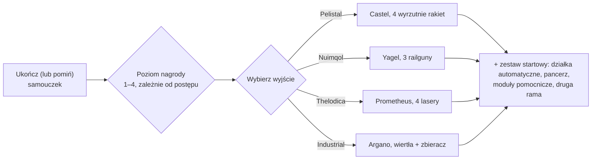

# FAQ

## Czy mogę pominąć samouczek?

Możesz opuścić strefę szkoleniową wcześniej, ale zrezygnujesz z nagrody, którą
daje jej ukończenie. Kiedy postać opuszcza samouczek, serwer:

- wypłaca **początkowe NIC** oraz bonus **za każdy osiągnięty poziom nagrody** w
  samouczku (istnieją cztery poziomy nagród),
- przenosi cię do **domyślnej korporacji** dla wybranej rasy i szkoły,
- przyznaje twoje **początkowe rozszerzenia** (umiejętności) oraz twoją **iskrę**,
- tworzy twojego **robota startowego**, dokuje cię w bazie New Virginia i
  ustawia ją jako twoją **bazę domową** — miejsce, w którym odradzasz się po
  zniszczeniu robota,
- umieszcza twoje **przedmioty nagrody** w publicznym kontenerze w tej bazie dokowania i
  wysyła ci wiadomość powitalną.

## Jak ukończyć samouczek?

Wykonuj cele po kolei; **Lista kontrolna rekruta** w kliencie (menu Pomoc
na górnym pasku) śledzi je i można ją przypiąć do dolnego paska. To, jak daleko
zajdziesz, określa twój poziom nagrody, który decyduje o tym, jakie pakiety nagród
otrzymasz przy wyjściu — wyjście na poziomie 1 daje tylko pierwszy pakiet, pełne ukończenie
daje wszystkie cztery.

## Co daje mi każde wyjście?

Twój wybór decyduje o trzech rzeczach: **robocie startowym**, który pilotujesz, **przedmiotach
nagrody**, które otrzymujesz, oraz **domyślnej korporacji i umiejętnościach startowych**, które zyskujesz.
Wszystko inne — każdą umiejętność, każdego robota, wyposażenie dowolnej frakcji — można wytrenować
i kupić później za EP i NIC, więc ten wybór to jedynie pakiet startowy, a nie trwałe ograniczenie.

| Wyjście | Robot startowy (wyposażony) | Temat nagrody |
|---|---|---|
| **Pelistal** | Castel — cztery wyrzutnie rakiet | rakiety + działka automatyczne |
| **Nuimqol** | Yagel — trzy railguny | amunicja do railgunów + działka automatyczne |
| **Thelodica** | Prometheus — cztery lasery | kryształy laserowe + działka automatyczne |
| **Industrial** | Argano — dwa wiertła, zbieracz, sonda górnicza | amunicja do wydobycia, zbiorów i skanowania artefaktów |

Każde wyjście zawiera również zestaw małych działek automatycznych z amunicją, pancerz oraz
moduły pomocnicze (naprawiacz pancerza, wzmacniacz czujników lub reduktor masy, doładowanie
rdzenia, modyfikatory obrażeń), drugą (pustą) ramę oraz kapsułę bomby ściennej (wall-bomb) na
najwyższych poziomach nagród.

## Co robić po wyjściu?

Niemal każda aktywność zapewnia EP na umiejętności i NIC na sprzęt:

- Wydobywaj rudę, zbieraj rośliny, szukaj artefaktów — i sprzedawaj zdobycze na [rynkach](/pl/features/market/).
- Poluj na NPC i sprzedawaj [łupy](/pl/features/npcs/).
- Zbieraj lub kupuj materiały i [wytwarzaj](/pl/features/production/) przedmioty.
- Wykonuj [misje](/pl/features/missions/) — wszystko, co oferowane jest w terminalu lub
  posterunku, możesz ukończyć samodzielnie w świecie gry.

Nowy w otwartym świecie PvP? Najpierw przeczytaj [uwagi dotyczące przetrwania w Pierwszych krokach](/pl/features/getting-started/#survival).

## Czy mogę ponownie odwiedzić strefę szkoleniową?

Nie. Strefa szkoleniowa jest przeznaczona dla nowych postaci i nie ma możliwości ponownego
wejścia po jej opuszczeniu. Lista kontrolna rekruta pozostaje dostępna w menu Pomoc, jeśli
chcesz ponownie przeczytać cele, i zawsze możesz stworzyć kolejną postać i pozostawić ją w
samouczku jako piaskownicę testową.

## Skróty

Powszechne skróty na czacie, ofertach rynkowych i konfiguracjach (fitach). Większość terminów ma
własną stronę (zalinkowaną w stosownych miejscach) — nazwy przedmiotów można odnaleźć w wyszukiwarce witryny.

| Skrót | Znaczenie |
|---|---|
| **EP** | [Punkty rozszerzeń (Extension Points)](/pl/features/research/#ep-sources) — waluta umiejętności na poziomie konta przeznaczona na ulepszanie [rozszerzeń](/pl/features/character/#extensions) (zasady zdobywania znajdują się na [stronie badań](/pl/features/research/#ep-sources)). |
| **NIC** | Kredyty Nian (Nian Credit) — waluta w grze (saldo `credit` twojej postaci). |
| **CT** | [CPRG — Program kalibracji](/pl/features/production/#cprg-calibration-programs) — program, którym kalibruje się linię produkcyjną przed rozpoczęciem produkcji (jeden na przedmiot, z uwzględnieniem wydajności materiałowej/czasowej). |
| **Proto** | Przedmiot prototypowy — wariant modułu/robota wyższego poziomu (tieru), wytwarzany w [obiekcie prototypowym](/pl/features/production/#the-item-lifecycle-the-circular-process) (zużywa egzemplarz poprzedniego poziomu; zobacz [progresję poziomów](/pl/features/production/#tier-progression)). |
| **LWF** | Lightweight frame — moduł pancerza zmniejszający masę (w kliencie nazwany „… lightweight frame”, np. *Niani lightweight frame*). Zmniejsza masę robota kosztem pancerza. |
| **TP / tele** | [Teleport](/pl/features/movement/) — szybka podróż między ustalonymi punktami lub do rozstawionego mobilnego urządzenia teleportacyjnego. |
| **SAP** | Service Access Point — aktywność związana ze [stabilnością](/pl/features/outposts/) posterunku. |
| **Stab** | Stabilizator broni (Weapon Stabilizer) — zwiększa celność trafień broni. |
| **Demob** | Demobilizator (Demobilizer) — moduł spowalniający innego robota (oraz jego moduły). |
| **EWar** | Moduły walki elektronicznej (Electronic Warfare) (zagłuszanie, tłumienie czujników, maskowanie). |
| **EnWar** | Moduły walki energetycznej (Energy Warfare) (wstrzykiwacze rdzenia, wysysacze, neutralizatory, transfery). |
| **Tuning** | Określenie w kliencie modułów ulepszeń zwiększających działanie innych modułów — modyfikatory obrażeń broni, *tuning przemysłowy* dla laserów górniczych i zbieraczy, tuning naprawy pancerza itp. |
| **MK2** | Ulepszony wariant robota (ramy `_mk2`) — większe pojemności, własna linia badawcza. |

Klasy robotów są zgodne z podziałem w kliencie gry — zobacz uwagę w sekcji
[Klasy robotów](/pl/content/robots/#robot-classes).

<!--
Written from scratch against the server backend, 2026-09-27:
Zones/Teleporting/Strategies/TrainingExitStrategy.cs (exit rewards, NIC,
corporation, extensions, spark, starter robot, home base, reward items),
Zones/Training/Reward/TrainingReward*.cs + trainingrewards/robottemplates
(reward levels 1-4, per-race starter packs and items),
Robots/Robot.Properties.cs (race ids 1=Pelistal, 2=Nuimqol, 3=Thelodica, 5=industrial).
An earlier version of this page was adapted from the Open Perpetuum
community wiki (perpetuum.miraheze.org) and has been fully rewritten from
backend sources; no text was reused.
-->
