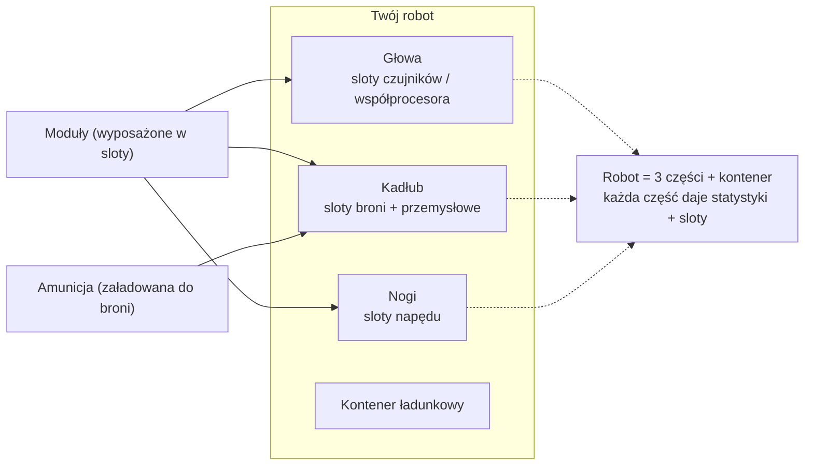

# Wyposażanie

Wyposażanie oznacza ładowanie **modułów** do slotów komponentów robota oraz **amunicji** do broni. Całe wyposażanie jest **dostępne wyłącznie po dokowaniu** — nie można się wyposażać w strefie.

> Lokalizacje w interfejsie odpowiadają [przeglądowi interfejsu klienta](/pl/features/ui/) (kategoria **Wyposażenie** na pasku górnym). Mechaniki poniżej są potwierdzone na serwerze.

## Wyposażanie modułów

Robot posiada kilka **komponentów** (broń, tarcza, pancerz, napęd, czujniki itp.), z których każdy ma zestaw **slotów**.

- **Wyposaż moduł** — weź moduł z kontenera i załaduj go do konkretnego slotu komponentu. Typ modułu musi być poprawny dla tego slotu w tej klasie robota. Jeśli slot jest zajęty, istniejący moduł jest zwracany do kontenera.
- **Wymień moduły** — przenieś moduł między dwoma slotami tego samego komponentu.
- **Zdejmij moduł** — wyjmij moduł ze slotu z powrotem do kontenera.

Serwer ponownie wylicza statystyki robota po każdej zmianie (moduły wpływają na wartości wyświetlane na panelu statusu po odłączeniu — zobacz [walka](/pl/features/combat/)).

## Wyposażanie amunicji

- **Wyposaż amunicję** — załaduj kompatybilny przedmiot amunicji do aktywnego modułu (broni). Moduł musi **akceptować dany typ amunicji**, a ładunek jest ograniczony do **pojemności amunicji** modułu. Poprzednio załadowana amunicja jest najpierw zwracana do kontenera.
- **Zmień amunicję** — zamień załadowaną amunicję na inny kompatybilny typ.
- **Zdejmij amunicję** — zwróć załadowaną amunicję do kontenera.

## Presety wyposażania

**Preset** to zapisane wyposażenie, które można szybko ponownie zastosować:

- **Zapisz** — zapisz bieżące wyposażenie robota pod nazwą.
- **Lista** — wyświetl zapisane presety.
- **Zastosuj** — załaduj preset na (inny) robot z kontenera.
- **Usuń** — usuń zapisany preset.

Presety są przydatne do ponownego wyposażenia po walce lub przy przełączaniu się między rolami.

## Uwagi praktyczne

- **Nie można się wyposażać w strefie** — wszystko tutaj wymaga bycia połączonym z dokiem.
- **Najpierw rozszerzenie Enabler** — bez zbadanej klasy robota nie można jej wybrać ani pilotować.
- **Amunicja musi pasować do broni** — niekompatybilna definicja amunicji jest odrzucana.
- **Zapakowane roboty nie mogą być używane** — rozpakuj robota przed jego wyborem lub wyposażeniem.
- **Używaj presetów do szybkiego wyposażania** — zapisz sprawdzone zestawienie, a następnie zastosuj je po stratach.

## Kategorie slotów

Komponenty robota (głowa, kadłub, nogi) zapewniają **sloty**, a każdy slot niesie zestaw flag kategorii. Moduł pasuje do slotu tylko wtedy, gdy jego własne flagi są **podzbiorem** flag slotu. Kategorie flag to:

`small`, `medium`, `large`, `turret`, `missile`, `melee`, `industrial`,
`ew_and_engineering`, `specialized` (slot specjalizowany akceptuje wyłącznie moduły
specjalizowane), a także strukturalne sloty `head` / `chassis` / `leg`.

Moduły mogą być również ograniczone do konkretnych robotów, a niektóre mają flagę **unikalną**, dzięki czemu tylko jeden moduł danego typu może być jednocześnie wyposażony. Efekty statystyk poszczególnych modułów znajdują się w wygenerowanej [tabelle robotów](/content/robots/).