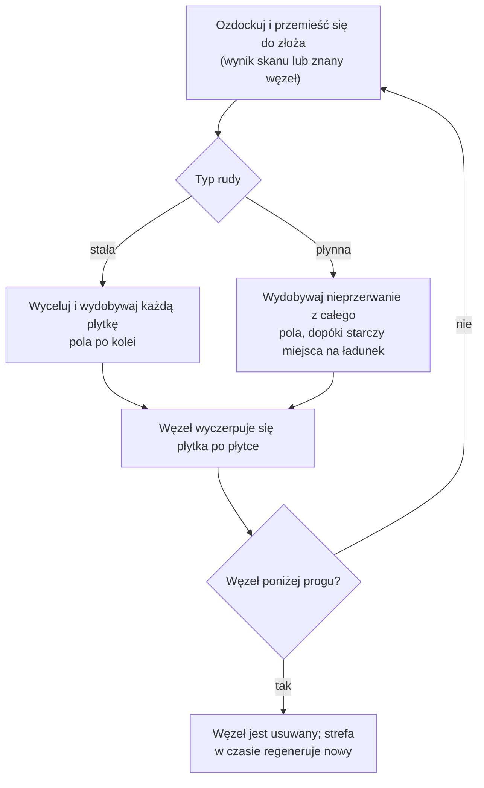
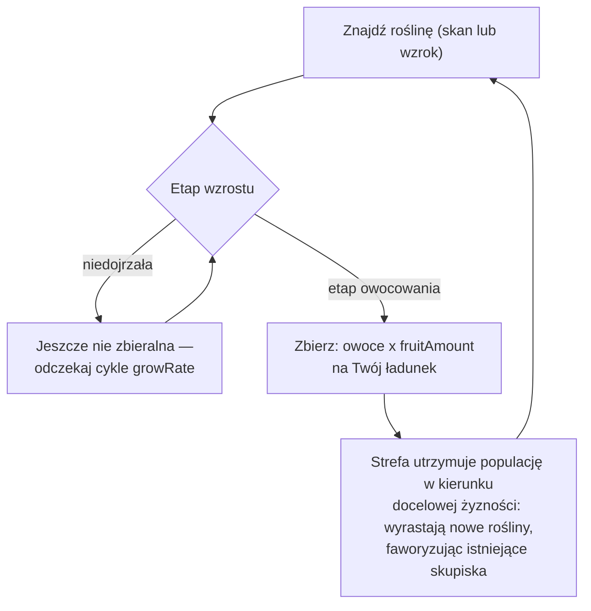
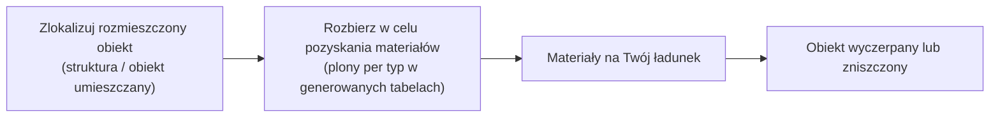

# Zbieranie i skanowanie

Zasoby w grze pochodzą z trzech źródeł w strefie: **złoża rud**, **rośliny**
oraz **rozmieszczane obiekty**. Ta strona wyjaśnia, jak każde z nich działa i jak przebiega cykl zbierania.

> Lokalizacje w interfejsie użytkownika są opisane w [przeglądzie interfejsu klienta](/pl/features/ui/): akcje skanowania i zbierania znajdują się
> na liście **akcji po zdockowaniu** (prawy górny róg w strefie). Wartości plonów dla każdego
> typu zasobu znajdują się w generowanych tabelach: [Content → Ores](/content/ores/) oraz
> [Content → Plants](/content/plants/). Mechaniki poniżej zostały zweryfikowane z implementacją
> po stronie serwera.

## Podstawowy cykl

1. **Ozdockuj** i przemieszczaj się do strefy (patrz [przemieszczanie](/pl/features/movement/)).
2. **Skanuj** obszar za pomocą modułu skanera Twojego robota.
3. **Zbieraj** — wydobywaj rudę, zbieraj owoce roślin lub rozbieraj rozmieszczone obiekty.
4. **Zadokuj** i dostarcz ładunek do kontenera bazy.

## Złoża rud

- Ruda występuje w gruncie jako **złoża (węzły)** rozrzucone po strefie.
- Aby je znaleźć i zarejestrować, potrzebujesz **modułu geoskanera** zamontowanego na aktywnym robocie.
  Skanowanie generuje **wynik skanu**, który następnie **przesyłasz** — trafia on na Twoją
  osobistą listę skanów minerałów.
- Zapisane wyniki skanów można **przeglądać, przenosić, usuwać lub konwertować na przedmioty**
  (przedmioty „skan minerału" używane do przetwarzania i produkcji).

- Złoża są **skończone**: każdy węzeł zawiera ograniczoną całkowitą ilość. Gdy węzeł
  zostanie wydobuty poniżej progu, jest usuwany, a strefa **regeneruje nowe węzły** w
  czasie, do skonfigurowanego maksimum. Sposób rozmieszczania węzłów i utrzymywania
  populacji roślin — z realnymi strefami jako przykładami — znajduje się w
  [Strefy → Generowanie](/zones/generation/).
- **Rudy stałe vs płynne.** Rudy stałe wyczerpują się płytka po płytce — wycelowywujesz
  i wydobywasz każdą płytkę pola, aż się wyczerpie. Rudy płynne są pobierane z całego pola,
  więc Twój robot wydobywczy może pracować nieprzerwanie, dopóki masz miejsce na ładunek.
  Ta łatwość to dokładnie powód, dla którego rudy płynne mają tendencję do niższej wartości:
  wymagają mniej umiejętności i uwagi.

### Statystyki roślin i rud w skrócie

Zachowanie rud i roślin jest sterowane danymi reguł per typ. Pola istotne dla gracza:

| Pole | Znaczenie w grze |
|---|---|
| `fertility` | Jak powszechny jest typ — wyższa wartość = strefa dąży do utrzymania większej ilości |
| `growRate` | Ile cykli wzrostu roślina musi spędzić w każdym etapie, zanim przejdzie dalej (wyższa = wolniej) |
| `spreading` | Czy typ rośnie w skupiskach (grupach) czy rozrzucony |
| `killDistance` | Minimalny odstęp między dwiema roślinami tego samego typu |
| `slope` / `minSlope` | Nachylenie terenu, na którym roślina może rosnąć |
| `allowedAltitudeLow/High` | Zakres wysokości, na którym roślina może rosnąć |
| `allowedWaterLevelLow/High` | Zakres odległości od brzegu (tworzy roślinność nadbrzeżną) |
| `fruitingState` | Który etap wzrostu roślina musi osiągnąć, zanim zacznie owocować (być zbieralna) |
| `fruitDefinition` / `fruitAmount` | Co roślina daje i podstawowa ilość |
| `maxAmount` | Limit liczby tego typu w obszarze przetwarzania |
| `health` | Punkty życia per etap wzrostu (wyższe etapy mogą być trwalsze) |
| `damageScale` | Odporność rośliny na obrażenia |
| `playerSeeded` | Roślina istnieje tylko tam, gdzie posadził ją gracz |
| `onlyOnUnprotectedZone` | Rośnie tylko na niezabezpieczonych strefach (klasy beta/gamma) |

Pełna referencja pola po polu (typy, wartości domyślne, przechowywanie i sposób użycia
przez tick strefy) znajduje się w [Formaty → Pola roślin](/pl/formats/plant-fields/).

## Rośliny

- Rośliny **rosną w czasie** przez sekwencję etapów. Każdy etap trwa określoną liczbę
  cykli wzrostu (`growRate`), zanim roślina losowo przejdzie dalej.
- Roślina **owocuje dopiero po osiągnięciu etapu owocowania** — niedojrzałe rośliny
  nie są zbieralne.
- Strefa utrzymuje populacje roślin w kierunku **docelowej żyzności**: jeśli obszar
  jest niedostatecznie obsadzony względem poziomu żyzności, wyrastają nowe rośliny;
  wybór typu uwzględnia `fertility` każdego gatunku, a `spreading` faworyzuje wzrost
  w istniejących skupiskach.

- Niektóre rośliny są **sadzone przez gracza** (istnieją tylko w ogrodach graczy),
  a niektóre występują **wyłącznie na niezabezpieczonych strefach**.
- Rośliny mogą być **uszkodzone i zabite**; ich `health` i `damageScale` określają,
  jak trudne to jest.

## Rozmieszczane obiekty

Rozmieszczane obiekty to obiekty umieszczone w strefie (patrz [Stacje baz zasilania](/pl/features/pbs/)
po stronie strukturalnej). Niektóre można **rozbierać** w celu pozyskania materiałów.
Zasady rozbierania i plony per typ znajdują się w generowanych tabelach:
[Content → Ores](/content/ores/) oraz [Content → Plants](/content/plants/).

## Kioski

**Kiosk** to struktura związana z misją: **składasz do niego przedmioty** (w zasięgu)
w ramach misji. Sam w sobie nie jest źródłem zbierania — patrz [misje](/pl/features/missions/).

## Uwagi praktyczne

- **Skanowanie wymaga modułu** — bez zamontowanego geoskanera nie ma wyników skanu.
- **Wyniki skanów są Twoje** — należą do postaci i nie są współdzielone.
- **Węzły rud odradzają się, ale powoli** — jeśli obszar jest pusty, złoże zniknęło,
  nie jest ukryte. Regeneracja przywraca liczbę węzłów, ale nie natychmiast.
- **Zbieraj dojrzałe** — rośliny w etapie owocowania dają pełny plon; młodsze etapy
  nic nie dają.

<!-- TODO: pozostaje tylko przepływ interfejsu klienta (ekran skanu, interakcja zbierania, interfejs ładunku) —
     wymaga uruchomionego klienta. Plony rud per typ znajdują się w /content/ores/, a definicje
     owoców roślin w /content/plants/ (generowane z bazy danych na żywo).
     Notatki developerskie: Zone/ZoneUploadScanResult.cs (wymagany GeoScannerModule);
     MineralScanResult*.cs (repozytorium per postać);
     Zones/Terrains/Materials/Plants/PlantRule.cs (wszystkie pola reguł roślin);
     Zones/Terrains/NatureCube.cs (GrowPlants, logika fertility/spreading/killDistance);
     Zones/Terrains/Materials/Minerals/MineralLayer.cs (cykl życia węzła rudy);
     Zone/UseItem.cs + UseItemVisitor.cs (ścieżka zbierania IUsableItem);
     Zone/KioskSubmitItem.cs (składanie przedmiotów misji, ograniczone zasięgiem). -->