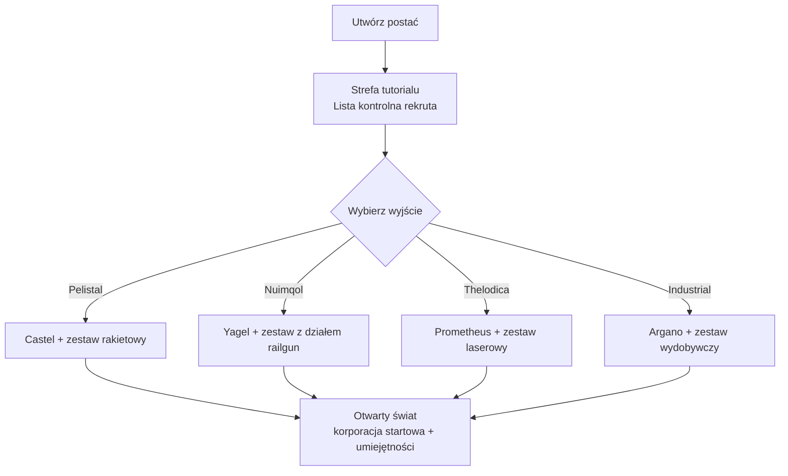

# Pierwsze kroki

Ta strona obejmuje pierwsze kroki: tworzenie postaci, otrzymanie pierwszego robota
oraz ustawienia na poziomie postaci, z którymi spotkasz się na początku.

> Lokalizacje w interfejsie użytkownika są opisane w [przeglądzie interfejsu klienta](/pl/features/ui/). Mechaniki poniżej zostały potwierdzone
> w implementacji serwerowej.

## Pobranie gry

Perpetuum jest dostępne za darmo na [Steam](https://store.steampowered.com/app/223410/Perpetuum/).

  <a class="steam-card-link" href="https://store.steampowered.com/app/223410/Perpetuum/" target="_blank" rel="noopener">
    
    Perpetuum na Steam — gra za darmo
  </a>

## Najpierw obejrzyj

Poradniki od Open Perpetuum Project. Kliknij kartę, aby odtworzyć wideo tutaj.

  

    
    &#9654;
    
Perpetuum Online Tutorial Walkthrough. + Extension Advice and lots more.

  

  

    
    &#9654;
    
Syndicate Careers Help — Artifacting

  

  

    
    &#9654;
    
Open Perpetuum Tutorial — How to run multiple clients

  

## Tworzenie postaci

- Możesz **sprawdzić, czy nazwa jest wolna**, zanim ją utworzysz (`characterCheckNick`).
- **Utwórz postać** — zostanie przypisana do Twojego konta. Jedno konto może
  zawierać wiele postaci; grasz jedną naraz.
- **Wybierz postać**, aby nią grać. Przełączenie postaci odznacza bieżącą.
- Możesz później **zmienić nazwę** postaci (nazwa musi być dostępna).
- Możesz **usunąć** postać, której już nie używasz.

## Twój pierwszy robot

- Gdy jesteś **dodokowany na bazie**, możesz **zlecić robota startowego** (udogodnienia
  bazy — patrz [przegląd interfejsu klienta](/pl/features/ui/), aby dowiedzieć się, gdzie
  znajdują się akcje bazy).
  - Baza musi mieć roboty startowe na stanie — na popularnych bazach mogą się
    wyczerpać, w takim przypadku zlecenie nie powiedzie się.
  - Między zleceniami robota startowego na jedną postać obowiązuje **5-minutowy cooldown**.
  - Nowy robot jest dostarczany do publicznego kontenera bazy.

- Gdy jesteś dodokowany, możesz również **zlecić „nieskończony kontener"**: specjalny
  kontener dodawany do Twojego ekwipunku za **opłatą 5 000 kredytów**. To kontener
  wygodny, a nie źródło darmowych zasobów.

## Ustawienia postaci {#character-settings}

- **Awatar** — wygląd Twojej postaci.
- **Komunikat nastroju** — krótki tekst widoczny dla innych graczy.
- **Notatka prywatna** — notatka widoczna tylko dla Ciebie na jednej z Twoich postaci.
- **Baza domowa** — ustaw lub wyczyść bazę domową; to Twoje domyślne miejsce
  dokowania, gdy gra musi Cię umieścić w bezpiecznym miejscu.
- **Ustawienia** — preferencje na poziomie postaci (get/set).
- **Blokada handlu** — włącz lub wyłącz handel dla postaci.
- **Kredyty** — przelewaj kredyty między własnymi postaciami; przeglądaj historię
  transakcji.
- **Poziom konta** — zmień e-mail/hasło sesji, przeglądaj historię transakcji konta
  oraz historię EP za aktywność.

## Wylogowanie / ponowne logowanie

- **Wylogowanie** kończy sesję; **wybór postaci** ją wznowia.
- Jeśli serwer Cię wyrzuci (np. przymusowe dodokowanie na bazie), ponownie
  pojawisz się dodokowany — patrz [ruch](/pl/features/movement/).

## Tutorial

Nowe postacie zaczynają w strefie treningowej z **Listą kontrolną rekruty** —
ukończ ją: obejmuje podstawy i wypłaca kilka robotów z modułami i amunicją.
Możesz ją pominąć (oddokuj i wejdź na wyjście frakcji), ale stracisz nagrody
i nie będziesz mógł wrócić do strefy treningowej. Co dają cztery wyjścia frakcji,
opisano w [FAQ](/pl/features/faq/).

## Przetrwanie

Perpetuum to sandbox oparty na ryzyku i nagrodzie, a gdy Twój robot ginie,
tracisz go — niezależnie od tego, czy był dodokowany, czy zabity przez gracza
lub NPC — i ponownie pojawia się na Twojej [bazie domowej](#character-settings)
(możesz tam zlecić darmowego robota startowego, jeśli przybywasz z pustymi rękami).
Kilka zasad, które sprawiają, że straty są do przeżycia:

- **Angażuj tylko to, co możesz zastąpić.** Odkowanie to zakład: jeśli robot
  zginie, on i jego zamontowane moduły przepadną (lub staną się łupem).
  Przed startem upewnij się, że taka strata jest do przeżycia.
- **Poznaj strefy.** Ochronione (PvE) wyspy są bezpieczne przed graczami;
  wyspy otwartego PvP to wolna walka bez systemu przestępstw i kar.
  Patrz [strefy](/zones/), aby zobaczyć mapę.
- **Poznaj NPC.** Pomarańczowe znaczniki atakują tylko, gdy zostaną sprowokowane;
  czerwone znaczniki atakują przy zbliżeniu. Uciekaj i przerywaj linię widzenia,
  aby stracić aggro. Patrz [NPC i łowy PvE](/pl/features/npcs/).
- **Mityguj ryzyko, nie tylko je akceptuj.** Wchodzenie na wyspę otwartego PvP
  w swoim najlepszym mechu z T4 to sposób, w jaki mechy giną. Tańszy,
  wymienny sprzęt, który się zwraca w kilka wypraw, wygrywa z drogim botem,
  który wymaga dwudziestu.
- **Zbuduj zrównoważony cykl.** Cokolwiek robisz — misje, zbieranie, łowy,
  produkcja, transport — ktoś płaci za to NIC. Trzymaj zapasowe aktywa,
  aby jeden zły dzień nie zniweczył Twojego dochodu.

## Co dalej

1. Wybierz robota startowego i poznaj ekran [hangaru i montażu](/pl/features/robots/).
2. Odkuj i rusz do strefy — patrz [ruch](/pl/features/movement/).
3. Skanuj teren i zacznij zbierać zasoby — patrz [zbieranie](/pl/features/gathering/).
4. Zbadaj swoje pierwsze rozszerzenia — patrz [badania](/pl/features/research/).
5. Wybierz karierę — [FAQ](/pl/features/faq/) ma menu.

<!-- TODO(Phase 1): verify client UI flow (account creation screen, character wizard).
     UI model: see features/ui.md (EVE-style, project-provided).
     Developer notes: Perpetuum.RequestHandlers.Characters/* (CharacterCreate,
     CharacterSelect, CharacterRename, CharacterSetHomeBase, ...);
     RequestStarterRobot (5-minute cooldown, base stock), RequestInfiniteBox
     (5000 credits, docked-only). -->