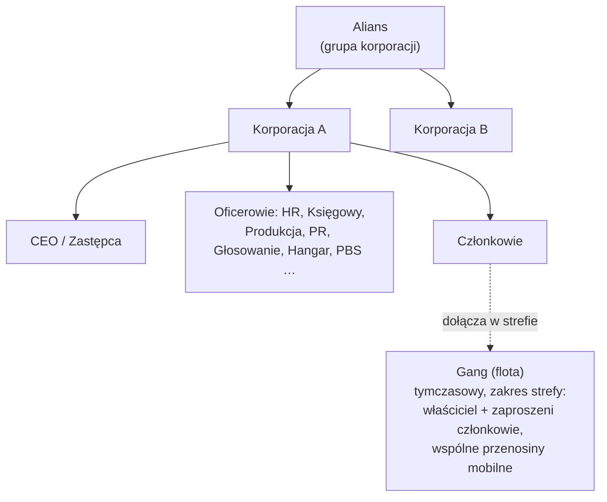

# Grupy

Istnieją trzy typy grup: **korporacje** (główna organizacja), **alianse** (grupy korporacji)
i **gangi** (tymczasowe floty do gry strefowej).

> Lokalizacje w interfejsie odpowiadają [przeglądowi interfejsu klienta](/pl/features/ui/) (przycisk
> **Korporacja** w lewym górnym rogu; kategoria **Magazyn korporacji**; gangi mają własne okno).
> Mechaniki poniżej zostały potwierdzone na serwerze.

## Korporacje

### Dołączanie i opuszczanie
- **Założenie** korporacji — wymaga podstawowego rozszerzenia zarządzania korporacją
  (poziom 1) i opłaty założycielskiej w wysokości **250 000 NIC**. Wybierasz oficjalną nazwę,
  **krótki identyfikator** (maks. 6 znaków, wyświetlany na terenie do identyfikacji Twoich członków)
  oraz **stawkę podatkową** — procent z zarobków członków (głównie wynagrodzenia za misje),
  który automatycznie trafia na konto korporacji.
- **Składanie wniosku** o przyjęcie lub **zapraszanie** postaci.
- **Akceptacja wniosku** / **lista wniosków** (oficerowie).
- **Odpowiedź** na otrzymane zaproszenie.
- **Opuszczenie** korporacji lub **anulowanie** oczekującego wyjścia.
- **Usunięcie członka**, **ustawienie roli członka**, **zdjęcie własnych ról** lub ustawienie
  członków na neutralnych.

### Role
Korporacje mają hierarchię ról. Role określają, co możesz robić — np. odblokowywanie
węzłów drzewa technologicznego korporacji, zarządzanie hangarem lub edycja PBS (zobacz
[pbs](/pl/features/pbs/)). Role zdefiniowane na serwerze (`CorporationRole`):

- **CEO** — pełna kontrola.
- **Zastępca CEO** — prawa ręka.
- **Menedżer HR** — członkostwo (wnioski/zaproszenia/usuwanie).
- **Delegat korporacji** / **Delegat aliansu** — działanie w imieniu organizacji.
- **Księgowy** — finanse korporacji.
- **Menedżer produkcji** — produkcja korporacji.
- **Administrator głosowań** — głosowania.
- **Menedżer PR** — relacje publiczne / tablica ogłoszeń.
- **Dostęp do hangaru (niski / średni / wysoki / bezpieczny)** — stopniowe uprawnienia hangaru,
  z odpowiadającymi poziomami **usuwania z hangaru** i rolą **operatora hangaru**.
- **Podgląd PBS / edycja PBS** — podgląd lub modyfikacja struktur PBS korporacji.
- **Lista drzewa technologicznego / odblokowanie** — podgląd lub odblokowanie drzewa technologicznego korporacji.

Kilka typowych ograniczeń: działania dotyczące członkostwa (wnioski/zaproszenia/usuwanie,
ustawianie ról) wymagają **CEO / zastępcy / menedżera HR**; tablica ogłoszeń i PR wymagają
**CEO / zastępcy / menedżera PR**; finanse korporacji i ulepszenia obiektów wymagają
**CEO / zastępcy / księgowego** (produkcja dodaje **menedżera produkcji**); wdrażanie PBS
wymaga **CEO / zastępcy / edycji PBS**.

Możesz przeglądać **historię ról** dla siebie i członków. Miejsce w hangarze jest wynajmowane
(domyślna konfiguracja serwera: 50 000 kredytów za okres 7 dni).

### Informacje i wyszukiwanie
- **Informacje o korporacji / moje informacje** — szczegóły i Twoje członkostwo.
- **Wyszukiwanie** korporacji.
- **Stosunki / reputacja** — stosunki i reputacja Twojej korporacji.
- **Delegaci** — postaci działające w imieniu korporacji.

### Finanse
- **Wpłata** na portfel korporacji.
- **Wypłata** z portfela.
- **Przelew** między portfelami.

### Wygląd i profil
- **Zmiana nazwy**, **ustawienie koloru**, **ustawienie informacji** (publiczny profil).
- **Logo** — do 5 symboli z ustalonego zestawu, każdy edytowalny (rozmiar, przezroczystość,
  warstwy); tylko uprawnieni członkowie mogą je tworzyć lub zmieniać.
- **Historia nazw** — poprzednie nazwy.

### CEO
- **Kandydowanie na CEO** lub sprawdzenie **statusu przejęcia CEO**.
- **Przejęcie w praktyce**: gdy CEO jest offline przez **30 dni**, zastępca
  może zainicjować przejęcie — rozpoczyna się **odliczanie 48 godzin**, ogłoszone w oknie
  korporacji. CEO lub inny zastępca może je natychmiast **wetać** (weto nie
  zatrzymuje kolejnej próby, jeśli CEO nadal się nie zaloguje). Gdy odliczanie dojdzie
  do zera, zastępca staje się CEO z pełnymi uprawnieniami.

### Głosowania
Korporacje mogą przeprowadzać **głosowania**:
- **Rozpoczęcie** głosowania, **ustawienie tematu**, **lista** głosowań, **zgłosowanie**, **usunięcie** głosowania.

## Tablica ogłoszeń
Tablica ogłoszeń prowadzona przez korporację:
- **Rozpoczęcie**, **lista** wpisów, podgląd **nowych wpisów**, **opublikowanie** wpisu, **moderacja**
  (edycja/usuwanie wpisów innych osób) i podgląd **szczegółów**.

## Hangar korporacji (magazyn)
Wspólna przestrzeń magazynowa korporacji na bazach:
- **Wynajęcie** sekcji hangaru, **opłacenie czynszu**, sprawdzenie **ceny czynszu**, **zamknięcie**.
- **Lista** zawartości (wszystko lub na konkretnej bazie).
- **Foldery** — tworzenie/usuwanie podfolderów.
- **Ustawienie dostępu** (kto może z niego korzystać) i **ustawienie nazwy**.
- **Dziennik** — podgląd, ustawianie i czyszczenie dziennika dostępu do hangaru.

Uwaga: **nie można wybrać robota z hangaru korporacji** jako aktywnego robota
(zobacz [roboty](/pl/features/robots/)).

## Dokumenty korporacji
Wspólny, wersjonowany system dokumentów tekstowych dla korporacji. Istnieją dwa typy dokumentów:

- **Plan PBS** — plan/projekt sieci PBS korporacji.
- **Projekt terraformingu** — zapis projektu modyfikacji terenu.

Operacje: **utworzenie**, **lista**, **otwarcie**, **aktualizacja treści** (wersjonowanie), **usunięcie**,
**przeniesienie** własności, **przedłużenie** (wydłużenie okresu ważności), **monitorowanie** / **odmonitorowanie**
(otrzymywanie powiadomień o zmianach) oraz **lista rejestracji** (do 25 członków) kontrolująca, kto
może pracować nad dokumentem.

## Alianse

Alians grupuje korporacje:
- **Informacje o moim aliansie**, **alianse domyślne** i **historia ról aliansu**.
- Stosunki mogą dotyczyć aliansów (zobacz [społeczność](/pl/features/social/)).

## Gangi (floty)

**Gang** to tymczasowa grupa do gry strefowej (np. do współdzielenia przenosin mobilnych lub
wspólnej walki):
- **Utworzenie**, **usunięcie**, **informacje**.
- **Zaproszenie**, **odpowiedź** na zaproszenie, **wykopanie**, **opuszczenie**.
- **Ustawienie lidera**, **ustawienie roli**.

Członkostwo w gangu ma znaczenie dla **przenosin mobilnych** — tylko właściciel lub członek gangu
może z nich korzystać (zobacz [ruch](/pl/features/movement/)).

## Uwagi praktyczne

- **Role ograniczają uprawnienia** — większość działań oficerskich (wnioski, hangar, PBS, głosowania)
  wymaga odpowiedniej roli.
- **Technologia korporacji jest wspólna** — odblokowywanie dla korporacji używa wspólnych punktów
  i mnożnika (zobacz [badania](/pl/features/research/)).
- **Hangar to magazyn, nie platforma startowa** — nie można z niego wylądować na robocie.
- **Gangi są efemeryczne** — używaj ich do sesji strefowej, nie jako stałej organizacji.
- **Stosunki podążają za Twoją korporacją** — stosunki Twojej korporacji wpływają na to, jak
  wszechświat traktuje Ciebie (zobacz [społeczność](/pl/features/social/)).

<!-- TODO: pozostaje tylko interfejs korporacji (układ okna, wybór roli).
     Potwierdzone: enum CorporationRole (21 ról, w tym poziomy dostępu/usuwania z hangaru
     niski/średni/wysoki/bezpieczny, viewPBS/editPBS, TechTreeList/TechTreeUnlock, delegaci);
     bramki uprawnień pobrane z handlerów (członkostwo CEO/Zastępca/HRManager;
     tablica ogłoszeń CEO/Zastępca/PRManager; finanse+ulepszenia obiektów CEO/Zastępca/Księgowy;
     produkcja +MenedżerProdukcji; PBS CEO/Zastępca/editPBS); dokumenty = pbsPlan(1) +
     terraformProject(2) (CorporationDocumentType.cs), wersjonowane, przedłużenie wydłuża ważność,
     monitorowanie do powiadomień o zmianach, lista rejestracji maks. 25 (MAX_REGISTERED_MEMBERS).
     Notatki developerskie: Corporations/* (wnioski/zaproszenia/akceptacja, role, wyjście, informacje, finanse,
     głosowania, tablica ogłoszeń, hangar, dokumenty, historie, CEO); AllianceGetMyInfo.cs /
     AllianceGetDefaults.cs / AllianceRoleHistory.cs; Gangs/* (utworzenie/zaproszenie/wykopanie/opuszczenie,
     lider/rola). SelectActiveRobot.cs zabrania robotów z hangaru korporacji. -->