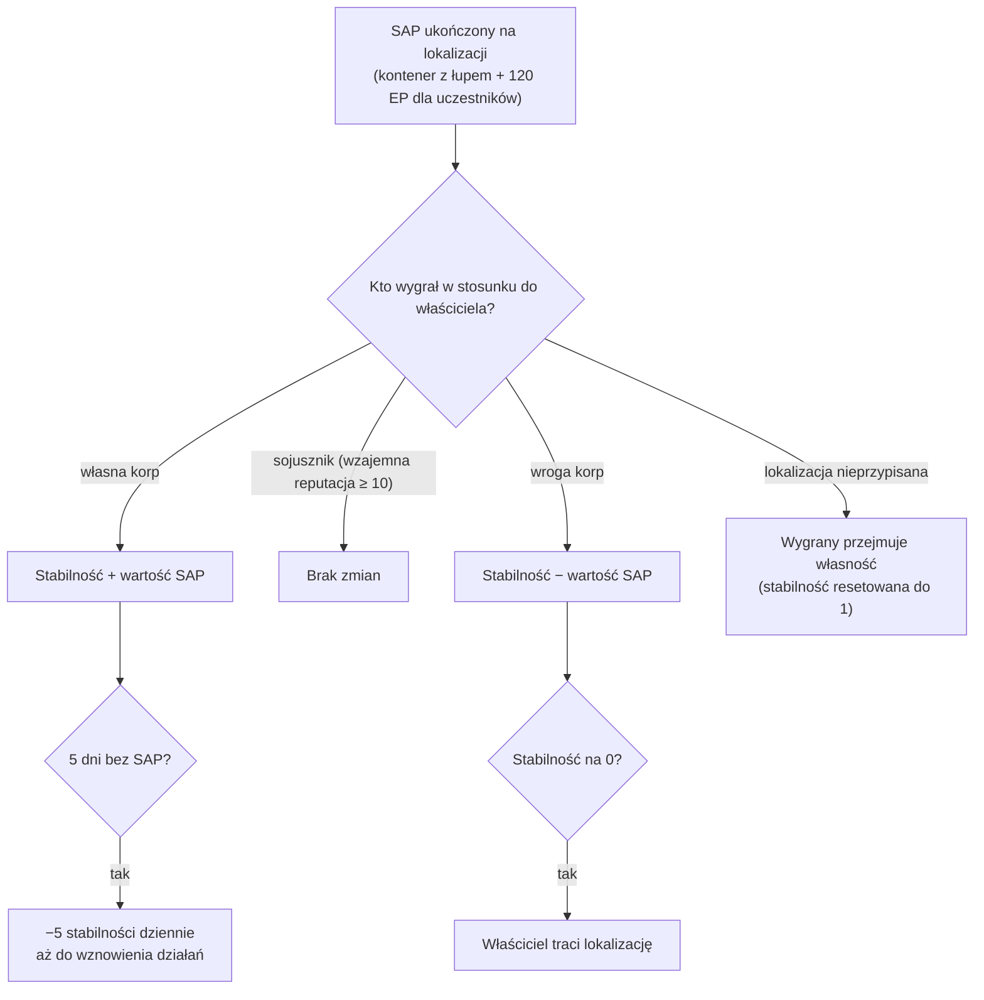

# Intruzja

**Intruzja** to tryb oparty na **lokalizacjach NPC** — lokalizacjach kontrolowanych przez graczy lub dostępnych do walki, wyposażonych w **stabilność**, **obronę** i **obiekty**. Inwestujesz przedmioty, wzmacniasz obronę i ulepszasz obiekty, aby przejąć kontrolę nad lokalizacją i czerpać z niej zyski.

> Nazwa trybu „intruzja" w grze powinna zostać potwierdzona. Lokalizacje w interfejsie opisano w
> [przeglądzie interfejsu klienta](/pl/features/ui/). Mechaniki poniżej zostały zweryfikowane na serwerze.

## Lokalizacje i stabilność

- **Informacje o lokalizacji** — szczegóły lokalizacji intruzji.
- **Stabilność** — kluczowy parametr lokalizacji, wartość od **0 do 150**. Nowy właściciel zaczyna od
  **1**. Stabilność determinuje wszystko:
  - **Progi bonusów** (content, `intrusionsitestabilitythreshold`): bonusy obiektów
    odblokowują się przy stabilności **20 / 60 / 80**; stos efektów aury (rdzeń intruzji,
    detekcja, geoskan, zbieracz, przemysłowy, maskowanie, górnictwo, naprawa, sygnały — każdy
    lvl1–3, plus połączone efekty lvl4) odblokowuje się w poziomach przy **10, 20, 40, 50, 70, 80 i
    100**; **prawa cumowania** odblokowują się przy **50**; limit węzłów obronnych rośnie przy **40**.
  - **Punkty produkcji** = `stabilność / 10` (maks. 15) — waluta służąca do ulepszania
    obiektów (jeden punkt na poziom).
  - **Degradacja**: jeśli przez **5 dni** nie zostanie ukończony żaden SAP, lokalizacja zaczyna tracić
    **5 stabilności dziennie**, dopóki nie podjęto ponownie działań.
  - **Utrata**: gdy stabilność spadnie do **0**, właściciel traci lokalizację (staje się
    nieprzypisaną).
- **Dziennik stabilności** — przegląd zmian stabilności lokalizacji.

### Kto zmienia stabilność

Zmiany stabilności wynikają z ukończonych **SAP-ów** (poniżej) oraz systemowej degradacji. Efekt
zależy od *tego, kto* wygrywa SAP w stosunku do obecnego właściciela:

- **Właściciel wygrywa** → stabilność **zyskuje** wartość SAP.
- **Sojusznik wygrywa** (wzajemna reputacja ≥ 10) → **brak zmian**.
- **Wroga korp wygrywa** → stabilność **traci** wartość SAP.
- **Lokalizacja nieprzypisana** → pierwszy wygrywający gracz/korp **przejmuje własność** (stabilność
  resetowana do 1).

## SAP-y (punkty ataku lokalizacji)

**SAP** to tymczasowy cel pojawiający się na lokalizacji. Jego ukończenie powoduje upuszczenie
**kontenera z łupem** w pozycji SAP, zmianę stabilności oraz wypłatę **120 EP** każdemu
uczestniczącemu postaci. **Kultyści NPC również rywalizują o SAP-y** — jeśli wypełnią wynik
pierwsi, SAP jest liczony przeciwko Twojej stronie. Istnieją cztery typy SAP:

| SAP | Sposób ukończenia | Wartość stabilności |
|---|---|---|
| **Aktywne hakowanie** | użycie modułu hakowania na SAP (do 120 użyci modułu) | +15 |
| **Pasywne hakowanie** | stanie w zasięgu 5 od SAP przez **8 minut** | +10 |
| **Zniszczenie** | zniszczenie SAP (obrażenia od NPC również się liczą) | +15 |
| **Przetwarzanie próbek** | dostarczenie **5–6 próbek SAP** (w partiach po 2–3, czas odnowienia 1,5 min, zasięg 7) | +15 |

- **Dostarczenie przedmiotu SAP** — w strefie, dostarczenie próbki do SAP przetwarzania próbek.
- **Informacje o przedmiocie SAP** — podgląd danych przedmiotu SAP (własnych i ogólnych).

Próbki SAP to przedmioty jednorazowego użytku w tym trybie; mają również dużą wartość rdzeniową,
więc pełnią podwójną rolę jako [paliwo reaktora PBS](/pl/features/pbs/).

## Obrona i efekty

- **Ustawienie progu obrony** — konfiguracja progu obrony lokalizacji (moment, w którym
  zautomatyzowana obrona lokalizacji zostaje aktywowana).
- **Ustawienie bonusu efektu** — ustawienie konfiguracji bonusu aury/efektu na lokalizacji (z
  zestawu aur odblokowanych przez stabilność).
- **Ulepszenie obiektu** — ulepszenie obiektu lokalizacji: kosztuje **1 punkt produkcji**
  (czyli 10 stabilności), wyłącznie CEO / zastępca / księgowy, z limitem maksymalnego poziomu.
- **Ustawienie wiadomości lokalizacji** — ustawienie publicznej wiadomości dla lokalizacji.

## Dzienniki

- **Mój dziennik intruzji** — Twoja aktywność w trybie intruzji.
- **Dziennik publiczny** — publiczny feed intruzji.
- **Dziennik moich lokalizacji** — aktywność na Twoich lokalizacjach.
- **Dziennik stabilności** — zmiany stabilności (patrz wyżej).

## Uwagi praktyczne

- **Stabilność to kluczowy parametr** — steruje poziomami bonusów, generuje walutę ulepszeń
  i to ją wrogie SAP-y odbierają.
- **SAP-y są rywalizowane** — kultyści NPC ścigają się z Tobą; przegrany SAP kosztuje Cię
  stabilność.
- **Nie zostawiaj lokalizacji bezczynnie** — 5 dni bez ukończonego SAP uruchamiają codzienną
  degradację.
- **Dzienniki opowiadają historię** — używaj dzienników (własny/publiczny/stabilności), aby
  śledzić, co dzieje się na Twoich lokalizacjach.

<!-- TODO: only the in-client name for "intrusion" and the UI remain.
     Confirmed: stability 0-150, start 1 (Outpost.cs constants); bonus thresholds from
     intrusionsitestabilitythreshold (facility 20/60/80; aura effects 50-74 at tiers
     10/20/40/50/70/80/100; docking rights 50; defense nodes 40); production points =
     stability/10, facility upgrade costs 1 point, CEO/Deputy/Accountant; decay -5/day
     after 5 days idle (OutpostDecay.cs); owner-win +, ally (standing>=10) 0,
     hostile -; unowned -> winner takes it; stability 0 -> ownership lost; 120 EP per
     SAP participant (EP_WINNER, EpForActivityType.Intrusion); 4 SAP types: active
     hacking (120 module uses, +15), passive (8 min in range 5, +10), destruction
     (kill it, +15), specimen processing (5-6 specimens in 2-3 batches, 1.5 min cd,
     range 7, +15; siegeitems table: def_specimen_sap_item 2-3); SAP increase values
     from entitydefaults #increase option; NPC sap guard/invade units contest SAPs.
     Developer notes: Intrusion/IntrusionSAPSubmitItem.cs (SpecimenProcessingSAP,
     zone submit), IntrusionSAPGetItemInfo.cs / IntrusionSapItemInfo.cs,
     IntrusionSetDefenseThreshold.cs, IntrusionSiteSetEffectBonus.cs,
     IntrusionUpgradeFacility.cs, SetIntrusionSiteMessage.cs; GetIntrusionSiteInfo.cs,
     GetIntrusionLog.cs / GetIntrusionPublicLog.cs / GetIntrusionMySitesLog.cs /
     GetIntrusionStabilityLog.cs, GetStabilityBonusThresholds.cs;
     EventProcessors/AffectOutpostStability.cs; Zones/Intrusion/Outpost.cs,
     OutpostDecay.cs, SAP.cs + *SAP.cs subclasses. -->