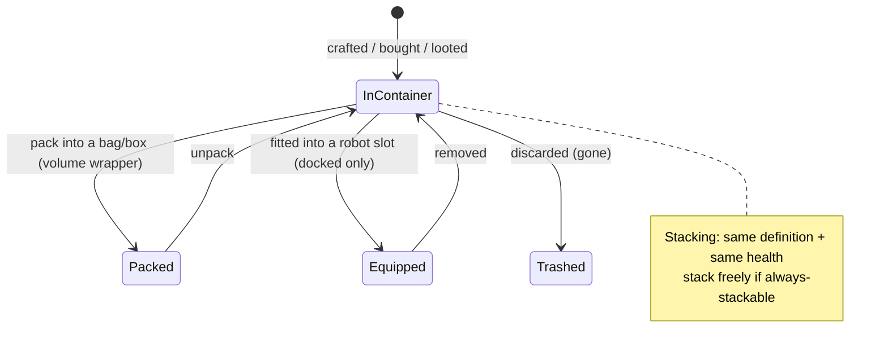

# Przedmioty i zapasy

Twoje **zapas** to zbiór **pojemników** (publiczny pojemnik bazy, pojemnik twojego robota, torby/skrynie itp.). Ta strona opisuje operacje na przedmiotach w ich wnętrzu.

> Lokalizacje w interfejsie użytkownika są opisane w [przeglądzie interfejsu klienta](/pl/features/ui/). Mechaniki poniżej zostały zweryfikowane na serwerze.

## Pojemniki

- **Wyświetl zawartość pojemnika** — podgląd jego zawartości.
- **Przenoszenie przedmiotów** — przenoszenie przedmiotów między pojemnikami, do których masz dostęp.

Obowiązują zasady dostępu: niektóre pojemniki (hangar korporacji, zapasy robota, pojemniki systemowe) są ograniczone — zobacz [roboty](/pl/features/robots/) i [grupy](/pl/features/groups/).

## Pakowanie i wypakowywanie

- **Pakowanie przedmiotów** — umieszczanie przedmiotów w torbie/skrzyni (pojemnik typu „opakowanie objętościowe") w celu kompaktowego przenoszenia.
- **Wypakowywanie przedmiotów** — wyjmowanie przedmiotów z torby/skrzyni.

Pakowanie to również sposób, w jaki **robot** jest kompaktowany do przechowywania/transportu: serwer usuwa jego stan dynamiczny i komponenty, a następnie oznacza go jako *repakowany*. Robota można zapakować wyłącznie wtedy, gdy jest **nieuszkodzony**, **niezaznaczony**, **nieubezpieczony** i ma **puste zapasy**. Wypakowywanie odtwarza robota i naprawia go. Tylko przedmioty oznaczone jako *możliwe do repakowania* w treści mogą być pakowane; repakowany robot nie może być zaznaczony ani wyposażony, dopóki nie zostanie wypakowany (zobacz [roboty](/pl/features/robots/)).

## Stosowanie

Wiele przedmiotów można łączyć w stosy. Operacje na stosach:

- **Łączenie w stos** / **dodaj do stosu** / **łącz zaznaczone** — łączenie przedmiotów tego samego typu w stos (lub przenoszenie stosu na inny).
- **Rozdziel ilość** — odłączenie określonej ilości od stosu.

Serwer łączy wyłącznie przedmioty o **tej samej definicji i tym samym stanie zdrowia**. Przedmioty oznaczone jako *zawsze stosowalne* (rudy, amunicja, większość surowców) łączą się swobodnie; przedmioty oznaczone jako *niestosowalne* nigdy się nie łączą; pozostałe mogą być łączone **wyłącznie w stanie repakowanym** (zapakowanym) — więc wypakowany, uszkodzony sprzęt pozostaje jako pojedyncze egzemplarze.

## Nadawanie nazw i używanie

- **Zmiana nazwy przedmiotu** — nadanie przedmiotowi niestandardowej nazwy.
- **Użycie przedmiotu** — aktywacja przedmiotu używalnego (zależne od kontekstu; w strefie może to również oznaczać interakcję z obiektami strefy — zobacz [zbieractwo](/pl/features/gathering/)).
- **Użycie przedmiotu losowego** — otwarcie/aktywacja przedmiotu typu loteryjnego.

## Usuwanie i zwrot

- **Usuwanie przedmiotów** — wyrzucenie przedmiotów (trwałe usunięcie).
- **Zwrot przedmiotu** — procedura zwrotu przez personel/administratora: tworzy przedmiot i przydziela go postaci, z zapisem w dzienniku transakcji. Gracze nie wywołują tej operacji bezpośrednio.

## Przedmioty specjalne

- **Kody wymienne** — lista, **wymiana** lub **aktywacja** przedmiotów wymiennych (kody/nadania).
- **Paczki prezentowe** — lista i **wymiana** paczek prezentowych (zestawy przedmiotów).
- **Otwarcie prezentu** — prezent zawiera jeden **losowy** przedmiot wylosowany z globalnej puli łupów serwera (amunicja, rudy surowe, plazma, zestawy badawcze, moduły, kapsuły, farby, boostery — 221 możliwe definicje, każda z własnym zakresem ilości).

## Uwagi praktyczne

- **Dostęp jest przypisany do pojemnika** — możesz manipulować wyłącznie pojemnikami, które posiadasz lub do których masz przyznany dostęp.
- **Pakuj, aby przenosić więcej** — torby/skrzynie pozwalają kompaktowo przenosić duże ilości przedmiotów.
- **Stosy oszczędzają miejsce** — łącz przedmioty tego samego typu; rozdzielaj stos, aby wyjąć dokładnie tyle, ile potrzebujesz.
- **Usuwanie jest trwałe** — usunięte przedmioty są bezpowrotnie utracone.
- **Kody wymienne/paczki prezentowe są jednorazowe** — wymiana zużywa kod/przedmiot.
- **Zapakowane roboty są nieaktywne** — wypakuj je przed zaznaczeniem lub wyposażeniem.
- **Tylko zapakowane przedmioty można łączyć w stosy** — jeśli przedmioty tego samego typu nie łączą się, najpierw je zapakuj (lub napraw).

<!-- TODO: only the inventory UI remains.
     Confirmed: stacking rules (Item.cs CanStackTo: same ED + same health; AttributeFlags
     alwaysStackable/nonStackable; others must be repackaged); pack rules (ItemPacker.cs:
     robot must be undamaged, not selected, not insured, empty inventory; repackable
     flag); unpack rebuilds + repairs (ItemUnpacker.cs); gifts = random draw from
     giftloots (221 defs: ammo x1500-2000, epriton/fluxore x600-1000, reactor plasma
     x10-20k, research kits, paints, capsules, named3 modules, boosters, respec tokens);
     goodie packs are campaign-based (GoodiePackRedeem: campaignID + indy selection);
     ReimburseItem = admin tool (opp_reimburselog). AttributeFlags bit positions:
     nonStackable=10, alwaysStackable=11, repackable, consumable=24, deployable=23.
     Developer notes: ListContainer.cs; RelocateItems.cs; PackItems.cs / UnpackItems.cs;
     StackTo.cs / StackSelection.cs / UnstackAmount.cs; SetItemName.cs; UseItem.cs /
     UseLotteryItem.cs; TrashItems.cs; ReimburseItem.cs (PbsReimburseRequestHander.cs);
     RedeemableItemList.cs / RedeemableItemRedeem.cs / RedeemableItemActivate.cs;
     GoodiePackList.cs / GoodiePackRedeem.cs; GiftOpen.cs. Container access:
     ContainerAccess / ContainerAccessChecker.cs. -->