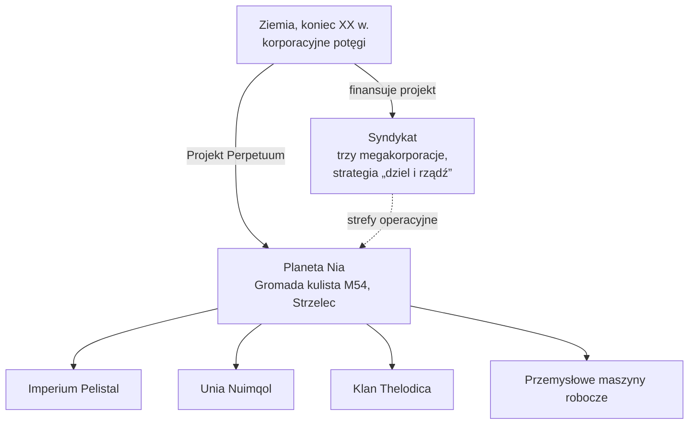

# Lore

## Odkrycie Nii

Boom technologiczny końca XX wieku na Ziemi — internet, integracja medycyny z IT, badania
kosmiczne — zburzył dawne granice fizyczne i mentalne. Komunikacja i handel stały się szybsze
oraz tańsze, a wielkie korporacje przekształciły się w faktyczne rządy swoich regionów.

W taki oto świat wkroczyło odkrycie **planety Nia** w gromadzie kulistej M54 w gwiazdozbiorze
Strzelca (będącej źródłem logo projektu). Nia krąży wokół jednej z pary gwiazd — jako czwarta
planeta tego układu podwójnego — i uderzająco przypomina Ziemię: średnia temperatura powierzchni
wynosi około 19 °C, a gęstość atmosfery jest zbliżona do ziemskiej. Dwie osobliwości wyróżniają
ją jednak spośród innych. Jej oceany stanowią nieprzebyte bariery dla czegokolwiek o napędzie
elektrycznym — gęste jądro planety i szybka rotacja utrzymują je w stanie naładowania — a ląd
stanowi jedynie około 17% powierzchni, który gwałtowna tektonika płyt nieustannie rozrywa
na wyspy. Na tym lądzie kwitnie życie.

## Nianie

Mieszkańcy Nii łamią potoczne pojęcie „formy życia”: to syntetyczny gatunek, przypominający
formą nasze roboty, lecz zorganizowany w odrębne, zaawansowane technologicznie **społeczności** —
każda z własnym przemysłem, wojskiem i kulturą. Osiągnięciem o kluczowym znaczeniu dla głodnej
energii Ziemi jest ich **technologia produkcji energii**.

Trzy obce rasy walczą o ostateczne zwycięstwo w łańcuchach wysp swoich domen — **Imperium
Pelistal**, **Unia Nuimqol** oraz **Klan Thelodica** — z rozproszoną **przemysłową** (Industrial)
populacją maszyn roboczych pomiędzy nimi (są to te same cztery grupy, które spotkasz jako
[NPC](/pl/features/npcs/)).

## Syndykat

Głównym inwestorem Projektu Perpetuum jest **Syndykat** — sojusz trzech najpotężniejszych
terriańskich megakorporacji, z których każda zarządza własną strefą operacyjną na powierzchni:

| Korporacja | Domena |
|---|---|
| **Truhold-Markson** | Północnoamerykański gigant przemysłu konsumenckiego; wkracza w podupadającą domenę **Pelistal**. |
| **ICS — Institute of Corporate Security** | Europejsko-rosyjskie stowarzyszenie; prowadzi operacje na zbuntowanym terytorium **Nuimqol**. |
| **Asintec** | Azjatycki hegemon przemysłowy z zaawansowanymi technologicznie sąsiadami; prowadzi pełnoskalową ofensywę przeciwko **Klanowi Thelodica**. |

Strategia to stara zasada *dziel i rządź*: utrzymywanie równowagi pomiędzy trzema strefami
sprawia, że obce potęgi walczą ze sobą, zamiast się zjednoczyć. Ludzcy „Agenci” operują
na powierzchni — wydobywając zasoby energetyczne Nian, badając ich technologię i pilnując
pokoju, którego pragnie Syndykat.

I w tym miejscu wkraczasz Ty.

<!--
Notatki deweloperskie: przepisane w 2026 r. oryginalną prozą z kanonicznego uniwersum.
Wcześniejsza wersja została zaadaptowana z wiki społeczności Open Perpetuum
(perpetuum.miraheze.org: Discovery of Nia, Nia, Syndicate); ten tekst został
całkowicie zastąpiony, nie użyty ponownie.
Spójność z backendem: trzy obce rasy + Industrial odpowiadają rasom NPC
(patrz /pl/features/npcs/); nazwy korporacji odpowiadają skrótom stref
(zone_ICS, zone_ASI, zone_TM — strefy poziomu beta w /zones/ są nazwane na cześć
swoich megakorporacji).
-->
