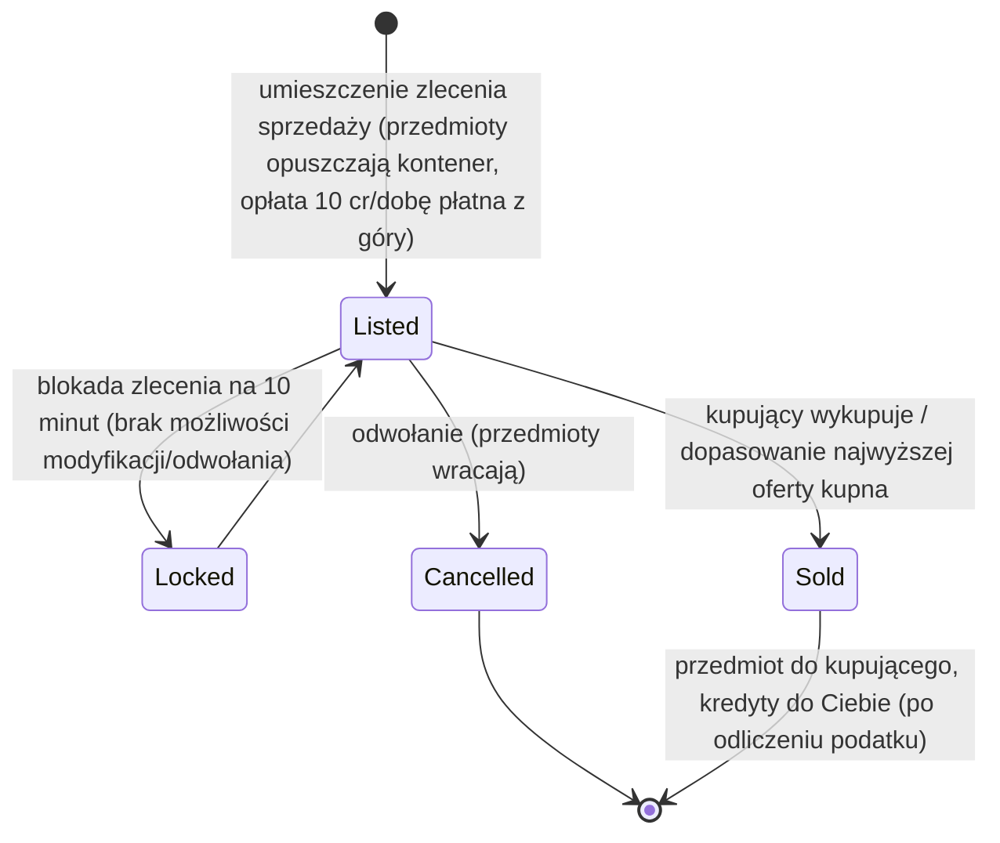

# Rynek i handel

**Rynek** to miejsce, w którym kupujesz i sprzedajesz przedmioty na bazie. Wszystkie operacje rynkowe są
**dostępne wyłącznie po dokowaniu** (handlujesz na bazie, do której jesteś dokowany).

> Lokalizacje w interfejsie użytkownika odpowiadają [przeglądowi interfejsu klienta](/pl/features/ui/) (kategoria **Rynek** na górnym
> pasku). Mechaniki poniżej zostały potwierdzone na serwerze.

## Zlecenia rynkowe

Umieszczasz dwa rodzaje zleceń na rynku bazy, do której jesteś dokowany:

### Zlecenia sprzedaży
Umieszczasz przedmioty na sprzedaż.
- Wybierz **przedmiot**, **ilość**, **cenę za sztukę** i **czas trwania** w dniach
  (minimum 1).
- Przedmiot jest pobierany z Twojego kontenera (rozbijany, jeśli sprzedajesz część stosu).
- **Opłata za wystawienie** — płacisz `10 kredytów × czas trwania` z góry (możliwe do zmniejszenia przez rozszerzenie *opłata transakcyjna rynku*); opłata trafia do centralnego banku bazy (pula zysków strefy).
- **Ochrona ceny** — gdy włączona, Twoja cena musi mieścić się w zakresie **±30%** od **średniej ceny 14-dniowej** przedmiotu; ceny poza tym zakresem są odrzucane. *(Ta ochrona jest obecnie **wyłączona** na tym serwerze.)*
- **Blokada zlecenia** — zlecenie nie może być zmodyfikowane ani odwołane przez **10 minut** po jego umieszczeniu.
- **Liczba zleceń** — możesz mieć otwarte 1 + (rozszerzenie *ekspert zleceń sprzedaży na rynku*) zlecenia sprzedaży (zlecenia kupna mają własny licznik).
- **Dla mojej korporacji** — możesz ograniczyć zlecenie sprzedaży do członków własnej korporacji (tylko dla korporacji innych niż domyślne).
- Płatność z **osobistego** lub **korporacyjnego** portfela, w zależności od sytuacji.

### Zlecenia kupna
Umieszczasz zlecenie stałe na zakup przedmiotu po określonej cenie.
- Rynek realizuje je, gdy pojawi się pasujące zlecenie sprzedaży.

### Zarządzanie zleceniami
- **Modyfikacja zlecenia** — zmiana ceny/ilości/czasu trwania.
- **Odwołanie przedmiotu / zlecenia** — wycofanie (przedmiot wraca do Twojego kontenera).
- **Moje przedmioty** — podgląd otwartych zleceń.
- **Dopasowanie najwyższej oferty kupna** — zlecenie sprzedaży może zostać skierowane do istniejącego zlecenia kupna.

## Bezpośredni zakup

- **Kup przedmiot** — natychmiast kup przedmiot dostępny na rynku (bez zlecenia stałego).

## Przeglądanie rynku

- **Lista przedmiotów / dostępne przedmioty / przedmioty w zasięgu** — przeglądaj, co jest na sprzedaż.
- **Informacje o rynku** — szczegóły dotyczące rynku bazy.
- **Średnie ceny** — średnia rynkowa, średnia per definicja i średnia **globalna**.
  To na ich podstawie działa ochrona ceny.

## Podatek rynkowy

- **Zmiana podatku rynkowego** — ustawienie stawki podatku na rynku. Tylko **rynki baz PBS**
  są kontrolowane przez graczy; wszędzie indziej obowiązuje stała domyślna stawka.
- **Dziennik podatkowy** — przegląd zmian podatkowych.

Podatek jest pobierany od kwoty, którą **sprzedający** otrzymuje przy sprzedaży na rynku. Domyślna stawka to
**12%** (sprzedający otrzymuje 88% ceny sprzedaży); stawkę można obniżyć przez rozszerzenie *podatek transakcyjny rynku* oraz, na rynkach kontrolowanych przez graczy, przez właściciela PBS ustawiającego
własną stawkę.

## Bezpośrednie wymiany między graczami

**Wymiana** to transakcja peer-to-peer między dwoma dokowanymi postaciami:

- **Rozpocznij wymianę** — rozpocznij sesję z innym graczem.
- **Ustaw / wycofaj moją ofertę** — umieść przedmioty/kredyty po swojej stronie.
- **Zaakceptuj** — obie strony akceptują, aby atomowo zakończyć wymianę.
- **Anuluj** — przerwij wymianę.
- **Wymiana zakończona / stan** — zakończenie i bieżący stan.

Postać może **zablokować wymiany** wobec siebie (zobacz [rozpoczęcie](/pl/features/getting-started/)).

## Sklep z przedmiotami

**Sklep z przedmiotami** to sprzedawca o stałych cenach na bazie (nie sterowany przez graczy). Pełny
katalog (każdy przedmiot, ilość, cena za walutę, wymagany standing) jest generowany w
[Sklep z przedmiotami](/content/shop/).

- **Lista** — zobacz, co sklep sprzedaje.
- **Kup** — kup przedmiot za kredyty.

## Przesyłanie kredytów

- **Prześlij kredyty** między własnymi postaciami (zobacz [rozpoczęcie](/pl/features/getting-started/)).

## Praktyczne uwagi

- **Wszystko jest dostępne wyłącznie po dokowaniu** — nie możesz handlować w strefie.
- **Uwzględnij 12% podatek w swoim cenotwórstwie** — sprzedający otrzymują domyślnie 88% ceny
  wystawionej (mniej na rynkach PBS z wysokim podatkiem).
- **Opłata za wystawienie jest płatna z góry** — długoterminowe wystawienie kosztuje więcej, nawet jeśli sprzedaje
  się w pierwszym dniu.
- **Zlecenia tylko dla korporacji** to sposób na przesuwanie towarów wewnątrz korporacji bez publicznej ekspozycji.
- **Wymiany są atomowe** — obie strony muszą zaakceptować, inaczej nic się nie przesuwa.
- **Zmiany podatku wpływają na efektywny koszt** — uwzględnij podatek rynkowy w swoim cenotwórstwie.

<!-- TODO: only the client UI remains (market and trade screen flows).
     Confirmed: MarketInfoService(0.3, 10, false) registered in
     PerpetuumBootstrapper.cs -> margin +-30% vs 14-day average (MARKET_AVERAGE_DAYSBACK
     14), fee 10 credits/day (Market.MARKET_FEE), CheckAveragePrice=false on this
     server; DEFAULT_MARKET_TAX = 0.12 (seller gets 88%), player-controlled tax only on
     PBSDockingBase markets (MarketTaxHelper); order modify/cancel locked 10 min after
     submit (MARKET_CANCEL_TIME); order count = 1 + expert extension bonus;
     fee paid up front to the base's central bank. -->
     Developer notes: Markets/MarketCreateSellOrder.cs (docked, price guard vs average
     price, corp-only, unstack, corp wallet), MarketCreateBuyOrder.cs,
     MarketModifyOrder.cs, MarketCancelItem.cs, MarketBuyItem.cs, MarketItemList.cs,
     MarketAvailableItems.cs, MarketItemsInRange.cs, MarketGetMyItems.cs,
     MarketGetAveragePrices.cs / MarketGetDefinitionAveragePrice.cs /
     MarketGlobalAveragePrices.cs, MarketTaxChange.cs / MarketTaxLogList.cs;
     Trade*.cs (begin/offer/accept/cancel, atomic); ItemShopList.cs / ItemShopBuy.cs;
     CharacterTransferCredit.cs. -->