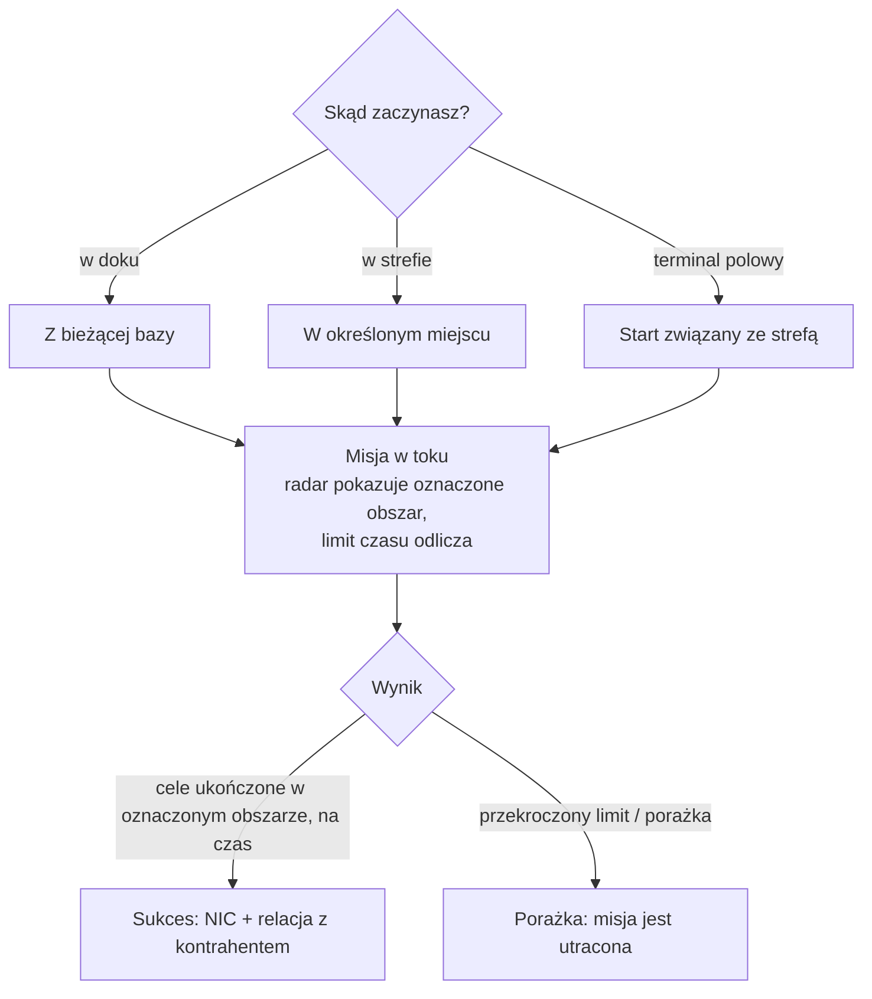

# Misje

**Misje** to ustrukturyzowane cele, które podejmujesz w strefie — dostarczasz przedmioty, trafiasz cele,
używasz struktur. To dzięki nim postępujesz, zdobywasz nagrody i napędzasz dużą część treści strefowych
(alarmy, kioski oraz niektóre haki PBS/transportowe są związane z misjami).

> Lokalizacje w interfejsie użytkownika są opisane w [przeglądzie interfejsu klienta](/pl/features/ui/). Mechaniki poniżej
> zostały zweryfikowane na serwerze.

## Rozpoczynanie misji

Misję rozpoczynasz, wybierając **kategorię** i **poziom** (poziomy są ograniczane do
ważnego zakresu), w **lokalizacji**:

- Jeśli jesteś **w doku**, misja startuje z lokalizacji Twojej bieżącej bazy.
- Jeśli jesteś **w strefie**, określasz lokalizację jawnie.
- Misje mogą również startować **bezpośrednio ze strefy** (start związany ze strefą) lub **z terminala
  polowego**.

Nie każda kategoria/poziom jest dostępna wszędzie — dostępność jest sterowana treścią.
Pełna lista misji (typ, kategoria, poziom, czas trwania, opłata nagrody i przedmioty nagrody)
jest generowana w [Misje](/content/missions/).

## Po co są misje

Misje służą jednocześnie dwóm celom: płacą NIC i budują Twoją **relację**
z wydającą (kontrahentem) korporacją. Lepsza relacja jest kluczowym czynnikiem
uzyskania **wyższego współczynnika obiektu** na terminalach tej korporacji — produkcja
i inne operacje obiektowe stają się dla Ciebie tańsze i szybsze. Relacje mogą też *spadać*: niektóre
misje kolidują z interesami innej korporacji, a notatka informuje, kiedy
będzie to kosztować Cię pozycji.

- **Misje treningowe** — łatwe, wyróżnione dla początkujących; wykonaj wszystkie, nagrody
  to miła wczesna zastrzyk.
- **Misje regularne** występują w trzech wariantach:
  - *Bojowe* — rozpoznanie (skanowanie wrogich robotów), łowienie nagród (eliminacja celów w oznaczonym
    okręgu), niszczenie i odzyskiwanie (eliminacja + odzyskanie + dostarczenie), rozpoznanie i odzyskiwanie, specjalne
    nagrody (trudnodostępne cele).
  - *Przemysłowe* — geologia (skanowanie minerału o odpowiednim ładunku), zbieranie, eksploatacja minerałów,
    zaawansowana eksploatacja (strzeżone miejsca wydobycia — weź uzbrojone wsparcie).
  - *Logistyczne* — transport (dostarczenie paczki między terminalami) i odbiór
    (duża paczka przez niebezpieczny teren — eskortuj ją).
- **Nie ma czegoś takiego jak bezpieczna misja**: jeśli widzisz wrogów na trasie i
  nie masz sprzętu do obrony, poproś o pomoc, zanim stracisz wszystko po drodze.
- **Cele liczą się tylko w oznaczonym obszarze** — mapa misji oznacza go
    czerwonym okręgiem na radarze; eliminacje i skany gdzie indziej nic nie wnoszą. Przekroczysz limit czasu,
    a misja natychmiast się nie powiedzie.
- **Prywatne kontrakty transportowe** — system prowadzony przez Syndykat (druga karta okna
  misji), w którym gracze publikują kontenery do przewozu między terminalami przez innych graczy,
  z określoną nagrodą i **wadiem**, które przewoźnik stawia (zwracane przy sukcesie, tracone, jeśli
  kontener zostanie zniszczony; przerwanie w połowie zwraca tylko połowę). Trzymaj kontenery
  na tyle małe, żeby ktoś mógł je faktycznie przenieść.

## Dane i opcje misji

- **Dane misji** — szczegóły misji.
- **Opcje misji** — dostępne wybory/warianty dla misji.
- **Zaopatrzenie misji** — zaopatrzenie, którego wymaga misja.
- **Przedmioty startowe** — przedmioty, z którymi misja się rozpoczyna.

## Prowadzenie misji

- **Lista aktywnych misji** — co aktualnie robisz.
- **Przerwanie** — anulowanie misji, którą prowadzisz.
- **Dodanie uczestnika** — włączenie innego bohatera do misji (misje wieloosobowe).
- **Dziennik misji** — dziennik zdarzeń misji.

## Dostawa

- **Dostarczenie** — ukończenie celu dostawy. Można to zrobić **w doku** (w bazie) lub
  **w strefie** (w określonym miejscu/eid), w zależności od misji.

## Agenci

- **Lista agentów** — dostępni agenci misji (NPC/fakcje wydające misje).

## Terminale polowe

- **Informacje o terminalu polowym** — inspekcja terminala polowego w strefie (struktura, która może
  rozpoczynać lub obsługiwać misje).

## Uwagi praktyczne

- **Misje to tkanka łącząca** — alarmy, kioski i niektóre struktury
  są obiektami misyjnymi (zobacz [zbieranie](/pl/features/gathering/) i [walka](/pl/features/combat/)).
- **Wieloosobowość** — możesz dodawać uczestników, aby współpracować przy misji.
- **Kontekst dostawy ma znaczenie** — niektóre dostawy wymagają bycia w doku, inne wymagają
  bycia w lokalizacji strefy.
- **Poziom jest ograniczany** — żądanie poziomu poza zakresem jest korygowane, nie jest błędem.
- **Przerwanie to Twoje wyjście** — jeśli misja idzie źle, przerwij ją.

## Struktury misyjne

Misje są zakotwiczone w strefach przez **struktury**. Serwer implementuje te typy:

| Struktura | Co robi |
|---|---|
| **Prosty przełącznik** | natychmiastowa interakcja — zbliż się i cel misji zostaje ukończony |
| **Przełącznik alarmowy** | zadanie z limitem czasu — pozostań w zasięgu przez określony czas (z opcji misji), sprawdzane co 2 s |
| **Dostawa przedmiotów** | z limitem czasu jak przełącznik alarmowy, następnie **generuje przedmioty do kontenera Twojego robota** |
| **Kiosk** | punkt **składania przedmiotów** — oddaj misji wymagane przedmioty |

<!-- TODO: the full mission list, categories, level ranges and rewards are generated at
     /content/missions/. Verified: mission structure types
     (MissionEngine/MissionStructures: SimpleSwitch, AlarmSwitch, ItemSupply, Kiosk);
     verify the mission UI.
     Developer notes: Missions/MissionStart.cs (category, level clamp, docked vs zone
     location), Missions/MissionDeliver.cs (docked vs zone delivery), MissionAbort.cs,
     MissionData.cs / MissionGetOptions.cs / MissionGetSupply.cs / MissionStartItems.cs,
     MissionListRunning.cs / MissionListAgents.cs / MissionLogList.cs,
     MissionPlayerAddsParticipant.cs, FieldTerminalInfo.cs, MissionStartFromZone.cs;
     Services/MissionEngine/* (MissionProcessor, mission structures incl. AlarmSwitch,
     Kiosk). -->