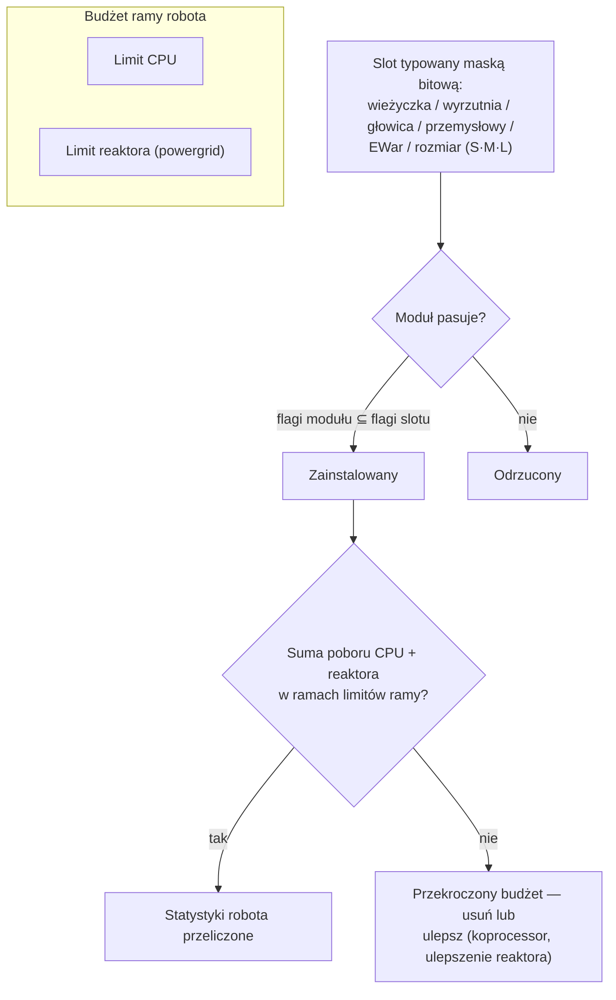

# Moduły i konfiguracja

„Kupno robota daje Ci tylko kadłub." Dopiero wyposażenie go w moduły sprawia, że robot staje się tym, czego potrzebujesz. *Konfiguracja* oznacza zarówno zestaw modułów („wyślij mi swoją konfigurację"), jak i budżet CPU/reaktora, który pochłania.

## Sloty i zasoby

Rama robota ma stały zestaw **slotów** zdefiniowany przez kadłub. Każdy slot jest typowany maską bitową — wieżyczka, wyrzutnia rakietowa, głowica, przemysłowy, EWar/inżynieryjny, rozmiar (mały / średni / duży) — a moduł pasuje do slotu tylko wtedy, gdy jego własna maska typu jest podzbiorem maski slotu. Wieżyczka na casterze przyjmuje więc małe, średnie *lub* duże moduły wieżyczkowe, ale żadna wyrzutnia rakietowa nie trafi do slotu wieżyczki. Moduły głowicowe (koprocessory, moduły strojenia) oraz moduły kadłuba/nóg (płyty, ramy) zajmują własne dedykowane sloty.

Każdy moduł pobiera **CPU** i **reaktor** (powergrid) z ramy — suma wszystkiego, co zainstalowane, musi mieścić się w obu limitach, a niektóre moduły pobierają również **akumulator** (core) w każdym cyklu. Pozostała pojemność to *dostępna moc wyjściowa* wyświetlana w oknie konfiguracji. Przybliżona skala kadłubów (przykłady T1/T2/T3):

| Klasa ramy | CPU | Reaktor | Przykład |
|---|---:|---:|---|
| Mały crawler | ~250 | ~140 | Castel |
| Lekki mech | ~480 | ~300 | Waspish |
| Ciężki mech | ~1 100 | ~1 000 | Tyrannos |
| Walker | ~3 200+ | ~1 100+ | Gropho |

Gdy brakuje Ci pojemności: **CPU** — moduły koprocessorowe (np. koprocessor T3 daje +20% CPU) lub warianty modułów T2 (niższy pobór). **Reaktor** — ulepszenia reaktora (np. T3 daje +20% mocy wyjściowej reaktora) lub uszczelnianie reaktora (obniża promieniowanie, co chroni również przed EnWar — patrz niżej).

## Rodziny modułów

Dane per model znajdują się w [katalogu przedmiotów](/content/) i [referencji formatów](/pl/formats/); poniżej mapa rodzin.

### Broń i amunicja

Cztery technologie broni, każda z własną amunicją i profilem dystansu:

| Broń | Amunicja | Profil dystansu | Uwagi |
|---|---|---|---|
| **Broń palna** | Kulki | Krótki dystans optymalny, ogromny spadek | Pociski, które *nigdy nie chybiają* — ale ich „celność" działa jako promień obszaru, więc małe cele wciąż otrzymują zmniejszone obrażenia od szerokich strzałów. |
| **Magnetyczna (railguny)** | Pociski | Średni dystans, ostry spadek | Wysoka prędkość uderzenia; duże zużycie energii. |
| **Lazery** | Komórki energetyczne | Długi dystans | Największe zużycie energii; skoncentrowane wiązki. |
| **Rakiety** | Rakiety | Długi dystans | Trafienie lub pudło decyduje statystyka szansy trafienia *robota*, a nie dystans. Obrażenia skalują się z rozmiarem celu względem promienia wybuchu — duże rakiety na małych celach zadają znacznie mniej obrażeń. |

Obrażenia spadają z dystansem po gładkiej krzywej cosinusowej: pełne obrażenia na dystansie optymalnym, zero na dystansie optymalnym + spadek (patrz [spadek obrażeń](/pl/features/combat/#typy-obrazen)).

Amunicja to miejsce, w którym stroisz obrażenia: typy obrażeń podstawowych i wtórnych pozwalają na precyzyjne dopasowanie do celu (patrz [typy obrażeń](/pl/features/combat/#typy-obrazen)) — za ceną niewielkiego zmniejszenia całkowitych obrażeń w porównaniu z amunicją czysto podstawową.

Wieżyczki występują w rozmiarach mały/średni/duży; **dopasuj rozmiar do robota** (małe boty używają małych modułów, mechy i ciężkie jednostki — średnich/dużych).

### Obrona

- **Płyty pancerne** — główny pulpit punktów życia; gdy pancerz spada do zera, robot eksploduje. Płyty **LWF** (lightweight frame) wymieniają trwałość na prędkość: płyta T2 LWF mnoży pancerz przez ~0,73, ale daje +19% prędkości, −0,2 sygnatury i −0,2 masy.
- **Generator tarczy** — bariera zasilana akumulatorem, która pochłania obrażenia przed pancerzem. Tarcza zużywa *własny core* do pochłaniania: trafienie, które zadałoby 100 obrażeń na tarczy 2×, pobiera 50 core zamiast 100 pancerza. Podczas aktywnej tarczy własna broń nie może strzelać. Jakość pochłaniania skaluje się z promieniem tarczy względem sygnatury — duże tarcze na małych ramach działają najlepiej.
- **Naprawa pancerza** — aktywne moduły naprawcze (mały/średni/duży); **zdalna naprawa pancerza** sięga zablokowanego celu (sojusznicy lub PBS), ale ma krótki zasięg i dłuższy cykl.
- **Wzmacniacze pancerza** — bierne punkty oporu per typ obrażeń (warianty chemiczny / kinetyczny / termiczny / wybuchowy).
- **Adaptacyjny stop** — bierne moduł, który *uczy się* mieszanki obrażeń, które przyjmuje, i redystrybuuje stały pulpit punktów oporu w stronę tego, czym trafiasz najczęściej.
- **Uniki / manewrowanie** — moduły redukcji sygnatury i NEXUS (poniżej) zmniejszają cel: mniej obrażeń od efektów obszarowych i trudniejsze zablokowanie.

### Energia

- **Reaktor** — limit mocy ciągłej; ulepszenia reaktora go podnoszą, uszczelnianie reaktora obniża promieniowanie (mniejsze obrażenia od EnWar, za niewielki koszt reaktora).
- **Akumulator (core)** — zapas energii impulsowej zasilającej cykle modułów. Ładuje się z czasem (chassis `core_recharge_time`, ~120 ms na crawlerze T1); **ładowarki akumulatora** przyspieszają ładowanie.
- **Injektory energii (boostery core)** — zużywają ładunek, aby natychmiast uzupełnić akumulator.
- **Transferatory energii** — przekazują core z Twojego robota do zablokowanego sojusznika (gracze nie mogą przekazywać NPC-om).

### Elektronika

- **Wzmacniacz czujników** — bierne, własne: skraca czas blokady i wydłuża zasięg blokady.
- **Zdalny wzmacniacz czujników** — aktywne, cel: ten sam boost zastosowany do zablokowanego sojusznika przez ~10,5 s.
- **Koprocessory** — podnoszą limit CPU ramy (T1 +10% … T3 +20%).
- **Stabilizatory broni** — poprawiają celność broni (mniejszy efektywny promień obszaru) i nieco zmniejszają masę.
- **Moduły strojenia** (sloty głowicowe) — płaskie bonusy do konkretnych rodzin: modyfikatory obrażeń (+25% obrażeń per rodzina broni na T3), ulepszenia wydobywcze (+10% wydobywania i zbierania na T3), ulepszenia naprawiaczy pancerza (+16% naprawy, −8% cyklu na T3).

### Wojna elektroniczna (EWar)

Oślepij i ogłusz wroga:

- **Tłumik czujników** — debuff na dystans: wydłuża czas blokady celu i skraca jego zasięg blokady na ~5,5 s. Trafia tylko wtedy, gdy Twoja siła ECM przewyższa (zrandomowaną) siłę czujników celu.
- **Jammer czujników** — natychmiastowe: resetuje *wszystkie* blokady celu przy udanym teście ECM.
- **ECCM** — buff własny na 20 s: podnosi siłę czujników i odporność na blokadę oraz *leczy* debuffy podatne na ECM (tłumiki, sieci).
- **Neuralyzer** — resetuje blokady **wszystkich** graczy w promieniu ~1,65 km. Przycisk paniki.

Kontrgra: siła czujników (kadłub), ECCM i utrzymywanie dystansu.

### Ukrywanie i detekcja

- **Moduł ukrywania** — ~10,5 s niewidzialności; zużycie skaluje się z promieniem sygnatury (większa rama, szybsze spalanie core).
- **Malownik celu** — debuff ~10,5 s, który odbiera celowi siłę ukrywania.
- **Moduł detekcji** — bierne wzmocnienie Twojej siły detekcji.

Siła detekcji vs. siła ukrywania decyduje, czy w ogóle możesz zobaczyć (i zablokować) ukryty cel — patrz [detekcja i maskowanie](/pl/features/combat/#detekcja-maskowanie-i-predkosc).

### Wojna energetyczna (EnWar)

Odbieraj lub odcinaj energię wroga:

- **Odbieracze (wampiry energetyczne)** — wyciągają core z zablokowanego celu i dodają go do własnego akumulatora.
- **Neutralizatory** — to samo, ale wyciągnięty core jest niszczony.
- Oba są osłabiane przez **promieniowanie reaktora** celu — uszczelnianie to realny kontr.
- **Demobilizatory (sieci)** — ~5,5 s redukcji prędkości celu; efekt skaluje się z masą celu (ciężkie ramy są spowalniane mniej) i nie działa na celach poza optymalnym zasięgiem modułu.
- **Scorcher** — broń elektryczna, która *przeskakuje* do 5 celów, trafiając tarcze i pancerz przenikającymi obrażeniami.

### Przemysłowe

- **Wiertła** (małe / duże) i **zbieracze** (małe / duże) — moduły zbierania; wydajność, czas cyklu i zużycie akumulatora to kluczowe statystyki. Wydobycie daje EP (z dziennym limitem i karą za płyn).
- **Geoskaner** — skanuje pole mineralne wokół Ciebie z dokładnością sondy; wynikiem jest mapa tego, co znajduje się pod ziemią (patrz [zbieranie](/pl/features/gathering/)).
- **Ekscawator** — moduł aury: zwiększa wydajność wydobywania/zbierania pobliskich jednostek (T3: +50%) za cenę ukrywania.
- **Terraformowanie** (strefy gamma) — blokady terenu, które podnoszą, obniżają lub wyrównują grunt (maks. promień 5 m) i rosną rośliny ścienne; patrz [sekcja stref](/zones/zone-gamma-z106/).
- **Zdalne kontrolery** — wieżyczki i drony na smyczy: każdy moduł kontrolera ma przepustowość (ile jednostek), zasięg operacyjny i czas życia drona (5–10 min w zależności od tieru). Warianty: taktyczny (obrażenia/cykl), szturmowy (obrażenia), wsparcia (zdalna naprawa), przemysłowy (drony wydobywcze/zbierające), myśliwski. Moduł **zdalnego tłumacza komend** wzmacnia obrażenia dronów, pancerz, wydajność wydobywania i output napraw (T3: +7,5% każde) i może rozszerzyć przepustowość kontrolera.

### NEXUS

Networked Extension Utilization Systems: **buffy drużynowe**. Moduł NEXUS emituje aurę wokół własnego robota, która buffuje **członków gangu** (i ich wieżyczki/drony) w promieniu aury — domyślnie 10 m, odnawialna co 10 s. Zasady:

- robot może nosić co najwyżej **3 aury NEXUS** i co najwyżej **jedną każdego typu**;
- aura sięga tylko jednostek w Twoim **gangu**, nie losowych sojuszników.

Lista typów T3 (13): prędkość, pancerz, tarcza, daleka blokada (zasięg blokady), booster blokady (czas blokady), trafienie krytyczne, szturm (cykl broni), EW (zasięg EWar), uniki (sygnatura), naprawiacz, przemysłowy (zużycie akumulatora podczas zbierania), szybki ekstraktor (cykl zbierania), ładowarka (ładowanie core). Każdy moduł T3 daje około +7,5% swojej statystyki; np. NEXUS prędkości mnoży maksymalną prędkość przez 1,075 dla każdego towarzysza gangu stojącego w promieniu 10 m.

### NOX

Kontry klasy kultystycznej: moduły **negatora**, które *wyłączają* wrogie moduły w swoim promieniu — **negator tarczy** (obniża pochłanianie tarczy o ~90%), **negator napraw** (obniża output napraw) i **negator teleportacji** (blokuje teleportowanie). Każde użycie **zużywa plazmę** z Twojego ładunku, a użycie w otwartej (nietreninkowej) strefie **flaguje Twoją postać pod PvP**.

### Specjalne

- **Moduł hacku oblężniczego** — narzędzie aktywnego SAP: cykl 5 s, zasięg 3 m (patrz [bazy](/pl/features/outposts/)).
- **Samozniszczenie** — uruchamia 8-sekundowy odliczanie; wiązka jest widoczna z 600 m. Ostateczność.
- **Detektor min** — wydłuża zasięg detekcji min ramy.
- **Emisery blobów** — wdrażają emiter rozprzestrzeniający pole blobów; moduł modyfikatora emisji stroi pole (patrz [walka](/pl/features/combat/)).
- **Budowa PBS** — moduł używany do stawiania struktur PBS na strefach gamma.

## Zasady ogólne

1. **Nie mieszaj broni.** Magnetyczna + laser + rakiety na jednym botie zwykle wypadają gorzej niż każda z osobna; mieszanie krótkiego i długiego dystansu rzadko kończy się dobrze.
2. **Uważaj na masę.** Każda płyta i moduł tarczy dodaje masę i sygnaturę — czasem prędkość jest ważniejsza niż obrona.
3. **Nie rób wszystkiego.** Bot, który wydobywa, skanuje i strzela, nie robi żadnej z tych rzeczy tak dobrze jak specjalista.
4. **Dopasuj rozmiar modułów** do robota i zostaw trochę CPU/reaktora na moduły strojenia, które sprawiają, że build faktycznie działa.
5. …i tak, niektóre niszowe konfiguracje łamią wszystkie powyższe zasady i nadal działają. Po prostu wnieś w to trochę myślenia.

<!--
Notatki developerskie: przepisane w 2026 r. z źródeł backendowych; nie użyto tekstu z wiki społeczności.
Zweryfikowano z:
- src/Perpetuum/Robots/RobotComponent.cs (konfiguracja maski bitowej slotów: moduleFlagMask & slotFlagMask)
- src/Perpetuum/Modules/SlotFlags.cs (12 bitów flag slotów)
- src/Perpetuum/Modules/Weapons/WeaponModule.cs + FirearmWeaponModule.cs +
  MissileWeaponModule.cs (celność: broń palna nigdy nie chybia, promień wybuchu z
  Accuracy; rakiety używają ParentRobot.MissileHitChance)
- src/Perpetuum/Modules/Weapons/Damage.cs (spadek cosinusowy, krytyczne 1,75x +/-10%,
  skalowanie wybuchu signature/explosionRadius ograniczone do [0,1])
- src/Perpetuum/Units/Unit.cs GetResistByDamageType (resist/(resist+100))
- src/Perpetuum/Zones/DamageProcessors/DamageProcessor.cs (tarcza pobiera core,
  elektryczne = przenikające)
- src/Perpetuum/Modules/EffectModules/ShieldGeneratorModule.cs (modyfikator
  pochłaniania = stosunek promienia tarczy / shieldAbsorbtion; WeaponModule.cs:112 blokuje
  strzelanie podczas HasShieldEffect)
- src/Perpetuum/Modules/EffectModules/{Webber,SensorDampener,SensorBooster,
  Stealth,TargetPainter,Eccm,Detection,AdaptiveAlloy}.cs (czasy trwania z
  tabeli efektów: tłumik/sieć 5,5 s, ukrywanie/malowanie/zdalny-boost 10,5 s, ECCM 20 s)
- src/Perpetuum/Modules/SensorJammerModule.cs + Neuralyzer.cs (reset blokad,
  NEURALYZER_RANGE=1650)
- src/Perpetuum/Modules/{EnergyVampire,EnergyNeutralizer,Scorcher,
  CoreBooster,EnergyTransferer}.cs (EnWar, modyfikator promieniowania reaktora, łańcuch)
- src/Perpetuum/Modules/GangModule.cs + Zones/Effects/GangEffect.cs +
  EntitiesModule.cs:532-544 (13 typów aur, tylko członkowie gangu, tabela efektów
  auraradius=10)
- src/Perpetuum/Modules/NoxModule.cs (zużycie plazmy, flaga PvP)
- src/Perpetuum/Modules/RemoteControl/* (przepustowość/zasięg/czas życia, amplifikacja
  tłumacza)
- wiersze entitydefaults: nazwane1-3 płyty pancerne/wzmacniacze, generatory tarcz
  (absorbtion 2,0-2,3, radius 5-33), LWF (mass_reductor), ulepszenia cpu/powergrid,
  strojenie obrażeń/wydobywania/naprawiaczy, wartości NEXUS named3, wartości NOX kultystyczne,
  hack oblężniczy (5 s/3 m), chassis core_max/powergrid_max.
Poprawki względem zaimportowanej strony: aury NEXUS sięgają tylko członków gangu (nie „wszystkich
przyjaznych jednostek"); nie istnieje moduł „współreaktora" (ulepszenia/uszczelnianie reaktora
to robią); efekt demobilizatora skaluje się z masą celu, nie ma „statystyki odporności";
supresor czujników = tłumik czujników (debuff 5,5 s).
-->