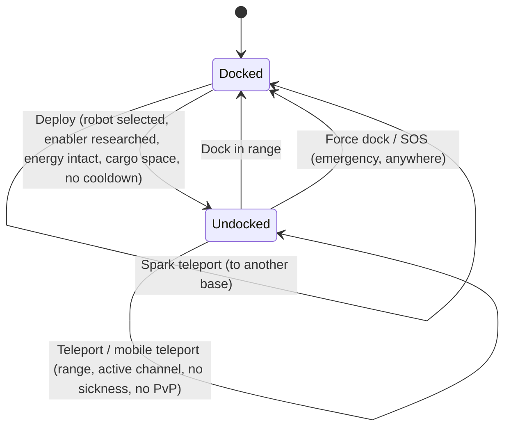

# Ruch i strefy

Zawsze jesteś w jednym z dwóch stanów: **zdokowany** w bazie lub **poza dokiem** w strefie,
sterując aktywnym robotem zdalnie. Wszystko na tej stronie dotyczy przechodzenia między tymi
stanami oraz między strefami.

> Lokalizacje w interfejsie zgodne z [przeglądem interfejsu klienta](/pl/features/ui/): **przycisk
> Rozpocznij/Dokuj** to przełącznik w centralnej części górnej belki. Mechaniki poniżej zostały
> potwierdzone na serwerze.

## Zdokowany vs. poza dokiem

- **Zdokowany** — jesteś w bazie. Twoje roboty i przedmioty znajdują się w kontenerach. Nie możesz
  sterować robotem, używać teleportów ani skanować, ale możesz wytwarzać, handlować, prowadzić
  badania i korzystać z udogodnień bazy.
- **Poza dokiem** — jesteś w strefie, sterując aktywnym robotem. Możesz się poruszać, skanować,
  walczyć i
  wchodzić w interakcje z obiektami strefy, ale większość aktywności dostępnych wyłącznie w bazie
  jest zablokowana.

## Opuszczanie doku

Naciśnij **Rozpocznij** (środek górnej belki). Serwer sprawdza wówczas wszystkie poniższe warunki:

1. Masz **wybranego aktywnego robota**.
2. Klasa tego robota ma wymagane **rozszerzenie włączające** opracowane na Twoim
   postaci (zobacz [badania](/pl/features/research/)).
3. **System energetyczny** robota jest sprawny.
4. **Kontener** robota ma wolną pojemność.
5. Nie jesteś w okresie **cooldownu opuszczania doku** (krótki timer po określonych zdarzeniach).

Jeśli którykolwiek warunek nie jest spełniony, opuszczenie doku zostanie odrzucone.

## Powrót do doku

- **Dokuj** w bazie, gdy znajdujesz się w jej zasięgu dokowania.
- **Przymusowe dokowanie** to akcja awaryjna: wyciąga Cię ze strefy i natychmiast dokuje w
  bazie głównej (TMA), nawet w trakcie walki. Używaj jej, gdy przegrywasz potyczkę.
- **SOS** — strefowa akcja pomocy, która dokuje Cię w bieżącej bazie i oznacza incydent.

## Kolejka wejściowa do strefy

Niektóre strefy są obłożone i korzystają z **kolejki wejściowej** przy opuszczaniu doku /
wejściu:

- Sprawdź stan kolejki (`zoneGetQueueInfo`).
- Ustaw preferowaną długość kolejki (`zoneSetQueueLength`).
- Anuluj oczekiwanie, jeśli zmieniłeś zdanie (`zoneCancelEnterQueue`).

## Teleporty

**Teleporty** to struktury wewnątrz strefy. Aby z nich skorzystać:

- Musisz znajdować się **w zasięgu teleportu**.
- **Kanał** (miejscowość docelowa) musi być **aktywny** i ważny.
- Nie możesz być pod wpływem *zmęczenia teleportem* — krótkiego cooldownu po każdym teleporcie,
  w trakcie którego nie możesz teleportować się ponownie.
- Określone efekty (np. negacja *Nox*) lub bycie **w walce PvP** mogą blokować teleporty.

Kanały teleportów występują w trzech rodzajach:

| Typ | Efekt |
|---|---|
| **W obrębie strefy** | Przenosi Cię w losowy punkt tej samej strefy |
| **Inna strefa** | Przenosi Cię w losowy punkt innej strefy |
| **Wyjście z treningu** | Wychodzi ze strefy treningowej (z opcją poziomu nagrody) |

**Teleporty mobilne** to *własne* przedmioty teleportacyjne (np. mobilne teleporty do twierdzy /
świata).
Obowiązują dodatkowe zasady:

- Może z nich korzystać wyłącznie **właściciel lub członek gangu właściciela**.
- **Nie można ich używać podczas PvP**.
- Każde użycie nakłada **cooldown** na dany teleport.

Możesz przeglądać listę teleportów i ich kanałów oraz zapytać o kanały w skali całego świata.

## Teleporty iskrowe

**Teleporty iskrowe** to system szybkiej podróży między bazami:

- **Ustawiasz** miejsce docelowe teleportu iskrowego w jednej bazie, a następnie **używasz** go
  (być zdokowanym), aby natychmiast przeskoczyć do innej bazy.
- Możesz **przeglądać, ustawiać, używać i usuwać** swoje teleporty iskrowe.
- Baza docelowa musi **pozwalać Ci na dokowanie**.
- Po przybyciu serwer wybiera odpowiedniego robota (takiego, którego rozszerzenia włączające
  opracowałeś).
- **Liczba teleportów iskrowych, które możesz posiadać**, jest ograniczona przez rozszerzenie
  (zobacz [badania](/pl/features/research/)); przekroczenie limitu zostanie odrzucone.

## Bramy

**Bramy** to struktury strefowe, z których można korzystać z dowolnego miejsca (bez ograniczenia
zasięgu jak w przypadku teleportów). Właściciel bazy może **zmieniać nazwę** swoich bram.

## Informacje o bazie

Możesz przeglądać dowolną bazę:

- **Informacje** — czym jest i gdzie się znajduje.
- **Własność** — kto jest właścicielem.
- **Udogodnienia** — co oferuje (produkcja, rynek, sklep, …).
- **Moje przedmioty** — Twoje przedmioty przechowywane w tej bazie.
- **Prawa dokowania** — właściciel bazy może ustalić, kto może tam dokować.

## Co może pójść nie tak

| Objaw | Prawdopodobna przyczyna |
|---|---|
| Odrzucone opuszczenie doku | Brak aktywnego robota, brak rozszerzenia włączającego, uszkodzony system energetyczny, pełny kontener robota lub cooldown opuszczania doku |
| Odrzucony teleport | Poza zasięgiem, nieaktywny kanał, zmęczenie teleportem, efekt Nox lub walka PvP |
| Odrzucony teleport mobilny | Nie jesteś właścicielem / członkiem gangu lub jesteś w PvP |
| Odrzucony teleport iskrowy | Baza docelowa zabrania dokowania, brak ważnego robota do wyboru lub osiągnięto limit teleportów iskrowych |
| Utrzymanie w kolejce strefy | Kolejka strefy — sprawdź stan kolejki lub anuluj |

<!-- TODO(Phase 1): verify client UI flow (dock/undock buttons, teleport screen).
     Developer notes: Dock.cs / Undock.cs / ForceDock.cs (TMA = baseEid 561) /
     ZoneSOS.cs; Zone/TeleportUse.cs (TeleportPlayerValidator, three
     TeleportDescriptionType strategies, mobile-teleport gang/PVP rules);
     Sparks/SparkTeleportUse.cs (docked-only, extension-count limit);
     Zone/ZoneCancelEnterQueue.cs + ZoneEnterQueueService; GateSetName.cs. -->