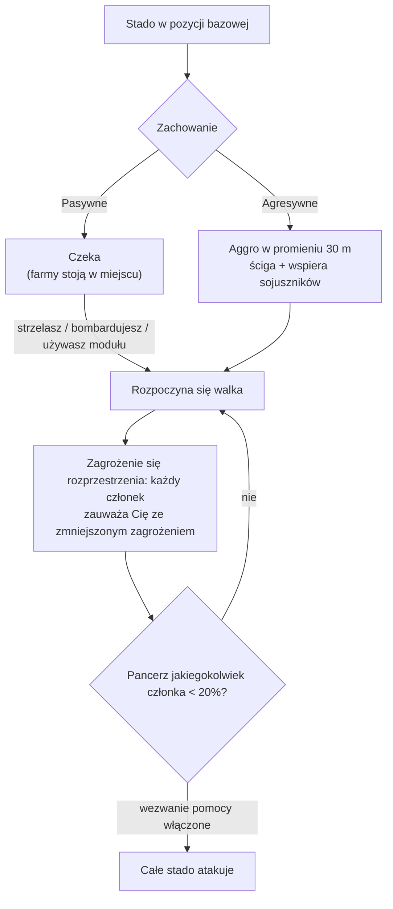

# NPC i łowy PVE

NPC to główne źródło [plazmy reaktora](/content/ores/),
[rdzeni](/pl/features/research/) i modułów, a także niezawodny sposób na zarabianie
punktów rozszerzenia na każdym poziomie. Istnieją w **stadach**: grupach, które
dzielą wspólną pozycję bazową, zasięg bazowy, czas respawnu i zachowanie.

## Kto tu krąży

NPC występują w czterech rasach — **Nuimqol, Pelistal, Thelodica i Industrial** —
każda z kilkoma klasami robotów (biegacze, pełzaki, mechy, ciężkie mechy) i
rangami 1–5, które skalują się w statystykach i łupach. Poza zwykłymi rangami:

- **Gobliny** — strażnicy EWar na chronionych wyspach. Kruche, ale ich
  modyfikatory blokowania są ekstremalne (blokują Cię ~5× szybciej niż normalnie,
  z ~2× większej odległości): obóz goblinów sprawia, że walka lub wydobycie
  w pobliżu staje się bolesne.
- **Elity** — rzadkie warianty NPC z rangami, z przybliżenie podwojonymi
  statystykami bazowymi i lepszym łupem.
- **Obserwatorzy** — wędrujące, agresywne NPC (Arbalest, Baphomet, Waspish,
  Tyrannos, Artemis, Kain, Gropho, Sequer, Seth, Mesmer…). Patrolują duże
  części wyspy i są znacznie trudniejsi niż NPC z rangami tej samej klasy —
  *grand* Obserwatorzy na chronionych wyspach i ich warianty z otwartych wysp
  to najsilniejsi zwykli łowcy, jakich można spotkać.
- **Bosse** — rzadkie, indywidualnie skonfigurowane NPC. Nigdy nie uciekają,
  mogą ogłosić się na całym serwerze, a niektóre są powiązane z posterunkami
  (zabicie ich zmienia [stabilność posterunku](/pl/features/outposts/)) lub
  spawnują szczeliny relikwii po zniszczeniu. Słabsi bosse są do pokonania
  solo na chronionych wyspach; najsilniejsi wymagają dedykowanej grupy.
- **Spawny Syndykatu** — specjalna frakcja (Syndykat, ze swoimi nazwanymi
  NPC), która prowadzi własne statyczne farmy, zwykle na chronionych i
  płytkich otwartych wyspach.

## Pasywne vs agresywne

- **Pasywne stada** nigdy nie atakują z własnej inicjatywy — musisz najpierw
  strzelić, zrzucić bombę lub użyć aktywnego modułu. Większość klasycznych
  statycznych farm jest pasywna.
- **Agresywne stada** wchodzą w tryb aggro z własnej inicjatywy, gdy zbliżysz
  się na **30 m**, ścigają Cię i wspierają sojuszników, którzy walczą. Wszyscy
  Obserwatorzy, większość wędrujących spawnów oraz strażnicy/najeźdźcy
  posterunków są agresywni.

Gdy walka się rozpocznie, **zagrożenie rozprzestrzenia się przez stado**:
każdy członek zauważa Cię ze zmniejszonym zagrożeniem, a jeśli pancerz
jakiegokolwiek członka spadnie poniżej **20%**, cała grupa rzuca się na Ciebie
(dla stad z włączonym wezwaniem pomocy). Zakładaj, że walczysz z całym spawny
w momencie, gdy pierwszy bot odda strzał.

## Spawny i respawn

- **Statyczne spawny** znajdują się na stałej pozycji bazowej z zasięgiem
  bazowym; członowie respawnują **indywidualnie** na własnym timerze. Stado,
  które było intensywnie farmowane, respawnuje szybciej; świeże — wolniej.
- **Wędrujące spawny** poruszają się po wyspie — to Obserwatorzy i stada
  typu konwoju, i zwykle są agresywne.
- **Wzmocnienia kopalni** — industrialne NPC pracujące na węźle zasobowym
  mają prekonfigurowane fale wzmocnień: im dłużej trwa walka, tym kolejne
  fale docierają do węzła. Bosse również wzywają wzmocnienia, gdy są
  uszkodzone. Zatem „jednorobotowa" farma może stać się walką grupową;
  sprawdź okolicę, zanim się zaangażujesz.

## Co upuszczają

Łup jest konfigurowany per typ NPC: **plazma reaktora rasy wyspy**,
**rdzenie** (zwykłe, hitech, industrialne i rasowe), komponenty modułów
oraz, rzadziej, zapakowane moduły. Wyższe rangi i specjalne typy upuszczają
więcej.

Każde zabicie wypłaca również **punkty rozszerzenia**, konfigurowane per
typ NPC — a podwojone na otwartych (beta-tier) wyspach.

## Perki poziomu strefy

Wyspy występują w trzech poziomach — chronione (alpha), otwarte PvE (beta)
i otwarte PvP (gamma). Polowanie staje się bardziej niebezpieczne, ale też
bardziej opłacalne, im głębiej idziesz:

- **Eksplozje śmierci** — na chronionych wyspach zniszczony robot *nie*
  eksploduje. Na otwartych wyspach (beta i gamma) każdy zniszczony robot —
  gracza lub NPC — detonuje i zadaje obrażenia obszarowe. Łańcuchowe
  eksplozje przyspieszają farmowanie i czynią miejsca zasadzek śmiertelniej.
- **Podwojone EP** — bazowa nagroda EP za każdą aktywność jest podwojona
  na wyspach beta-tier.
- **Lepsze misje** — wyższe poziomy misji znajdują się na otwartych wyspach,
  a ich EP misji jest również podwojone.
- **Monety misji frakcji** — misje na otwartych wyspach wypłacają monetę
  misji danej rasy (moneta Nuimqol / Pelistal / Thelodica) zamiast uniwersalnej
  monety. Monety frakcji można również kupić bezpośrednio w terminalach
  na otwartych wyspach, a uniwersalną monetę można kupić tam, gdzie
  frakcyjnych nie ma.

## Praktyczne uwagi

- **Sprawdź stado przed zaangażowaniem** — policz członków, zanotuj rangi
  i czy spaw jest agresywny; pasywna farma, na którą wszedłeś, może mieć
  pięć botów.
- **Przewyższaj ich zasięg** — statyczne spawny pozostają w swoim zasięgu
  bazowym; pozycjonowanie pod czyste strzały z dalekiego zasięgu to zwykle
  najtańszy sposób na zwycięstwo.
- **Miejsca zasobów to pułapki** — wzmocnienia kopalni oznaczają, że im dłużej
  walczysz, tym więcej przeciwników.
- **Obserwatorzy w ruchu** — jeśli eksplorujesz, zbierasz artefakty lub
  pokonujesz długą trasę, agresywny Obserwator na Twojej drodze to walka
  lub objazd.

<!--
Written from scratch against the server backend, 2026-09-27:
Zones/NpcSystem/Flocks/ (Flock.cs, NormalFlock.cs — group respawns, adaptive
respawn multiplier), AI/Behaviors/ (Passive vs Aggressive; threat spread at
50%, call-for-help at 20% armor in SmartCreature.cs), AI/BodyPullThreatHelper.cs
(30 m aggro range, aggressive-only body-pull), Reinforcements/ + npcreinforcements
(mining-site and boss waves at HP thresholds), NpcSpecialType + npcbossinfo
(boss respawn noise, outpost stability links, server-wide announce),
entitydefaults (rank1-5 + dps/interceptor/scout/miniboss/elite variants, 30
elite definitions with ~2x modifiers; 13 def_npc_roaming_* observers; goblin
lancer/shark with 5x lock-time / 2x lock-range modifiers),
npcloot (26k rows: race plasma, common/hitech/industrial/race kernels,
modules), NpcEp.cs + GetNpcKillEp (EP per NPC, x2 on beta),
Unit.DoExplosion (death AoE suppressed on protected zones, active on
beta/gamma; radius from signature, damage from remaining core),
MissionLocation.cs (race-specific mission coins; universal coin on protected
zones), ZoneConfiguration (IsAlpha/IsBeta/IsGamma).
An earlier version of this page was adapted from the Open Perpetuum
community wiki (perpetuum.miraheze.org) and has been fully rewritten from
backend sources; no text was reused.
The ingested "TAP" section was dropped: no teleport-attractor concept exists
in this backend (no definition, code or table).
-->