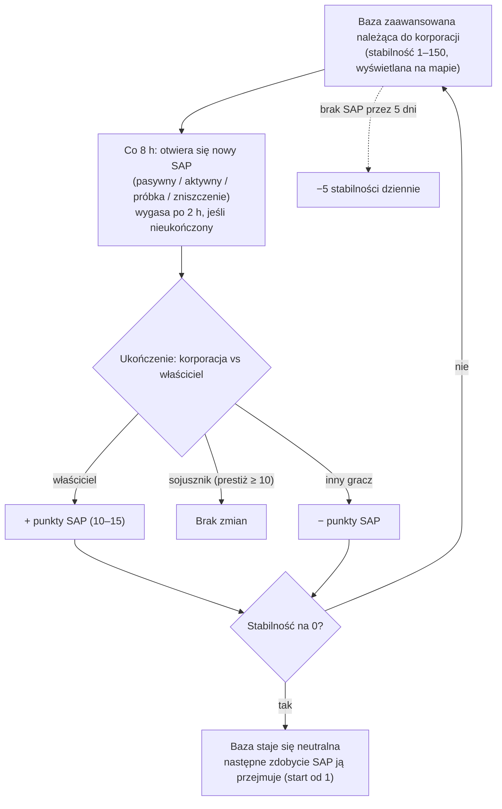

# Zaawansowane bazy i SAP

Na wyspach z otwartym PvP **zaawansowane bazy mogą być własnością korporacji graczy**.
Kontrola mierzona jest wskaźnikiem **stabilności** (0–150) wyświetlanym nad bazą
w widoku mapy. System **SAP** (Service Access Point) to mechanizm, który
rządzi tym wskaźnikiem — i sposobem, w jaki bazy zmieniają właściciela.

## Zasady

- Gdy **właściąca** korporacja ukończy SAP, stabilność rośnie o
  wartość punktów tego SAP.
- Gdy **korporacja sojusznicza z właścicielem** (wzajemny prestiż +10 lub wyższy)
  ukończy SAP, stabilność **nie zmienia się**.
- Gdy **inny gracz** ukończy SAP, stabilność spada o tę samą
  wartość.
- Przy **zerze** baza traci właściciela i staje się neutralna. Ukończenie
  dowolnego SAP na neutralnej bazie **zdobywa** ją (ukończająca korporacja
  staje się właścicielem, startując od stabilności 1).
- **Zmniejszanie**: jeśli przez **5 dni** nie ukończono żadnego SAP, baza zaczyna tracić
  **5 stabilności dziennie**, aż do ukończenia (lub utraty).

## Cztery typy SAP

Co 8 godzin baza otwiera nowy SAP — jeden z czterech typów. Każdy typ ma
własną wartość punktów i własną metodę ukończenia:

| Typ | Sposób ukończenia | Punkty | Charakter nagrody |
|---|---|---|---|
| **Pasywny** | Stań wewnątrz wiązki SAP przez **8 minut**. Postęp jest indywidualny (własny ciągły czas każdego gracza w wiązce); najwyższy indywidualny postęp przejmuje SAP. | +10 | Plazma frakcji (skalowana z stabilnością), zestawy badawcze, boostery EP. |
| **Aktywny** | Celuj w SAP i utrzymuj **moduł hakowania SAP** — około 120 cykli modułu (po 5 s każdy), czyli ~10 minut. Postęp jest zachowywany przy zatrzymaniu lub opuszczeniu; indywidualny. | +15 | Plazma, rdzenie, zestawy badawcze i **rdzenie reaktora** (produkcja robotów). |
| **Próbka** | Dostarcz **przedmioty-próbki** do SAP (w promieniu 7 m) i złóż 5–6 wymaganych. Każde złożenie ma 90-sekundowy cooldown; postęp jest indywidualny. | +15 | Plazma, rdzenie, zestawy badawcze. |
| **Zniszczenie** | Zestrzel: **30 000 pancerza** i **150 odporności na wszystkie cztery typy obrażeń** (60% redukcji), **sygnatura 6 m** — małe bronie trafiają najlepiej. Postęp obrażeń jest **korporacyjny, nie indywidualny**, więc całe floty mogą jednocześnie zadawać obrażenia; korporacja z największą ilością obrażeń w momencie zniszczenia SAP stosuje wynik. | ±15 | **Amunicja PvP** frakcji, plazma, rdzenie. |

Wszystkie cztery typy SAP **transmitują aktualnych liderów** (top 10) do wszystkich
w pobliżu i **wygasają po 2 godzinach**, jeśli nie zostały ukończone.

### Odmawianie wrogowi

Ponieważ postęp zniszczenia jest korporacyjny, a znak zmiany stabilności
zależy od tego, kto wygrywa, popularną taktyką jest **zadanie wystarczających obrażeń, aby znaleźć się na szczycie listy, ale nie wystarczających, aby ukończyć SAP**: jeśli własna załoga właściciela go ukończy, *Twoja* korporacja nadal jest zwycięzcą, a zmiana stabilności
trafia na właściciela.

## Obserwacja i przewidywanie

- **Ładunek skanera intruzji** w geoskanerze, aktywowany w pobliżu
  bazy, raportuje **czas do następnego SAP** dla baz w zasięgu
  (na wyspach z otwartym PvP ten sam ładunek raportuje status wzmocnień NPC
  zamiast tego).
- SAP-y ogłaszają się graczom w pobliżu krótko przed otwarciem.
- Transmisja liderów SAP oznacza, że można **obserwować sporny SAP w
  czasie rzeczywistym** i zdecydować, czy go kontestować.

## Inne sposoby zmiany stabilności

- **Relikty SAP** — obiekty relikty, które pojawiają się 90–350 m od bazy (odrodzenie co 4 godziny, maksymalny wiek 12 godzin). Zniszczenie jednego natychmiast stosuje **±1 stabilności**
  (dla Twojej korporacji), oznacza Cię jako PvP i wypłaca EP oraz pojemnik z plazmą.
- **Strażnicy i najeźdźcy** — bossowie NPC bazy:
  - NPC **Strażnicy** trzymają się blisko bazy (~35 m). Zabicie jednego **zawsze
    zmniejsza** stabilność o 3, niezależnie od tego, kto go zabije; odtwarzają się po ~6 godzinach.
  - NPC **Najeźdźcy** patrolują do ~300 m. Zabicie jednego **zwiększa** stabilność o
    2 dla zabijającej korporacji; odtwarzanie po ~6 godzinach.

## Dlaczego zaawansowane bazy są ważne

Własność zaawansowanej bazy daje korporacji jej bonusy (produkcja, obiekty obronne,
efekty) i stanowi kręgosłup terytorialnej gry w otwartym PvP — zobacz
[PBS](/pl/features/pbs/) dla struktur, które czynią z bazy prawdziwą bazę operacyjną.

<!--
Written from scratch against the server backend, 2026-09-27:
Zones/Intrusion/Outpost.cs (stability 0-150, capture at 1, ally threshold
+10, EP to participants), OutpostDecay.cs (5-day grace, -5/day), SAP.cs +
PassiveHackingSAP.cs / ActiveHackingSAP.cs / SpecimenProcessingSAP.cs /
DestructionSAP.cs (8-min passive, 120x5s active, 5-6 specimen items with 90s
cooldown, corporate destruction score, 2h expiry, top-10 broadcast),
entitydefaults options (#increase=n10/n15), siegeitems (def_specimen_sap_item
2-3 x 5-6), def_sap_destruction stats (30k armor, 150 res all types, 6m
signature), def_siege_hack_module (5s cycle), intrusionsitestabilitythreshold
+ intrusionsaps, intrusionloot (plasma/kernels/research kits/cores/PvP ammo
by stability tier), npcbossinfo + npcflock (guard -3 @ ~35m, invader +2 @
~300m, 6h respawn), OutpostRelicManager.cs + SAPRelic.cs (90-350m spawn,
4h respawn, 12h lifespan, +1 stability, PvP flag), Scanner.Intrusion.cs
(next-SAP-time scan), EntitiesModule.cs (8h SAP interval).
An earlier version of this page was adapted from the Open Perpetuum
community wiki (perpetuum.miraheze.org) and has been fully rewritten from
backend sources; no text was reused.
Note: the ingested text had several numbers this server contradicts (3-day
decay vs 5-day, 10-min passive vs 8-min, "no resistances" vs 150 all types,
3 km invader range vs 300 m).
-->