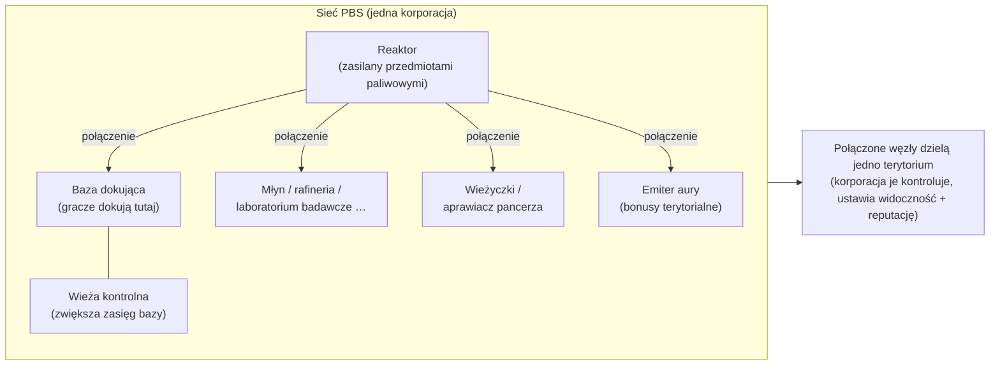
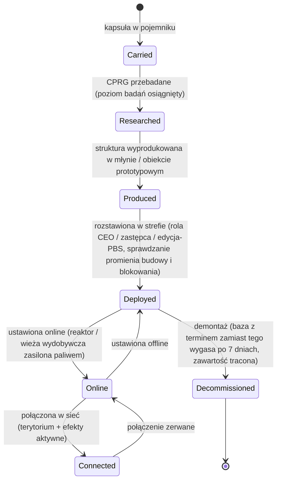

# Stacje baz zasilania (PBS)

**PBS** (Power Base Station) to struktura do postawienia w strefie. Obiekty PBS mogą być
**połączone** w **sieć**, która definiuje **terytoria** i umożliwia **efekty**.
Jest to aktywność korporacyjna/strukturalna — większość działań wymaga odpowiedniej
roli w korporacji.

> Lokalizacje w interfejsie użytkownika są opisane w [przeglądzie interfejsu klienta](/pl/features/ui/). Nazwa „PBS" w kliencie powinna
> zostać potwierdzona. Mechaniki poniżej zostały potwierdzone na serwerze.

## Funkcje PBS

- Jest **węzłem** w sieci **PBS**.
- Połączone węzły tworzą wspólne **terytorium**, którym zarządza korporacja-właściciel.
- Sieć może projektować **efekty** (buffy/kontrole) na swoim terytorium.
- Niektóre struktury PBS można **zasilać** przedmiotami (paliwem), aby działały.

## Rodziny struktur

Każda struktura PBS występuje w tierach **mały / średni / duży**. Nosisz
**kapsułę**, badasz przedmiot (CPRG) i **rozstawiasz** obiekt — rozstawianie jest
ograniczone uprawnieniami (patrz niżej). Rodziny:

| Rodzina | Struktury | Rola |
|---|---|---|
| Zasilanie | reaktor, studnia energetyczna, bateria rdzeniowa, nadajnik rdzeniowy | generowanie, przechowywanie i dystrybucja **energii rdzeniowej**, na której wszystko działa |
| Dokowanie | baza dokująca, baza dokująca z terminem, wieża kontrolna | miejsce dokowania graczy; wieża kontrolna zwiększa zasięg bazy |
| Produkcja | młyn, rafineria, przetwornica, naprawa, prototypownia, laboratorium badawcze, kuźnia kalibracji (CPRG), kuźnia zestawów badawczych, ulepszenie produkcji | obiekty [produkcji](/pl/features/production/), w strefie zamiast w bazie domowej |
| Obrona | wieżyczki (laser / rail / rakietowa / wojna elektroniczna), naprawiacz pancerza | zautomatyzowana obrona terytorium |
| Efekty | emiter aury, dostawca efektów, maskertower, wieża wydobywcza | projektowanie bonusów efektów terytorium; wieża wydobywcza automatycznie wydobywa rudę |
| Transport | węzeł autostrady | połączenie z **autostradą** strefy (linie szybkiej podróży) |
| Budowa | moduł budowy | konstruktor, który stawia pozostałe struktury |

### Efekty emitera aury

Emiter aury to główny buff terytorialny. Każdy tier projektuje jeden z trzech
**bonusów bazowych skalowanych poziomem**:

- **mały** — sensory lvl1 / inżynieria lvl1 / przemysł lvl1
- **średni** — te same trzy na lvl2
- **duży** — te same trzy na lvl3

Sensory zwiększają zasięg skanowania/reconu, inżynieria przyspiesza budowę, przemysł przyspiesza
produkcję.

### Baza dokująca z terminem

Specjalna baza PBS o stałym **czasie życia 7 dni** (168 h w treści). **Nie może
zostać zdemontowana** — albo **wygasa, albo zostaje zniszczona**. Pozostały czas życia
jest ogłaszany przez wewnętrznego ogłaszacza (temat kanału bazy, e-mail i MOTD); gdy czas
dojdzie do zera, baza jest niszczone, a jej zawartość tracona. To model „wynajmu" dla
dokowania PBS: nie płacisz czynszu, dostajesz limit czasowy.

## Rozstawianie

- **Sprawdzenie rozstawiania** — przed postawieniem zweryfikuj, czy PBS może zostać
  rozstawiona w danym miejscu (nachylenie, blokowanie i sprawdzanie uprawnień). Wymaga roli
  korporacyjnej (**CEO / zastępca / edycja-PBS**).
- Rozstawianie używa **promienia budowy** i **promienia blokowania** struktury.

## Sieć i połączenia

- **Pobierz sieć** — podgląd sieci PBS, do której należysz.
- **Informacje o węźle** — szczegóły węzła PBS.
- **Zmiana nazwy węzła**.
- **Utworzenie połączenia** — połączenie dwóch węzłów PBS. (Łączenie się z siecią, która już ma
  bazę dokującą, uruchamia specyficzny przypadek przeniesienia własności.)
- **Rozłączenie połączenia** — rozłączenie dwóch węzłów.
- **Ustawienie wagi połączenia** — dostosowanie siły/priorytetu połączenia.

## Kontrola i stan

- **Ustaw online** — włączenie/wyłączenie węzła.
- **Ustawienie efektu** — konfiguracja efektu projektowanego przez węzeł.
- **Ustawienie demontażu bazy** — oznaczenie bazy do demontażu.

## Terytorium

- **Pobierz terytoria** — lista terytoriów kontrolowanych przez Twoją sieć.
- **Ustawienie widoczności terytorium** — kontrola, czy terytorium jest widoczne dla innych.
- **Ustawienie limitu reputacji** — ograniczenie dostępu na podstawie reputacji.
- **Ustawienie przesunięcia wzmocnienia** — dostosowanie zachowania wzmocnienia.

## Zasilanie

- **Informacje o zasilaniu** — czego PBS potrzebuje i jaki jest jej aktualny stan zasilania.
- **Zasilanie przedmiotami** — podanie przedmiotów do zasilania/uruchomienia PBS.

Struktury zasilane to **reaktor** i **wieża wydobywcza**. Zasilanie konwertuje
przedmioty o wartości energetycznej (`corecalories` na sztukę) na bufor energii rdzeniowej
węzła, do jego maksimum — każdy gracz w zasięgu może zasilić węzeł. Co można spalić:

| Paliwo | Rdzeń na sztukę |
|---|---|
| Wzmacniacz reaktora klasa C | 8 000 000 |
| Wzmacniacz reaktora klasa B | 4 000 000 |
| Wzmacniacz reaktora klasa A | 2 000 000 |
| Specimen SAP (intruzja) | 600 000 (wariant flux: 28 000) |
| Blok energii gamma | 2 000 |
| Amunicja wzmacniacza rdzeniowego | 1 000 |
| Ruda surowa (espitium) | 400 |
| Ruda surowa (vitricyl / prilumium / chollonin) | 300 |
| Ruda surowa (axicol) | 40 |

Wzmacniacze to wydajne paliwo; ruda surowa to tani zamiennik.

## Zwrot kosztów

- **Pobierz / ustaw informacje o zwrocie** — konfiguracja zwrotu kosztów związanych z PBS.

## Logi

- **Logi PBS** — przegląd aktywności PBS (połączenia, rozstawianie itp.).

## Uwagi praktyczne

- **To aktywność oficerska** — rozstawianie i większość kontroli wymaga roli korporacyjnej.
- **Połączenia definiują terytorium** — sieć, którą budujesz, to to, czym zarządzasz.
- **Najpierw sprawdź rozstawianie** — powie Ci, dlaczego umieszczenie by się nie powiodło (nachylenie,
  blokowanie, uprawnienia), zanim się zobowiążesz.
- **Zasilanie utrzymuje to w ruchu** — reaktory i wieże wydobywcze spalają przedmioty paliwowe
  (wzmacniacze lub rudę surową), aby utrzymać bufor rdzeniowy.
- **Baza z terminem to Twój limit czasowy** — 7 dni, bez demontażu; planuj na zniszczenie.
- **Widoczność terytorium i reputacja** pozwalają otworzyć lub zamknąć Twoją strefę dla innych.

## Wieżyczki obronne

Niekontrolowane przez gracza — rozstawiane jako struktury obronne PBS. Wieżyczki są składane z
części jak każdy inny robot, ale są przypięte do podkładki PBS i nie mogą być pilotowane.

| Wieżyczka | Rola |
|---|---|
| PBS Turret | Ogólna obrona PBS |
| PBS EW Turret | Wojna energetyczna (zakłócanie tarczy/pancerza) |
| PBS Laser Turret | Obrona bronią wiązkową |
| PBS Missile Turret | Obrona rakietowa |
| PBS Rail Turret | Obrona pociskowa (EM) |
| Police guard tower | Obrona NPC-ów policyjnych strefy |

Zobacz [referencję robotów](/content/robots/) w celu szczegółów na poziomie części.

<!-- TODO: pozostaje tylko nazwa PBS w kliencie i interfejs (lista struktur,
     edytor sieci, ekran zasilania).
     Potwierdzone: 416 definicji def_pbs_*, tiry S/M/L z wariantami
     kapsuła/cprg/pr/obiekt; emiter aury #effect=N93..101 = pbs sensory/inżynieria/przemysł lvl1-3
     (wyliczenie EffectType); zasilane = reaktor + wieża wydobywcza (IPBSFeedable), paliwo =
     definitionconfig.corecalories (wzmacniacze A/B/C 2/4/8M, SAP 600k/28k, blok gamma
     2k, ruda espitium 400 / vitricyl+prilumium+chollonin 300 / axicol 40);
     ExpiringPBSDockingBase: czas życia 168 h z definitionconfig.lifetime, bez
     demontażu, temat kanału ogłaszacza + e-mail, zniszczenie po wygaśnięciu. -->
     Notatki developerskie: Zone/PBS/PBSCheckDeployment.cs (promień budowy/blokowania,
     rola CEO/zastępca/editPBS), PBSMakeConnection.cs / PBSBreakConnection.cs,
     PBSSetConnectionWeight.cs, PBSSetOnline.cs, PBSSetEffect.cs, PBSSetBaseDeconstruct.cs,
     PBSGetNetwork.cs, PBSNodeInfo.cs, PBSRenameNode.cs, PBSGetTerritories.cs,
     PBSSetTerritoryVisibility.cs, PBSSetStandingLimit.cs, PBSSetReinforceOffset.cs,
     PBSFeedableInfo.cs / PBSFeedItemsHander.cs, PBSGetReimburseInfo.cs /
     PBSSetReimburseInfo.cs, PbsGetLog.cs; Zones/PBS/* (IPBSObject, ConnectionHandler). -->