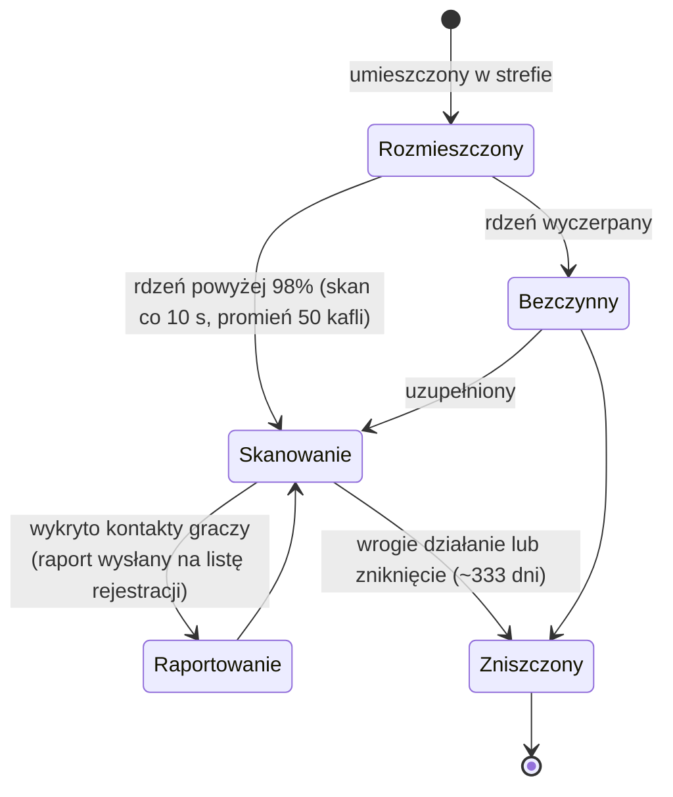

# Czujniki zbliżeniowe

Czujniki dzielą się na dwie rodziny:

- **Czujniki widoczności (zbliżeniowe)** — małe urządzenia, które rozmieszczasz w strefie, aby **obserwować obszar**. W trakcie zasilania skanują okoliczne jednostki graczy i wysyłają raporty do postaci, które zarejestrowałeś. To narzędzie do inwigilacji i rozpoznania.
- **Czujniki wydobywcze** — **moduł** montowany w robocie (poziomy od *noob* przez *standard*, *industrial*, *named*, *elite* do *artifact*) oraz **amunicja czujnikowa dla każdego rodzaju rudy** (warianty kafel / kierunek / obszar dla każdej rudy). Wystrzelenie go generuje wynik skanowania dla tej rudy w danym obszarze, przechowywany per postać (patrz [zbieranie → skanowanie](/pl/features/gathering/)).

> Lokalizacje w interfejsie są opisane w [przeglądzie interfejsu klienta](/pl/features/ui/). Mechaniki poniżej zostały potwierdzone na serwerze.

## Zarządzanie czujnikami

- **Lista** czujników — wyświetla czujniki, które posiadasz.
- **Informacje o rejestracji** — stan/informacje o rejestracji czujnika.
- **Ustaw rejestrację** — przypisz postacie do listy raportów czujnika.
- **Ustaw nazwę** — nadaj czujnikowi etykietę.
- **Usuń** rejestrację czujnika (w strefie) — zatrzymaj obserwację / wyczyść.

### Jak działa czujnik widoczności

- Jest **zasilany rdzeniem**: skanuje tylko wtedy, gdy jego rdzeń jest niemal pełny (powyżej 98% `core_max`); pusty czujnik pozostaje bezczynny.
- W trakcie aktywności skanuje **co 10 sekund** roboty graczy w promieniu **detekcji (50 kafli)** i wysyła raport (ID postaci i pozycja każdego kontaktu) do wszystkich osób na liście rejestracji.
- **Rejestracja** to aktywność korporacyjna: możesz zarejestrować wyłącznie **członków własnej korporacji**, a **CEO i zastępca są zawsze na liście** automatycznie. Lista ma maksymalny rozmiar.
- **Czas życia**: rozmieszczony czujnik znika po upływie zdefiniowanego `despawn_time` (czujnik widoczności jest ustawiony na ~333 dni) lub zostaje zniszczony.

## Zdarzenia cyklu życia

Serwer raportuje zdarzenia cyklu życia czujników w miarę ich występowania:
- **utworzony**, **zaktualizowany**, **zniszczony** — czujnik jest rozmieszczony, raportuje lub zostaje zniszczony.

Przychodzą jako powiadomienia push; nie wysyłasz ich, reagujesz na nie.

## Praktyczne uwagi

- **Zarejestruj przed odczytem** — czujnik raportuje tylko do zarejestrowanych postaci.
- **Czujniki mogą zginąć** — wrogie działanie lub wygaśnięcie może zniszczyć czujnik; obserwuj zdarzenia cyklu życia.
- **Nadawaj im nazwy** — przy kilku czujnikach w terenie etykiety pomagają zachować porządek.
- **Rozpoznanie, nie walka** — czujniki zbierają informacje; nie walczą.

<!-- TODO: pozostaje tylko interfejs (lista czujników, wybór rejestracji).
     Potwierdzone: czujnik widoczności (def_visibility_probe): core_max 50, aktywny tylko przy
     core>98%, interwał skanowania 10 s (ProximityDevice.cs _probingInterval), detekcja przez
     blob_emission 10 / blob_emission_radius 50, raport = characterID + x/y per kontakt
     wysyłany do zarejestrowanych postaci (ProximityProbe.OnUnitsFound); rejestracja =
     tylko członkowie własnej korporacji, CEO+Zastępca zawsze uwzględnieni, maks. liczba
     (ProximityProbeRegisterSet.cs); despawn_time 28,800,000 s (~333 d) na kapsule;
     stealth_strength 275 / detection_strength 45. Czujniki wydobywcze: moduły
     (noob/standard/industrial1-2/named1-3/elite t2-t4/artifact) + amunicja kafel/
     kierunek/obszar per ruda (79 definicji def_*probe*).
     Notatki deweloperskie: ProximityProbeList.cs / ProximityProbeGetRegistrationInfo.cs /
     ProximityProbeRegisterSet.cs / ProximityProbeSetName.cs; Zone/ProximityProbeRemove.cs;
     Zones/ProximityProbes/ProximityProbe.cs + ProximityProbeDeployer.cs +
     ProximityDevice.cs; Zones/Blobs/* (blob emission/stealth); zdarzenia cyklu życia przez
     komendy ProximityProbeCreated/Update/Dead/Info. -->
     Notatki deweloperskie: ProximityProbeList.cs / ProximityProbeGetRegistrationInfo.cs /
     ProximityProbeRegisterSet.cs / ProximityProbeSetName.cs; Zone/ProximityProbeRemove.cs;
     Zones/ProximityProbes/ProximityProbe.cs + ProximityProbeDeployer.cs; zdarzenia cyklu
     życia przez komendy ProximityProbeCreated/Update/Dead/Info. -->