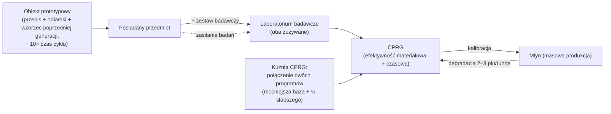

# Produkcja

Produkcja to sposób, w jaki zamieniasz surowce i komponenty na użyteczne przedmioty. Odbywa się w
**obiekcie produkcyjnym** (tzw. „młyn") w Twojej bazie, do której jesteś dokowany. Wszystko tutaj jest **wyłącznie w trybie dokowanym**.

> Lokalizacje w interfejsie użytkownika odpowiadają [przeglądowi interfejsu klienta](/pl/features/ui/) (kategorie **Rafineria / Recykling / Naprawa /
> Ubezpieczenie** na pasku górnym). Mechaniki poniżej zostały zweryfikowane na serwerze.

## Linie produkcyjne

**Linia produkcyjna** to zapisany przepis: definiuje, co produkujesz i z czego. Pełna lista komponentów
dla każdego przedmiotu możliwego do wyprodukowania (z poziomami badań) jest generowana w
[Przepisach](/content/recipes/). Uruchamiasz linię na określoną liczbę **rund**.

- **Lista linii** — wyświetla dostępne linie.
- **Uruchom linię** — wykonaj ją w obiekcie na wybraną liczbę rund (minimum 1).
  - Możesz płacić z **osobistego portfela** lub **portfela korporacji**.
  - Komponenty źródłowe można wyszukiwać z **inwentarza** lub z **robotów**.
- **Skalibruj linię** — dostosuj ustawienia linii.
- **Ustaw rundy** — wybierz liczbę rund do wykonania.
- **Zapytaj o następną rundę** — podgląd tego, co następna runda zużyje/produkuje.
- **Anuluj** — zatrzymaj trwałą produkcję.
- **Usuń linię** — usuń zapisaną linię.

Uruchomienie linii zużywa komponenty (i kredyty) i produkuje przedmiot docelowy w ciągu
rund.

## Operacje jednorazowe

To pojedyncze akcje, a nie wielorundowe linie. Każda ma wariant **Zapytaj**
dodający podgląd kosztu/wyniku przed zatwierdzeniem.

- **Rafinacja** — surowce → towar, z użyciem przepisu przedmiotu (zob. [Przepisy](/content/recipes/)).
  Wybierasz, ile sztuk przedmiotu docelowego wyprodukować; nominalne wejścia przepisu są skalowane
  mnożnikiem materiałowym `1 + 50/(bonus + 100)`, gdzie *bonus* to Twoja umiejętność rafinacji
  (rozszerzenia + punkty obiektu + punkty reputacji). Bez bonusu zużywasz **150%**
  nominalnego przepisu; z maksymalnym bonusem spada w kierunku **100%**.
- **Recykling / przeróbka** — rozkłada przedmiot z powrótem na komponenty z przepisu (odwrotny
  przepis). Wydajność wynosi `nominalnie × (1 − 75/(bonus + 100)) × stosunek wytrzymałości przedmiotu` —
  bez bonusu umiejętności to bazowe **25%**, poprawiające się w kierunku 100%, a **uszkodzony przedmiot
  daje proporcjonalnie mniej** (napraw go wcześniej, jeśli jest cenny). Recyklingowi podlegają tylko pełne „partie"
  (pełne domyślne ilości); reszta pozostaje. Przedmioty misyjne są usuwane,
  a nie recyklingowane.
- **Naprawa** — przywraca uszkodzonemu przedmiotowi/robotowi pełną wytrzymałość. Cena to
  `(brakujące % wytrzymałości) × wartość materiałowa przedmiotu × 75/(bonus + 100)`. „Wartość
  materiałowa" jest wyliczana rekurencyjnie: przepis przedmiotu jest rozkładany na surowce i
  wyceniany po **średnich cenach rynkowych**, więc koszt naprawy zmienia się wraz z rynkiem.
  Mnożnik umiejętności zaczyna się od **75%** bez bonusu i dąży do 0 przy maksymalnym bonusie.
- **Komponenty badawcze** — produkuj komponenty badawcze (zapytanie + uruchomienie).

## Cykl życia przedmiotu (proces cyrkularny)

Tworzenie przedmiotów to pętla trzech powiązanych obiektów:

1. **Badania (inżynieria odwrócona)** — podaj przedmiot tego typu, który chcesz
   produkować, oraz **zestaw badawczy**, którego poziom spełnia poziom badawczy przedmiotu
   (zestawy mają poziomy 0–10), do laboratorium badawczego. Oba wejścia są **zużywane**,
   a zadanie daje jeden **CPRG** dla tego przedmiotu. Efektywności wynikowego programu
   startują od bazy per przedmiot (większość przedmiotów 50, amunicja wyższa,
   wieże do 90) i są podnoszone o *poziom zestawu powyżej wymaganego × 5*
   plus bonus umiejętności badawczej (do +50 więcej). Zestaw o kilka poziomów
   powyżej przedmiotu — oraz przyzwoite rozszerzenia produkcyjne — to to, co zamienia świeży
   program 50/50 w konkurencyjny. To tak nowe przedmioty wchodzą do Twojego
   repertuaru produkcyjnego.
2. **Młyn (masowa produkcja)** — masowo produkuj z programu. Każda runda
   **degraduje** efektywności linii (2–3 punkty na rundę, per kategoria przedmiotu;
   zob. [CPRG](#cprg-programy-kalibracyjne)) — gdy marnotrawstwo staje się zbyt wysokie, skalibruj
   świeży program na linii. Przedmioty prototypowe wymagają również **wzorca
   poprzedniej generacji** jako komponentu (jeden standardowy moduł do prototypu T2,
   jeden T2 do prototypu T3), który jest zużywany w procesie.
3. **Obiekt prototypowy** — produkuj **prototyp** przedmiotu bezpośrednio:
   materiały z przepisu plus odłamki robotów *oraz* wzorzec poprzedniej generacji,
   w czasie około **10× dłuższym niż cykl młyna** (plus zwykły mnożnik czasu).
   Możesz prototypować tylko przedmioty odblokowane w drzewku technologicznym.
   Prototypy kosztują znacznie więcej niż ich standardowe odpowiedniki; ich głównym
   celem jest **zbadanie w celu uzyskania wysokiej jakości programów** (badanie
   przedmiotu prototypowego odblokowuje następną tierę) — lub użycie na robocie, gdy
   przedmiot jest zbyt rzadki, by go zdobyć, i zbyt drogi na rynku.

## Progresja tierów

Większość modułów i robotów występuje w **tierach T1 → T4** (odznaka tieru w kliencie;
linie definicji `standard → named1 → named2 → named3`, a następnie specjalne linie
`elitet4`/`artifact`). Zasady:

- **Każda tier to osobny przedmiot z własnym węzłem w drzewku technologicznym.** Odblokowanie
  węzła kosztuje punkty badawcze (badane z rdzeni) i wymaga
  **węzła nadrzędnego** — tiery muszą być odblokowane kolejno. Możesz tylko
  **prototypować** (lub masowo produkować) przedmiot, którego węzeł jest już odblokowany:
  nie ma sposobu, by wyprodukować wyższą tierę bez badań.
- **Każda wyższa tier zużywa jeden wzorzec poprzedniej tiery** jako
  komponent (plus materiały i odłamki robotów). Przedmiot T1 nigdy nie może być
  „oddany" w zamian za T3 — prototyp T3 wymaga przedmiotu **T2**, a
  wzorzec jest **zużywany**, a nie konwertowany: wynikiem jest zupełnie nowy przedmiot.
- Każda strona przedmiotu pokazuje jego **linię tierów** — cały łańcuch `T1 → T2 → T3 → T4`
  jako linki — a [strony węzłów drzewka technologicznego](/content/techtree/) pokazują
  węzeł nadrzędny/następny każdej tiery i ceny punktowe.

Przykład, linia modułu małego górnika: [standardowy mały górnik (T1)](/content/items/standard-small-driller/) →
[moduł małego górnika Biroter 5050 (T2)](/content/items/named1-small-driller/) →
[moduł małego górnika Sublimator Low-D (T3)](/content/items/named2-small-driller/) →
[moduł małego górnika Scraper-990 (T4)](/content/items/named3-small-driller/) —
i ten sam wzorzec dla każdej rodziny modułów/robotów.

## Prototypy i zestawy badawcze

- **Prototyp** — produkuj przedmiot prototypowy (uruchomienie + zapytanie). Jeden prototyp na
  slot; więcej równoległych zadań prototypowych pochodzi z rozszerzeń produkcyjnych.
- **Łączenie zestawów badawczych** — łącz wiele zestawów badawczych w wyższy
  (uruchomienie + zapytanie). Wyższy zestaw zarówno skraca czas badań, jak i podnosi
  efektywności wynikowego programu.

## CPRG (programy kalibracyjne)

**CPRG** (program kalibracyjny) to to, na czym działa linia produkcyjna — program per przedmiot
z punktami **efektywności materiałowej** i **efektywności czasowej** (0–100 każdy). Uzyskujesz go przez
**zbadanie przedmiotu** w laboratorium badawczym (poziom badawczy determinuje, które przedmioty w ogóle
możesz produkować), lub przez aktywację **kapsuły kalibracyjnej**.

- Świeżo zbadany CPRG startuje od **50/50** punktów.
- **Kuj CPRG** w kuźni programów kalibracyjnych: łącz dwa CPRG dla tego samego przedmiotu;
  wynik zachowuje punkty mocniejszego programu jako bazę i dodaje jedną trzecią
  słabszego. Kucie zajmuje czas i kosztuje kredyty (czas × cena obiektu za
  sekundę).
- **Skalibruj linię** CPRG, aby ustawić jej efektywności. Każda runda produkcji
  **degraduje** efektywność linii (wartość dekaliibracji per przedmiot), więc linie dryfują
  w dół z czasem — przeliczaj przed długimi cyklami.

Efektywności wpływają na wzory młyna (per cykl produkcyjny):

- **Zużyte materiały** = przepis × `1 + 50/(punkty materiałowe + umiejętność + 100 + bonusMłyna)`
  — nowy CPRG 50-punktowy bez umiejętności i bez bonusu masowej produkcji z drzewka technologicznego zużywa
  ≈ **133%** nominalnego przepisu.
- **Czas produkcji** = bazowy czas obiektu (3600 s na cykl dla młyna) ×
  `1 + 100/(punkty czasowe + umiejętność + 100)` × modyfikator czasu trwania przedmiotu — nowy CPRG bez
  umiejętności zajmuje ≈ **1 godzinę 40 minut** na przedmiot.
- **Cena** = czas produkcji × cena obiektu za sekundę (7 kredytów/s dla młyna PBS,
  3 dla dużych/średnich laboratoriów badawczych PBS) × modyfikator ceny przedmiotu (1–10).
- CPRG związane z misjami są darmowe i stałe na 10 sekund.

## Ubezpieczenie

Obiekt ubezpieczeniowy ubezpiecza **Twoich robotów**, a nie produkcję:

- **Kup** polisę dla robota (musi być nienaruszony, rozpakowany i nie może to być robot startowy),
  **wylistuj** swoje polisy, **zapytaj** o polisę, **usuń** polisę.
- Ochrona trwa **15 dni** (+ dni bonusowe z rozszerzenia); możesz posiadać polisy na
  1 + (bonus rozszerzenia) robotów.
- Każdy robot ma zdefiniowaną w treści **opłatę** i **wypłatę** (tabela `insuranceprices`,
  67 definicji robotów); opłata jest zniżkowana przez bonus rozszerzenia opłat i może być płacona
  z portfela korporacji.
- Jeśli ubezpieczony robot zostanie zniszczony, **wypłata jest wypłacana w kredytach** (robot
  nadal jest utracony) — zob. [walka](/pl/features/combat/).

## Obiekt i status

- **Informacje o obiekcie / opis** — co oferuje obiekt produkcyjny.
- **W toku (moje / korporacji)** — co jest obecnie produkowane.
- **Historia produkcji** — Twoja przeszła produkcja.
- **Lista komponentów** — dostępne komponenty produkcyjne.
- **Informacje o serwerze** — status serwera produkcyjnego.

## Praktyczne uwagi

- **Musisz być dokowany w bazie z obiektem produkcyjnym.**
- **Zapytaj przed uruchomieniem** — warianty zapytania pokazują koszt i wynik, żebyś nie spalił
  komponentów na błędzie.
- **Portfel korporacji** — możesz wydawać środki korporacji na produkcję, jeśli jest to dozwolone.
- **Komponenty pochodzą też z robotów** — linia może pobierać komponenty źródłowe z Twoich
  wyposażonych robotów, nie tylko z inwentarza.
- **Recyklinguj przy pełnej wytrzymałości** — uszkodzony przedmiot daje mniej; naprawaj drogie przedmioty przed
  przeróbką.
- **Mnożniki umiejętności to prawdziwe dźwignie ekonomiczne** — bonusy rafinacji/recyklingu/naprawy/młyna
  skalują się w ten sam sposób; inwestycja w rozszerzenia produkcyjne zwraca się w
  oszczędnościach materiałowych przy każdym cyklu.
- **Ubezpieczenie to siatka bezpieczeństwa dla robotów** — kupuj je dla drogich konfiguracji przed PvP w głębokim kosmosie.
- **Zestawy badawcze to bramka** — poziom badawczy przedmiotu (1–9) decyduje, które
  zestawy mogą go zdekodować, a uruchomienie zestawu o kilka poziomów powyżej przedmiotu to
  najtańszy sposób na podniesienie efektywności wynikowego programu.

<!--
Notatki developerskie: przepisane w 2026 z źródeł backendowych; nie użyto tekstu z wiki społeczności.
Zweryfikowano z:
- refine = 1 wynik na jednostkę, wejście = nominalnie x (1+50/(bonus+100)) (Refinery.cs);
- recycle = odwrotny przepis x (1-75/(bonus+100)) x healthRatio, tylko pełne partie,
  przedmioty misyjne usuwane (ReprocessSessionMember.cs);
- cena naprawy = (1-healthRatio) x wartość rynkowa PriceCalculator x
  75/(bonus+100) (Repair.cs + PriceCalculator.cs);
- ResearchLab.cs (StartResearch/EndResearch: przedmiot źródłowy + zestaw badawczy oba
  zużywane; poziom zestawu musi być >= itemresearchlevels.researchlevel (1-9);
  efektywność = baza per przedmiot + różnicaPoziomów*5 + (1-100/(100+skill))*50);
- itemresearchlevels (1101 wierszy, poziomy 1-9), zestawy badawcze def_research_kit_0..10
  (opcja #level), RandomResearchKit (zestawy misyjne, fałszywe 100/100);
- calibrationdefaults (bazowe efektywności per CPRG 50-90; domyślny fallback 50/50;
  CalibrationProgram.OnInsertToDb ustawia 50/50);
- PBSFacilities.cs CalculateResultingPoints (kuźnia = lepsza baza + słaby/3 +
  (1-100/(100+skill))*25);
- productiondecalibration (spadek 2-3 punkty na rundę per kategoria,
  distorsion 0.5-1%);
- Prototyper.cs (StartPrototype: komponenty zawierają wzorzec poprzedniej generacji przez
  tabelę components — np. T2 NEXUS zużywa 1x standardowy moduł, T3 zużywa 1x T2;
  czas = 10x cykl x mnożnik; sprawdzenie odblokowania w drzewku technologicznym w
  ProductionPrototypeStart.cs);
- tabela prototypes (339 wierszy, mapowanie standard->prototyp);
- Mill.cs (CalculateFinalMaterialMultiplier 1+50/(pts+skill+100+millBonus) z
  bonusem masowej produkcji z drzewka technologicznego; CalculateFinalTimeMultiplier;
  tabela productionduration);
- Ubezpieczenie: InsuraceFacility.cs (15d + bonus rozszerzenia czasu, 1+slot-rozszerzenie
  polis, robot noob wykluczony, musi być pojedynczy+rozpakowany), InsuranceDescription.cs
  (wypłata w kredytach przez bank centralny), insuranceprices (67 definicji robotów,
  wypłata = 80x opłata, z wyjątkiem noob/arkhe2 na 4x).
- Opcje obiektów (entitydefaults): def_pbs_facility_mill #perSecondPrice=7
  #productionTime=3600; rafineria #materialEfficiency=0.95;
  calibration_program_forge #perSecondPrice=7; def_production_public_factory
  #materialEfficiency=0.6 #manufactureTime=3600 #perSecondPrice=3.
Pliki developerskie: Production/ProductionLineStart.cs (PrepareProductionForPublicContainer,
LineStartInMill, portfel korporacji, wyszukiwanie w robotach, rundy); Production/ProductionLine*.cs;
Production/ProductionRefine*.cs, ProductionReprocess*.cs, ProductionRepair*.cs,
ProductionResearch*.cs (pary zapytanie+uruchomienie); Production/ProductionPrototype*.cs,
ProductionMergeResearchKitsMulti*.cs; Production/ProductionCPRG*.cs,
ProductionGetCPRGFromLine*.cs; Production/ProductionInsurance*.cs;
Production/ProductionFacility*.cs, ProductionInProgress*.cs, ProductionHistory.cs;
Services/ProductionEngine/Facilities/*.cs; Services/ProductionEngine/PBSFacilities.cs;
Services/ProductionEngine/ResearchKits/*.cs; Services/ProductionEngine/CalibrationPrograms/*;
Services/Insurance/InsuranceHelper.cs; Items/PriceCalculator.cs.
Poprawki względem zaimportowanej strony: nie istnieje przedmiot „dekoder" (zestawy badawcze to
wejścia ograniczone poziomem); twierdzenie „zbadane do 100%" jest błędne (odblokowanie w drzewku
technologicznym to bramka; poziomy badawcze to 1-9); czas prototypu to 10x cykl młyna; zużycie
wzorca zweryfikowane z tabeli components; wypłata ubezpieczenia to 80x opłata.
-->