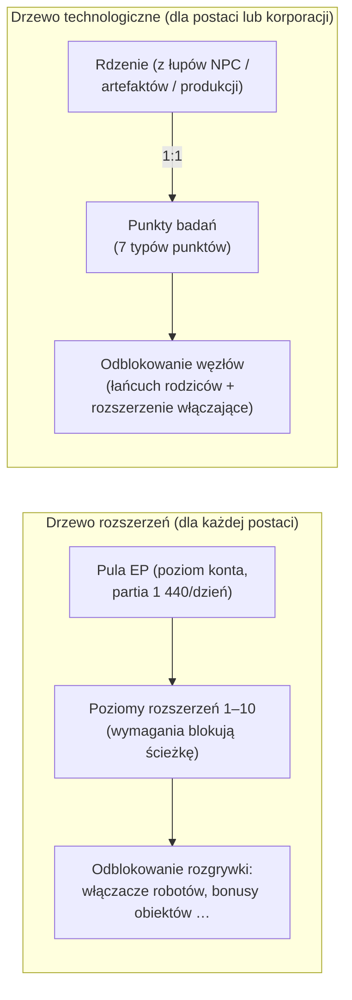

# Badania

Istnieją **dwa niezależne systemy progresji**. Oba działają wyłącznie w doku.

> Lokalizacje w interfejsie są zgodne z [przeglądem interfejsu klienta](/pl/features/ui/) (okno postaci → rozszerzenia;
> drzewo technologiczne ma własne okno). Mechaniki poniżej zostały potwierdzone na serwerze.

## Drzewo rozszerzeń (umiejętności postaci)

Rozszerzenia to poziomy umiejętności przypisane do postaci, które odblokowują elementy rozgrywki — przede wszystkim
**rozszerzenia włączające**, pozwalające pilotować klasę robota (wymagane do wyjścia z doku i wyboru
robota, zob. [ruch](/pl/features/movement/) i [roboty](/pl/features/robots/)).

### Jak działa nauka

- Aby się uczyć, musisz być **w doku**.
- Każde rozszerzenie można podnieść do **poziomów 1–10** (poziom 10 to limit).
- **Poziom 1 kosztuje kredyty** (`price` rozszerzenia), pobierane z twojego portfela.
- **Każdy poziom kosztuje Punkty Rozszerzeń (EP)** według stałej tabeli rangi × poziomu —
  dla poziomów 1–5 koszt wynosi `60 × ranga × poziom`; poziomy 6–10 skaczą do
  `ranga × (1440, 2520, 3840, 5400, 12000)`. Dziesięć poziomów rozszerzenia rangi 1 kosztuje
  60 → 6 000 EP, łącznie 13 500; rozszerzenie rangi 10 kosztuje dziesięć razy więcej na każdym poziomie.
- **Wymagania wstępne** muszą być już opanowane, zanim możesz podjąć się danego rozszerzenia
  (lista „prerequire").
- EP to **pula na poziomie konta**: jest współdzielona między twoimi postaciami i zdobywana z
  upływem czasu (zob. „Źródła EP" poniżej).

### Zarządzanie rozszerzeniami

- **Lista kategorii / pobraj wszystkie / lista opanowanych / lista wymagań** — przeglądaj drzewo i to,
  co już posiadasz.
- **Dostępne punkty** — zobacz swoją bieżącą pulę EP.
- **Usuń jeden poziom** — obniż pojedynczy poziom rozszerzenia.
- **Zresetuj rozszerzenia postaci** — zresetuj całe drzewo dla danej postaci.
- **Wyzwól zablokowane EP** — uwolnij EP, które są zablokowane (np. po usunięciu poziomów).
- **Kup boost EP** — płatny akcelerator zwiększający zysk EP.
- **Dzienny dziennik EP za aktywność** — sprawdź, ile EP zdobywasz z rozgrywki.

### Źródła EP

EP to nie waluta, którą kupujesz — naliczana jest w **dziennych partiach**:

- Każde konto otrzymuje **1 440 EP dziennie** (przyznawane raz dziennie, między 08:00 a
  11:00 czasu serwerowego, przez procedurę `extensionPointsAdd`). Kod definiuje również
  podwojoną partię **2 880 EP** dla kont z płatną subskrypcją, ale bieżąca procedura
  wypłaca bazową partię wszystkim kontom.
- **Płatne boosty** (zakupy boostów EP) są dodawane na wierzch.
- Twoje **dostępne EP** = wszystkie otrzymane dzienne partie − kary − EP wydane w grze.
  (Dziennik EP za aktywność pokazuje szczegółowy podział dziennych zarobków.)

**Pełny katalog** — wszystkie rozszerzenia (ranga, cena poziomu 1, bonus, wymagania wstępne) znajdują się w
[Rozszerzenia](/content/extensions/), a wszystkie węzły drzewa technologicznego (odblokowany przedmiot, rozszerzenie
włączające, ceny punktów) w [Drzewo technologiczne](/content/techtree/).

## Drzewo technologiczne (odblokowania)

Drzewo technologiczne to graf **węzłów**, które odblokowujesz wydając **punkty badań**. W przeciwieństwie
do EP (pula konta), punkty drzewa technologicznego są **zdobywane przez zużywanie „rdzeni"** — przedmiotów,
które badasz, a następnie składasz.

### Jak to działa

- **Badaj rdzenie** — składasz przedmioty rdzeniowe z kontenera. Każdy rdzeń konwertuje się
  **1:1** w punkty badań danego **typu punktów**; rdzenie są zużywane.
  Istnieje siedem typów rdzeni, po jednym na każdy typ punktów: Theodica, Pelistal, Nüimqol,
  Industrial, Common, HiTech i NewTech.
- **Odblokuj węzeł** — wydaj wymagane punkty badań. Węzeł można odblokować tylko wtedy, gdy:
  - wszystkie jego **węzły nadrzędne** są już odblokowane, oraz
  - masz opanowane **rozszerzenie włączające** danego węzła na swojej postaci.
- **Odblokowania korporacyjne** — z odpowiednią rolą w korporacji węzeł można odblokować
  **dla korporacji** (współdzielone). Odblokowania korporacyjne kosztują więcej (obowiązuje mnożnik
  ceny korporacyjnej) i są opłacane z punktów korporacji.
- **Daruj** — daruj punkty badań (np. swojej korporacji).
- **Informacje / dzienniki** — wyświetlaj szczegóły węzłów i historię odblokowań/badań.

### Dlaczego to ważne

Odblokowane węzły drzewa technologicznego blokują dostęp do treści i funkcji wyższych poziomów. Sprawdź
wymagania węzła (łańcuch rodziców + rozszerzenie włączające) przed wydaniem punktów.

## Uwagi praktyczne

- **Rozszerzenia włączające blokują roboty** — nie możesz pilotować klasy robota, której nie
  zbadałeś (to ten sam test, który blokuje wyjście z doku / wybór robota).
- **Poziom 1 to jedyny koszt w kredytach** w drzewie rozszerzeń; powyżej tego to same EP.
- **Drzewo technologiczne jest nieodwracalne** — punkty wydane na odblokowanie są utracone; planuj swoją ścieżkę.
- **Technologia korporacyjna to wysiłek zespołowy** — korzysta ze współdzielonych punktów i mnożnika ceny.

<!-- TODO: pozostaje tylko interfejs badań (układ okna, wyświetlanie punktów).
     Potwierdzone: zysk EP = 1440/dzień stała wartość przez dbo.extensionPointsAdd (okno 08:00-11:00,
     raz dziennie; stała bonusowa 2880 istnieje w GiveExtensionPointsService dla płatnych
     subskrypcji, ale bieżąca procedura wypłaca bazową wartość wszystkim); dostępne = partie -
     kary - wydane (funkcja extensionPointsAvailable); tabela kosztów EP w
     Services/ExtensionService/ExtensionPoints.cs (60*ranga*poziom dla poziomów 1-5, potem
     ranga*(1440,2520,3840,5400,12000)); rdzenie konwertują się 1:1 (TechTreeResearch.cs), 7
     definicji rdzeni -> typy punktów n1..n7 (Theodica/Pelistal/Nuimqol/Industrial/
     Common/HiTech/NewTech).
     Notatki deweloperskie: Extensions/ExtensionBuyForPoints.cs (w doku, wymagania, limit poziomu 10,
     cena kredytowa poziomu 1, EP wg rangi/poziomu, pula konta, darmowe dla postaci treningowej);
     Extensions/ExtensionGetAvailablePoints.cs; Extensions/ExtensionBuyEpBoost.cs,
     ExtensionFreeLockedEp.cs, ExtensionRemoveLevel.cs, ExtensionResetCharacter.cs;
     EpForActivityDailyLog.cs; TechTree/TechTreeResearch.cs (rdzenie → punkty);
     TechTree/TechTreeUnlock.cs (łańcuch rodziców + rozszerzenie włączające, mnożnik korporacyjny);
     TechTree/TechTreeDonate.cs; Services/ExtensionService/GiveExtensionPointsService.cs;
     Services/ExtensionService/ExtensionPoints.cs. -->
     Notatki deweloperskie: Extensions/ExtensionBuyForPoints.cs (w doku, wymagania, limit poziomu 10,
     cena kredytowa poziomu 1, EP wg rangi/poziomu, pula konta, darmowe dla postaci treningowej);
     Extensions/ExtensionGetAvailablePoints.cs; Extensions/ExtensionBuyEpBoost.cs,
     ExtensionFreeLockedEp.cs, ExtensionRemoveLevel.cs, ExtensionResetCharacter.cs;
     EpForActivityDailyLog.cs; TechTree/TechTreeResearch.cs (rdzenie → punkty);
     TechTree/TechTreeUnlock.cs (łańcuch rodziców + rozszerzenie włączające, mnożnik korporacyjny);
     TechTree/TechTreeDonate.cs. -->