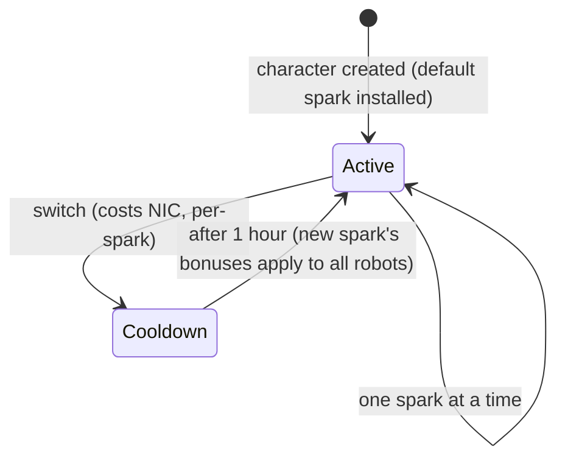

# Iskry

**Iskra** to specjalizacja nanobota zainstalowana na Twoim bohaterze. Podczas gdy jest aktywna, jej bonusy stosują się do każdego robota, którego pilotujesz — np. iskra linii bojowej frakcji zwiększa obrażenia broni i szansę na trafienie krytyczne z każdym poziomem, a linia przemysłowa zwiększa pojemność rdzenia i wydajność górnictwa.

Każdy bohater ma **domyślną iskrę** nadawaną przy tworzeniu. Poza tym iskry występują w rodzinach — podstawowe domyślne linie, linie bojowe/przemysłowe/społeczne dla każdej frakcji (po trzy poziomy), płatne linie Syndykatu oraz specjalne linie limitowane — a dokładne bonusy iskry to po prostu zestaw stałych poziomów umiejętności, które można zobaczyć na [stronie rozszerzeń](/content/extensions/). [Przegląd rodzin poniżej](#rodziny-iskier) przenosi bezpośrednio do iskier każdej rodziny.

## Odblokowanie (autoryzacja) iskry

Zainstalowanie iskry, której jeszcze nie posiadasz, wymaga najpierw jej **odblokowania** (tylko w dokach). W zależności od iskry, serwer sprawdza:

- **cenę** w NIC (płatne linie — np. iskry użyteczności Syndykatu i limitowane specjalne iskry),
- **renomę** z megakorporacją dewelopera (linie dla frakcji wymagają minimalnej renomy z megakorporacją tej frakcji, budowanej przez ukończenie jej [misji](/pl/features/missions/)),
- lub **przedmiot** pobrany z Twojego ekwipunku (niektóre specjalne iskry odblokowuje się przedmiotem-kluczem).

Odblokowanie jest jednorazowe: po odblokowaniu iskra pozostaje w Twojej kolekcji.

## Przełączanie iskier

- Możesz mieć tylko **jedną aktywną iskrę** naraz; zainstalowanie innej ją zastępuje.
- Każde przełączenie **kosztuje NIC** — kwota jest przypisana do konkretnej iskry (popularne linie kosztują 10k, płatne specjalne linie do miliona).
- Istnieje **jednogodzinny czas odnowienia** między przełączeniami: serwer śledzi, kiedy Twoja aktualna iskra została aktywowana, i odmawia nowej, dopóki nie upłynie godzina.

Ponieważ przełączanie zawsze kosztuje NIC i trwa godzinę, wybierz iskrę, która pasuje do aktywności, na którą spędzasz najwięcej czasu, i traktuj respecjalizację jako okazjonalną decyzję, a nie decyzję na każdą sesję.
<!-- sparkfamilies:generated -->

## Rodziny iskier

47 iskier w 6 rodzinach w skrócie: jedno pole na rodzinę (liczba iskier, sposób odblokowania), w kolejności dodawania linii (od lewej do prawej, od góry do dołu). **Kliknij pole, aby przejść do iskier danej rodziny poniżej.** **Najedź kursorem na diagram, aby powiększyć**, przeciągnij, aby przesuwać, i użyj przycisku ⟲, aby zresetować.

<button type="button" class="zoommap-reset" title="Reset the zoom">⟲</button>
<svg class="zoommap" xmlns="http://www.w3.org/2000/svg" viewBox="0 0 1008 278" width="960" height="264" role="img" aria-label="Spark families: 6 families, 47 sparks; click a family to jump to its sparks below">
  <rect x="0" y="0" width="1008" height="278" fill="#10151f" stroke="#39445a" stroke-width="1"/>
  <g><title>Event &amp; special: 9 sparks, unlocks with free</title><a href="#family-special"><rect x="24" y="40" width="300" height="84" rx="10" fill="#10151f" stroke="#c8d2e0" stroke-width="1.5"/><text x="174" y="68" text-anchor="middle" fill="#e8eefc" font-size="15" font-weight="700">Event &amp; special</text><text x="174" y="92" text-anchor="middle" fill="#c8d2e0" font-size="12">9 sparks · free</text></a></g>
  <g><title>TM (Truhold-Markson): 9 sparks, unlocks with TM standing</title><a href="#family-tm"><rect x="354" y="40" width="300" height="84" rx="10" fill="#10151f" stroke="#41d3ff" stroke-width="1.5"/><text x="504" y="68" text-anchor="middle" fill="#e8eefc" font-size="15" font-weight="700">TM (Truhold-Markson)</text><text x="504" y="92" text-anchor="middle" fill="#41d3ff" font-size="12">9 sparks · TM standing</text></a></g>
  <g><title>ICS: 9 sparks, unlocks with ICS standing</title><a href="#family-ics"><rect x="684" y="40" width="300" height="84" rx="10" fill="#10151f" stroke="#6ee7a0" stroke-width="1.5"/><text x="834" y="68" text-anchor="middle" fill="#e8eefc" font-size="15" font-weight="700">ICS</text><text x="834" y="92" text-anchor="middle" fill="#6ee7a0" font-size="12">9 sparks · ICS standing</text></a></g>
  <g><title>ASI: 9 sparks, unlocks with ASI standing</title><a href="#family-asi"><rect x="24" y="154" width="300" height="84" rx="10" fill="#10151f" stroke="#f5a05a" stroke-width="1.5"/><text x="174" y="182" text-anchor="middle" fill="#e8eefc" font-size="15" font-weight="700">ASI</text><text x="174" y="206" text-anchor="middle" fill="#f5a05a" font-size="12">9 sparks · ASI standing</text></a></g>
  <g><title>Syndicate (NIC): 5 sparks, unlocks with NIC price</title><a href="#family-syndicate"><rect x="354" y="154" width="300" height="84" rx="10" fill="#10151f" stroke="#a78bfa" stroke-width="1.5"/><text x="504" y="182" text-anchor="middle" fill="#e8eefc" font-size="15" font-weight="700">Syndicate (NIC)</text><text x="504" y="206" text-anchor="middle" fill="#a78bfa" font-size="12">5 sparks · NIC price</text></a></g>
  <g><title>Limited: 6 sparks, unlocks with NIC price</title><a href="#family-limited"><rect x="684" y="154" width="300" height="84" rx="10" fill="#10151f" stroke="#f472b6" stroke-width="1.5"/><text x="834" y="182" text-anchor="middle" fill="#e8eefc" font-size="15" font-weight="700">Limited</text><text x="834" y="206" text-anchor="middle" fill="#f472b6" font-size="12">6 sparks · NIC price</text></a></g>
</svg>

### Wydarzenia i specjalne (9)

Odblokowanie: nic — to podstawowe domyślne linie. Każde przełączenie kosztuje NIC (kwota jest przypisana do konkretnej iskry, zobacz karty) i wymaga jednogodzinnego czasu odnowienia — zobacz [Przełączanie iskier](#przelaczanie-iskier) powyżej.

ww

odblokowanie bez kosztu · przełączenie 10k NIC

Domyślna iskra — zainstalowana przy tworzeniu bohatera

wi

odblokowanie bez kosztu · przełączenie 10k NIC

Domyślna iskra — zainstalowana przy tworzeniu bohatera

ws

odblokowanie bez kosztu · przełączenie 10k NIC

Domyślna iskra — zainstalowana przy tworzeniu bohatera

iw

odblokowanie bez kosztu · przełączenie 10k NIC

Domyślna iskra — zainstalowana przy tworzeniu bohatera

ii

odblokowanie bez kosztu · przełączenie 10k NIC

Domyślna iskra — zainstalowana przy tworzeniu bohatera

is

odblokowanie bez kosztu · przełączenie 10k NIC

Domyślna iskra — zainstalowana przy tworzeniu bohatera

sw

odblokowanie bez kosztu · przełączenie 10k NIC

Domyślna iskra — zainstalowana przy tworzeniu bohatera

si

odblokowanie bez kosztu · przełączenie 10k NIC

Domyślna iskra — zainstalowana przy tworzeniu bohatera

ss

odblokowanie bez kosztu · przełączenie 10k NIC

Domyślna iskra — zainstalowana przy tworzeniu bohatera

### TM (Truhold-Markson) (9)

Odblokowanie: renoma z megakorporacją TM (2 → 4 → 6 w zależności od poziomu). Każde przełączenie kosztuje NIC (kwota jest przypisana do konkretnej iskry, zobacz karty) i wymaga jednogodzinnego czasu odnowienia — zobacz [Przełączanie iskier](#przelaczanie-iskier) powyżej.

Combat Lvl1

odblokowanie renoma 2 z TM · przełączenie 10k NIC

Zawiera 2 poziomy rozszerzeń

Combat Lvl2

odblokowanie renoma 4 z TM · przełączenie 100k NIC

Zawiera 3 poziomy rozszerzeń

Combat Lvl3

odblokowanie renoma 6 z TM · przełączenie 1M NIC

Zawiera 3 poziomy rozszerzeń

Indy Lvl1

odblokowanie renoma 2 z TM · przełączenie 10k NIC

Zawiera 2 poziomy rozszerzeń

Indy Lvl2

odblokowanie renoma 4 z TM · przełączenie 100k NIC

Zawiera 3 poziomy rozszerzeń

Indy Lvl3

odblokowanie renoma 6 z TM · przełączenie 1M NIC

Zawiera 3 poziomy rozszerzeń

Social Lvl1

odblokowanie renoma 2 z TM · przełączenie 10k NIC

Zawiera 2 poziomy rozszerzeń

Social Lvl2

odblokowanie renoma 4 z TM · przełączenie 100k NIC

Zawiera 3 poziomy rozszerzeń

Social Lvl3

odblokowanie renoma 6 z TM · przełączenie 1M NIC

Zawiera 3 poziomy rozszerzeń

### ICS (9)

Odblokowanie: renoma z megakorporacją ICS (2 → 4 → 6 w zależności od poziomu). Każde przełączenie kosztuje NIC (kwota jest przypisana do konkretnej iskry, zobacz karty) i wymaga jednogodzinnego czasu odnowienia — zobacz [Przełączanie iskier](#przelaczanie-iskier) powyżej.

Combat Lvl1

odblokowanie renoma 2 z ICS · przełączenie 10k NIC

Zawiera 2 poziomy rozszerzeń

Combat Lvl2

odblokowanie renoma 4 z ICS · przełączenie 100k NIC

Zawiera 3 poziomy rozszerzeń

Combat Lvl3

odblokowanie renoma 6 z ICS · przełączenie 1M NIC

Zawiera 3 poziomy rozszerzeń

Indy Lvl1

odblokowanie renoma 2 z ICS · przełączenie 10k NIC

Zawiera 2 poziomy rozszerzeń

Indy Lvl2

odblokowanie renoma 4 z ICS · przełączenie 100k NIC

Zawiera 3 poziomy rozszerzeń

Indy Lvl3

odblokowanie renoma 6 z ICS · przełączenie 1M NIC

Zawiera 3 poziomy rozszerzeń

Social Lvl1

odblokowanie renoma 2 z ICS · przełączenie 10k NIC

Zawiera 2 poziomy rozszerzeń

Social Lvl2

odblokowanie renoma 4 z ICS · przełączenie 100k NIC

Zawiera 3 poziomy rozszerzeń

Social Lvl3

odblokowanie renoma 6 z ICS · przełączenie 1M NIC

Zawiera 3 poziomy rozszerzeń

### ASI (9)

Odblokowanie: renoma z megakorporacją ASI (2 → 4 → 6 w zależności od poziomu). Każde przełączenie kosztuje NIC (kwota jest przypisana do konkretnej iskry, zobacz karty) i wymaga jednogodzinnego czasu odnowienia — zobacz [Przełączanie iskier](#przelaczanie-iskier) powyżej.

Combat Lvl1

odblokowanie renoma 2 z ASI · przełączenie 10k NIC

Zawiera 2 poziomy rozszerzeń

Combat Lvl2

odblokowanie renoma 4 z ASI · przełączenie 100k NIC

Zawiera 3 poziomy rozszerzeń

Combat Lvl3

odblokowanie renoma 6 z ASI · przełączenie 1M NIC

Zawiera 3 poziomy rozszerzeń

Indy Lvl1

odblokowanie renoma 2 z ASI · przełączenie 10k NIC

Zawiera 2 poziomy rozszerzeń

Indy Lvl2

odblokowanie renoma 4 z ASI · przełączenie 100k NIC

Zawiera 3 poziomy rozszerzeń

Indy Lvl3

odblokowanie renoma 6 z ASI · przełączenie 1M NIC

Zawiera 3 poziomy rozszerzeń

Social Lvl1

odblokowanie renoma 2 z ASI · przełączenie 10k NIC

Zawiera 5 poziomów rozszerzeń

Social Lvl2

odblokowanie renoma 4 z ASI · przełączenie 100k NIC

Zawiera 6 poziomów rozszerzeń

Social Lvl3

odblokowanie renoma 6 z ASI · przełączenie 1M NIC

Zawiera 6 poziomów rozszerzeń

### Syndykat (NIC) (5)

Odblokowanie: cena w NIC (1M za iskrę). Każde przełączenie kosztuje NIC (kwota jest przypisana do konkretnej iskry, zobacz karty) i wymaga jednogodzinnego czasu odnowienia — zobacz [Przełączanie iskier](#przelaczanie-iskier) powyżej.

Syndicate Nic Combat

odblokowanie 1M NIC · przełączenie 100k NIC

Zawiera 2 poziomy rozszerzeń

Syndicate Nic Scout

odblokowanie 1M NIC · przełączenie 100k NIC

Zawiera 2 poziomy rozszerzeń

Syndicate Nic Coreboost

odblokowanie 1M NIC · przełączenie 100k NIC

Zawiera 2 poziomy rozszerzeń

Syndicate Nic Allresist

odblokowanie 1M NIC · przełączenie 100k NIC

Zawiera 4 poziomy rozszerzeń

Syndicate Nic Fitboost

odblokowanie 1M NIC · przełączenie 100k NIC

Zawiera 2 poziomy rozszerzeń

### Limitowane (6)

Odblokowanie: cena w NIC (25–50M za iskrę). Każde przełączenie kosztuje NIC (kwota jest przypisana do konkretnej iskry, zobacz karty) i wymaga jednogodzinnego czasu odnowienia — zobacz [Przełączanie iskier](#przelaczanie-iskier) powyżej.

Anniversary Combat

odblokowanie 25M NIC · przełączenie 1M NIC

Zawiera 6 poziomów rozszerzeń

Anniversary Logistic

odblokowanie 25M NIC · przełączenie 1M NIC

Zawiera 6 poziomów rozszerzeń

Amazon c1 Combat

odblokowanie 25M NIC · przełączenie 1M NIC

Zawiera 2 poziomy rozszerzeń

Amazon c1 Indy

odblokowanie 25M NIC · przełączenie 1M NIC

Zawiera 2 poziomy rozszerzeń

Steam a

odblokowanie 50M NIC · przełączenie 1M NIC

Zawiera 2 poziomy rozszerzeń

Steam b

odblokowanie 50M NIC · przełączenie 1M NIC

Zawiera 2 poziomy rozszerzeń

<!--
Napisane od zera na podstawie backendu serwera, 2026-09-27:
RequestHandlers/Sparks/SparkUnlock.cs (reguły odblokowania: cena, renoma, przedmiot),
RequestHandlers/Sparks/SparkChange.cs + Services/Sparks/SparkHelper.cs
(60-minutowy czas odnowienia przełączania, cena zmiany przypisana do iskry),
Services/Sparks/Spark.cs, tabele sparks + sparkextensions (47 iskier, pakiety bonusów
dla każdej linii).
Wcześniejsza wersja tej strony została zaadaptowana z community wiki Open Perpetuum
(perpetuum.miraheze.org) i została w pełni przepisana na podstawie źródeł backendowych;
żaden tekst nie został ponownie wykorzystany.
-->