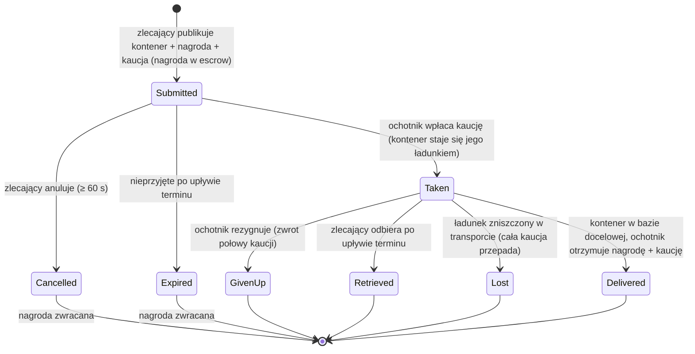

# Transport (wysyłanie przedmiotów)

**Zlecenie transportowe** przenosi kontener z przedmiotami z jednej bazy do drugiej, z **ochotniczym przewoźnikiem**, który otrzymuje wynagrodzenie. To dwustronny rynek: **zlecający** publikuje wysyłkę, a **ochotnik** ją przyjmuje i dostarcza.

> Lokalizacje w interfejsie użytkownika są opisane w [przeglądzie interfejsu klienta](/pl/features/ui/) (kategoria **Zlecenia** na pasku górnym). Mechaniki poniżej zostały potwierdzone na serwerze.

## Dwie strony

- **Zlecający (główny)** — publikuje wysyłkę: kontener do przeniesienia, z **bazy źródłowej**
  do **bazy docelowej**, za **nagrodę**, z **kaucją**, na określony **czas trwania**.
- **Ochotnik (przewoźnik)** — przyjmuje zlecenie, przewozi kontener i dostarcza go.

## Publikowanie transportu (zlecający)

**Złóż transport** z:
- **kontenerem** (opakowaniem objętościowym) do wysłania,
- **nagrodą**, którą płacisz przy dostawie,
- **kaucją** (gwarancją wpłacaną przez przewoźnika),
- **bazą źródłową** i **bazą docelową**,
- **czasem trwania** (w dniach), przez jaki zlecenie pozostaje otwarte.

Przy złożeniu **nagroda jest blokowana** z Twojego portfela (escrow).

## Przyjmowanie transportu (ochotnik)

- **Przyjmij** zlecenie — wpłacasz **kaucję** jako gwarancję, a kontener
  staje się Twoim ładunkiem do przewiezienia.

## Dostarczanie i odbieranie

- **Dostarcz** — przynieś kontener do bazy docelowej. Przy dostawie **ochotnik
  otrzymuje nagrodę + kaucję**, a zlecający otrzymuje towar.
- **Odbierz** — zlecający (lub ochotnik, w odpowiednim przypadku) odbiera
  kontener do bazy; przy odbiorze **kaucja jest zwracana**, a **nagroda
  jest zwracana** zlecającemu.

## Anulowanie / rezygnacja

- **Anuluj** — anuluj zlecenie.
- **Rezygnacja** — ochotnik porzuca zlecenie. Rezygnacja nakłada **karę na kaucję**:
  zwracana jest tylko **połowa** kaucji (reszta przepada) — stała kary
  wynosi 0,5 w `TransportAssignment.cs`.

## Inspekcja

- **Lista** transportów, **lista zawartości** jednego, **informacje o kontenerze**,
  **czy jest aktywne?**, oraz **dziennik transportu**.

## Przepływ pieniędzy (w skrócie)

**Nagroda** to płatność zlecającego, blokowana przy złożeniu i wypłacana wyłącznie przy dostawie.
**Kaucja** to gwarancja ochotnika: wpłacana zlecającemu przy przyjęciu, trzymana, gdy
ładunek jest w transporcie, i zwracana (wraz z nagrodą) przy dostawie.

| Wydarzenie | Warunek | Zlecający | Ochotnik | Kontener |
|---|---|---|---|---|
| Złożenie | — | nagroda w escrow | — | przeniesiony do magazynu transportowego |
| Przyjęcie | nieprzyjęte | otrzymuje kaucję | wpłaca kaucję | staje się ładunkiem ochotnika |
| Dostawa | w bazie docelowej | otrzymuje towar | otrzymuje **nagrodę + kaucję** | dostarczony |
| Anulowanie | nieprzyjęte, ≥ 60 s po złożeniu | nagroda zwracana | — | wraca do bazy źródłowej |
| Rezygnacja | przyjęte | nagroda zwracana | **połowa** kaucji zwracana (kara 0,5) | wraca do bazy źródłowej |
| Wygaśnięcie | nieprzyjęte, po upływie terminu | nagroda zwracana | — | wraca do bazy źródłowej |
| Odbiór | przyjęte **i** po upływie terminu | nagroda zwracana | — | wraca do bazy źródłowej (natychmiast, jeśli zdokowany, w przeciwnym razie przy następnym dokowaniu ochotnika) |
| Zniszczenie ładunku | w transporcie | nagroda zwracana **+ cała kaucja** | cała kaucja przepada | utracony |

## Uwagi praktyczne

- **Brak opłat** — jedynymi środkami, które się przemieszczają, są nagroda i kaucja.
- **Nagroda jest w escrow** — zlecający nie może jej wydać, dopóki transport nie zostanie rozliczony.
- **Kaucja to gwarancja przewoźnika** — jej wpłata umożliwia przyjęcie wysyłki;
  utrata ładunku w transporcie oznacza przepadek **całej** kwoty.
- **Rezygnacja ma swoją cenę** — porzucenie transportu oznacza przepadek połowy kaucji.
- **Czas trwania ma znaczenie, ale tylko do momentu przyjęcia** — termin wygaśnięcia
  ustawiony przy złożeniu zamyka automatycznie tylko te zlecenia, których nikt nie przyjął
  (serwer sprząta wygasłe nieprzyjęte zlecenia co godzinę). Przyjęte zlecenie
  nigdy samo nie wygasa; wyjściem awaryjnym zlecającego jest **Odbiór**, który staje się
  dostępny po upływie terminu i wycofuje ładunek (oraz nagrodę) do bazy źródłowej —
  natychmiast, jeśli przewoźnik jest zdokowany, lub automatycznie przy następnym
  dokowaniu przewoźnika.
- **Sprawdź zawartość przed przyjęciem** — zbadaj, co znajduje się w kontenerze, i trasę.

<!-- TODO: pozostaje tylko interfejs klienta (układ ekranu zleceń).
     Model finansowy potwierdzony: nagroda w escrow przy złożeniu (CashInOnSubmit), kaucja
     wpłacana przez ochotnika przy przyjęciu (TakeCollateral -> PayCollateralToPrincipal),
     dostawa wypłaca ochotnikowi nagrodę + kaucję (PayOutReward); anulowanie wymaga
     60 s od utworzenia; wygaśnięcie = czas złożenia + czas trwania w dniach z klienta
     (<=0 -> 1), sprzątane co godzinę przez MissionProcessor (_transportAssignmentInterval 1h),
     tylko taken=0; odbiór wymaga upływu terminu + przyjęcia, auto-zakładane przy
     następnym dokowaniu; zniszczony ładunek zwraca nagrodę i przepada cała kaucja
     na rzecz zlecającego.
     Notatki developerskie: TransportAssignments/TransportAssignmentSubmit.cs;
     Services/MissionEngine/TransportAssignments/TransportAssignment.cs (escrow nagrody/kaucji,
     PayOutReward = nagroda + kaucja, PaybackCollateral, PaybackHalfCollateral
     = COLLATERAL_PENALTY przy rezygnacji, RetrieveToBasePublicContainer, wygaśnięcie);
     TransportAssignmentTake/Deliver/Retrieve/Cancel/GiveUp/List/ListContent/
     ContainerInfo/Running/Log. -->