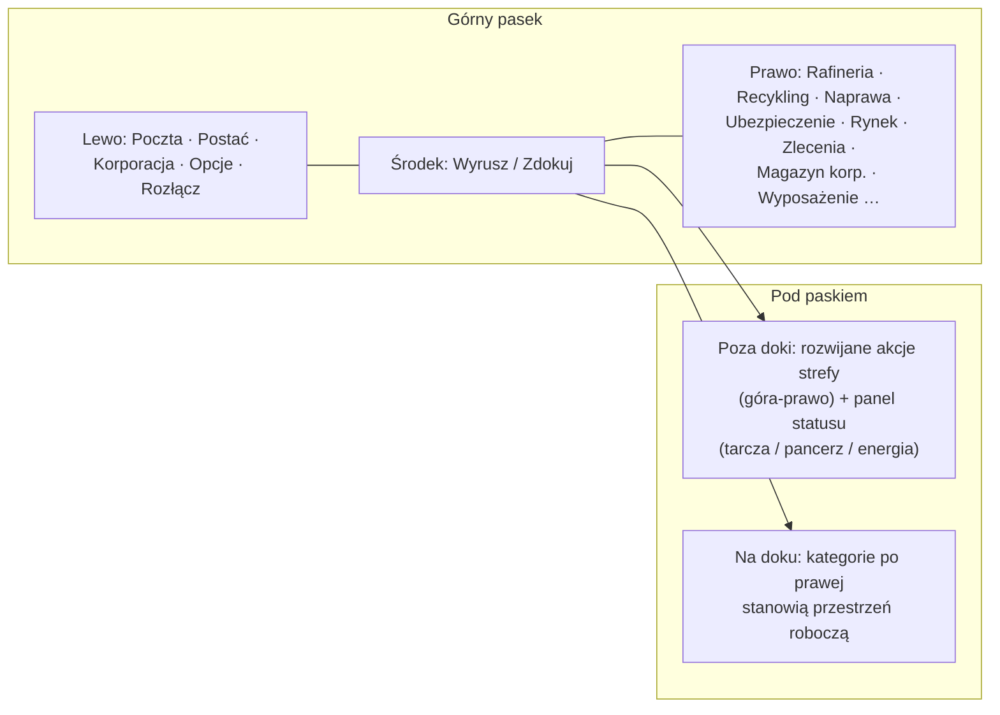

# Przegląd interfejsu klienta

Klient to interfejs **w stylu EVE Online**: pełnoekranowy widok przestrzeni/strefy z
pływającymi, **skalowalnymi i przesuwalnymi oknami**, które można **zamykać i otwierać** w dowolnym momencie.
Układ jest zorganizowany per system — zobacz strony powiązane poniżej.

> Ten układ to działający model dostarczony przez projekt, służący do opisu miejsca, w którym
> znajdują się poszczególne akcje. Dokładne nazwy ekranów mogą się nieznacznie różnić; struktura jest wzorcem.

## Górny pasek

Trwały pasek na górze ekranu.

| Obszar | Zawartość |
|---|---|
| **Lewo** | Główne przyciski: **Poczta**, **Postać**, **Korporacja**, inne **Opcje** oraz **Rozłącz** |
| **Środek** | Przycisk **Wyrusz / Zdokuj** — główny przełącznik zdokowany⇄poza doki (zobacz [ruch](/pl/features/movement/)) |
| **Prawo** | Kategorie akcji jako przyciski: **Rafineria**, **Recykling**, **Naprawa**, **Ubezpieczenie**, **Rynek**, **Zlecenia** (transport), **Magazyn korp.**, **Wyposażenie**, … |

Kategorie po prawej otwierają okna swoich systemów:

| Przycisk | Otwiera / robi | Strona wiki |
|---|---|---|
| Rafineria | Przetwarzanie surowców na komponenty | [produkcja](/pl/features/production/) |
| Recykling | Rozkładanie przedmiotów na materiały bazowe | [produkcja](/pl/features/production/) |
| Naprawa | Naprawa uszkodzonych robotów/modułów | [produkcja](/pl/features/production/) |
| Ubezpieczenie | Polisy ubezpieczeniowe produkcji/robotów | [produkcja](/pl/features/production/) |
| Rynek | Zamówienia rynkowe i zakupy bezpośrednie | [rynek](/pl/features/market/) |
| Zlecenia | Zlecenia transportowe (przesyłki) | [transport](/pl/features/transport/) |
| Magazyn korp. | Hangar/magazyn korporacji | [grupy](/pl/features/groups/) |
| Wyposażenie | Dopasowywanie modułów i amunicji do aktywnego robota | [roboty](/pl/features/robots/) |

## Stan zdokowany

Podczas **zdokowania** kategorie akcji po prawej stronie stanowią główną przestrzeń roboczą: przetwarzasz,
handlujesz, dopasowujesz i zarządzasz magazynem, nie opuszczając bazy. Przycisk Wyrusz odpina cię
do strefy (zobacz [ruch](/pl/features/movement/) dla warunków wstępnych odpięcia).

## Stan poza doki

Podczas **bycia poza doki** (pilotowanie aktywnego robota w strefie):

- Obszar **góra-prawo** zyskuje **rozwijany przycisk akcji**: kliknij go, a lista
  dodatkowych akcji strefy rozwinie się w dół (skanowanie, akcje zbioru/interakcji, narzędzia strefy —
  akcje opisane na stronach [zbieranie](/pl/features/gathering/) i [walka](/pl/features/combat/)).
- **Główny panel statusu** wyświetla stan twojego robota: **tarcza, pancerz/poszycie, energia**
  oraz powiązany status bojowy — te same dane, do których odnosi się strona [walka](/pl/features/combat/)
  (np. kontrola „system energii nienaruszony" przy odpinaniu).
- Kategorie dostępne tylko na doku (rafineria, rynek, …) są niedostępne do ponownego zdokowania.

## Wspólne okna

Większość systemów otwiera się w standardowym pływającym oknie: pasek tytułu, przycisk zamknięcia,
skalowane krawędzie, zawartość w zakładkach lub liście. Powtarzalne systemy (inwentarz/kontenery, rynek,
linie produkcyjne) mogą mieć wiele okien otwartych jednocześnie.

- **Inwentarz / kontenery** — lista kontenera, przenoszenie/stosowanie/pakowanie przedmiotów, zmiana nazwy,
  kosze — zobacz [przedmioty](/pl/features/items/).
- **Okno postaci** (przycisk góra-lewo) — profil, rozszerzenia (badania), ustawienia,
  kredyty — zobacz [rozpoczęcie](/pl/features/getting-started/) i [badania](/pl/features/research/).
- **Okno korporacji** (przycisk góra-lewo) — informacje o korporacji, hangar, dokumenty, głosowania,
  biuletyn — zobacz [grupy](/pl/features/groups/).
- **Okno poczty** (przycisk góra-lewo) — poczta osobista i masowa — zobacz [społeczność](/pl/features/social/).

## Konwencja używana w tej wiki

- **„Górny pasek → X"** = przycisk o nazwie X na górnym pasku.
- **„Akcje poza doki"** = rozwijana lista w prawym górnym rogu podczas przebywania w strefie.
- **Przycisk Wyrusz/Zdokuj** = centralny przełącznik na górnym pasku.

<!-- Note: this page is the agreed UI model (project-provided). If the real client
     differs in button names or placement, update this page first — every other
     features/ page references the conventions defined here. -->