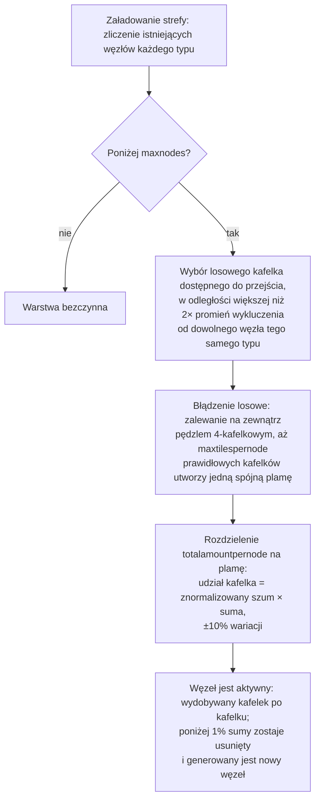

# Generowanie zasobów w strefie

Ta strona wyjaśnia, w jaki sposób serwer uzupełnia zasoby w strefie. Oba systemy działają
nieprzerwanie w tle, gdy strefa jest załadowana; do ich działania nie jest wymagana żadna
aktywność gracza.

## Konfiguracja zasobów strefy

Każda strefa jest skonfigurowana w bazie danych za pomocą dwóch niezależnych list:

- **Konfiguracja rud** (`mineralconfigs`) — jeden wiersz na każdy typ rudy obecny w strefie,
  z czterema parametrami na typ:
  | Kolumna | Znaczenie |
  |---|---|
  | `maxnodes` | Ile węzłów tego typu utrzymuje strefa |
  | `maxtilespernode` | Maksymalna liczba kafelków, jaką może zająć pojedynczy węzeł |
  | `totalamountpernode` | Całkowita ilość materiału w nowym węźle, rozłożona na jego kafelki |
  | `minthreshold` | Minimalny współczynnik wypełnienia kafelka (0–1); kafelki poniżej tej wartości po wydobyciu są usuwane |
- **Konfiguracja roślin** (`zones.fertility` + zestaw reguł roślin) — docelowy procent
  pokrycia roślinnością w strefie oraz lista gatunków roślin, które mogą tam rosnąć
  (zachowanie każdego gatunku określa plik reguł, udokumentowany w sekcji
  [Rośliny](/pl/content/plants/)).

Strefy bez konfiguracji rud (areny, strefy treningowe, twierdze, niektóre strefy gamma)
nie posiadają żadnych warstw rudy.

## Węzły rudy

### Jak węzeł jest rozmieszczany

Gdy strefa jest ładowana, warstwa każdego typu rudy zlicza swoje istniejące węzły (zapisane w
tabeli `mineralnodes`) i generuje nowe, aż do osiągnięcia `maxnodes`. Nowy węzeł jest
umieszczany za pomocą **błądzenia losowego**:

1. Wybierz losowy kafelek dostępny do przejścia.
2. Musi znajdować się daleko od najbliższego istniejącego węzła tego samego typu — promień
   wykluczenia wyliczany jest z `maxtilespernode` (`√(maxtilespernode/π) × 2`, a punkt
   startowy musi być oddalony co najmniej o dwukrotność tej wartości), dzięki czemu węzły
   nigdy nie łączą się w jedno gigantyczne złoże.
3. Z kafelka startowego błądzenie losowo rozszerza się na zewnątrz (pędzlem o wielkości 4 kafelków
   naraz), zbierając do `maxtilespernode` prawidłowych kafelków w jedną spójną plamę.
4. Zasób materiału węzła `totalamountpernode` jest rozdzielany na plamę: udział każdego kafelka
   to jego (znormalizowana) wartość szumu pomnożona przez sumę, z losową wariacją ±10%,
   dzięki czemu żadne dwa węzły tego samego typu nie wyglądają identycznie.

Kafelek jest prawidłowy dla węzła tylko wtedy, gdy znajduje się w granicach strefy, nie jest wyspą,
nie jest chroniony przed terraformowaniem przez PBS i jest dostępny do przejścia. Dwa rzadkie
typy otrzymują **strefy zastrzeżone** wokół baz dokujących i teleportów: **epriton**
zachowuje minimalną odległość, a **ruda flux** zachowuje podwojoną odległość — ruda flux
nigdy nie występuje więc tuż obok bazy.

### Jak węzeł jest zużywany

- Górnictwo usuwa materiał kafelek po kafelku.
- Węzeł, który spadnie poniżej **1% swojej skonfigurowanej sumy**, zostaje usunięty, a nowy
  węzeł jest generowany (powrót do kroku 1), aby utrzymać w strefie liczbę `maxnodes`.
- Węzły rudy flux dodatkowo sterują **odradzaniem NPC** — wydobywane (lub usuwane) węzły
  publikują zdarzenia, których nasłuchuje system NPC, dlatego złoża rudy flux przyciągają
  uwagę.

## Rośliny

### Skanowanie roślin

Strefa jest podzielona na **obszary 32×32 kafelki**. Moduł obsługi roślin przegląda te kafelki
po kolei, przetwarzając jeden na tick, w tempie, w którym **pełne przejście przez strefę zajmuje
około 8 godzin** (możliwe do nadpisania dla danej strefy). Każdy „sześcian” 32×32 jest
przetwarzany przez stały potok:

1. **Walidacja** — usunięcie nieprawidłowych roślin (złe podłoże, martwe, na niewłaściwym miejscu).
2. **Wzrost** — przejście każdej rośliny przez jej etapy wzrostu (zobacz
   [Zbieranie surowców](/pl/features/gathering/) dla wartości `growRate` i owocowania).
3. **Odradzanie** — dodanie nowych roślin tam, gdzie sześcian znajduje się poniżej swojego celu żyzności.
4. **Niszczenie ścian** — wysokość blokowania roślin ulega z czasem degradacji.
5. **Usuwanie ze względu na odległość** — wymuszenie odstępów między roślinami tego samego typu (`killDistance`).
6. **Odnawianie materiału** — niewielka ilość materiału owoców ulega regeneracji.

### Jak wybierana jest nowa roślina

Kafelek może wykiełkować tylko wtedy, gdy plik strefy przypisuje mu **potencjał odradzania**
(bajt na kafelek zapisany w warstwie roślinnej strefy — 0 oznacza, że kafelek nigdy nie
wykiełkuje). W danym ticku, dla każdego kwalifikującego się kafelka:

- **Najpierw sprawdzana jest żyzność strefy**: jeśli pokrycie sześcianu roślinami blokującymi
  osiąga już `fertility%` jego kafelków podłoża, nic nowego się tam nie odradza.
- **Szansa na kafelek**: losowy rzut musi pokonać potencjał odradzania kafelka.
- **Wybór gatunku**:
  - Jeśli kafelek **nie ma sąsiadujących roślin**, gatunek wybierany jest w ważonym
    losowaniu, gdzie wagą każdego dozwolonego gatunku jest jego `fertility` (gatunki sadzone
    przez graczy są wykluczone z naturalnego odradzania).
  - Jeśli **ma sąsiadów**, następuje rzut monetą: 50% szans na aktualnie *dominujący* sąsiedni
    gatunek (najpowszechniejszy w pobliżu), 50% na losowanie **rozprzestrzeniania** ważone przez
    `(liczba sąsiadów × spreading)` dla każdego gatunku — to właśnie sprawia, że skupiska
    rozszerzają się w ramach własnego gatunku.
- **Limity i odstępy**: gatunek z limitem `maxAmount` jest pomijany, gdy w strefie jest go
  wystarczająco dużo, a kafelek w obrębie `killDistance` od innej rośliny tego samego typu
  jest pomijany.

### Co to oznacza dla graczy

- Gęstość roślin jest ograniczona przez żyzność strefy — nigdy nie zobaczysz strefy o 100%
  pokryciu roślinami, jeśli jej żyzność wynosi 20.
- Skupiska są regułą: rozprzestrzenianie sprawia, że każdy gatunek rozszerza własne poletka, więc
  strefa ma tendencję do tworzenia terytoriów gatunków zamiast jednolitej mieszaniny.
- Gatunki z parametrem `killDistance` (np. niektóre rośliny o wysokiej wartości) są rozmieszczone
  równomiernie, co sprawia, że ich lokalizacje stają się przewidywalne po znalezieniu pierwszej z nich.
- Nowe węzły pojawiają się wszędzie tam, gdzie zakończy się błądzenie losowe — w strefie nie ma
  stałego „miejsca na rudę”; wymagane jest skanowanie (zobacz
  [Zbieranie surowców](/pl/features/gathering/)).

<!-- Developer notes: TerrainsModule.cs (per-zone layer construction: OreLayer for
     Solid, LiquidLayer for Liquid, GravelLayer for TrainingZone; LoadMineralNodes
     top-up); MineralLayer.cs (LoadMineralNodes: delete <1% nodes, generate to
     maxnodes; FluxOre -> OreNpcSpawnMessage on decrease/expiry);
     Generators/MineralNodeGeneratorBase.cs (FindStartPosition keep-out + spacing,
     NormalizeNoise, CreateMineralNode jitter); RandomWalkMineralNodeGenerator.cs
     (flood-fill brush 4, 50k step cap); MineralNodeRepository.cs (mineralnodes table,
     compressed per-tile values); PlantHandler.cs (32x32 areas, 8h full pass,
     PlantsGrowthTimerOverrideMin, scanner modes); NatureCube.cs (ProcessAll pipeline,
     SpawnPlants fertility/spawn/killDistance logic, GetNewPlantRule 50/50 ruling vs
     spreading); PlantRuleExtensions.cs (fertility-weighted + spreading-weighted
     draws); PlantInfo.cs (per-tile spawn byte comes from the zone's plant layer
     file, never assigned by server code). -->
