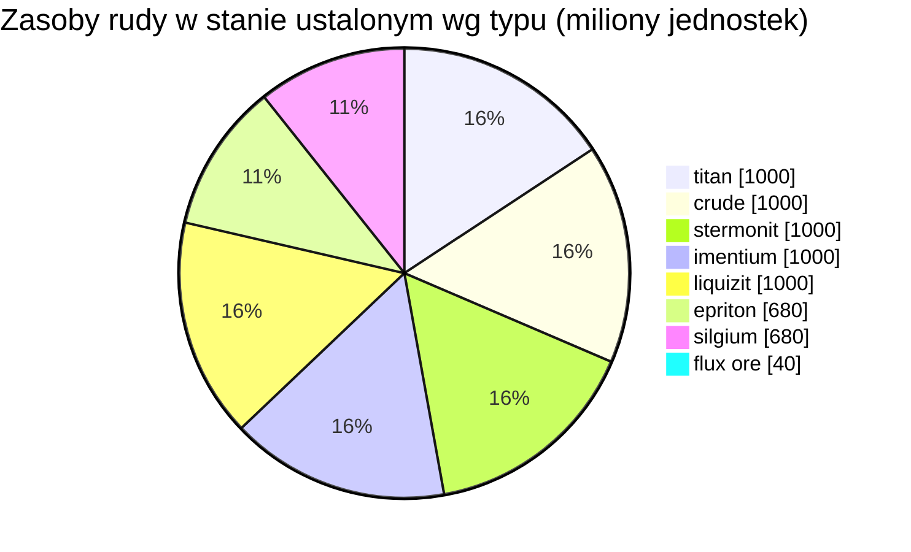

# Daoden (zone_ASI) — praktyczny przykład

  <a href="/pl/zones/map/">
    
    <strong>Mapa świata</strong> — położenie tej strefy pośród pozostałych wraz z połączeniami teleportów. Otwórz pełną mapę.
  </a>

Gdzie znajdują się kolumny teleportacyjne w tej strefie (kropki z etykietą celu — przyciemnione, gdy
kolumna jest obecnie wyłączona), miejsca lądowania teleportów przybywających z innych stref (przerywane
okręgi) oraz bramy wyjściowe (romby), jeśli istnieją. Pozycje to współrzędne kafelków zapisane
przez serwer.
Przerywane linie łączą pary lokalnych (wewnątrzstrefowych) kolumn teleportacyjnych.

Strefa **otwartego PvP** poziomu alpha — najbogatsza konfiguracja rudy w grze i miejsce,
gdzie występują rzadkie typy surowców. Wszystko to, co posiada New Virginia, plus epriton,
silgium oraz złoża rudy flux przyciągające ataki NPC.

| Parametr | Wartość |
|---|---|
| ID strefy | 2 |
| Typ | PvP (otwarta) |
| Ochrona | [Beta](/pl/zones/protection/) — otwarte PvP, standardowy teren |
| Rozmiar | 2048 × 2048 kafelków |
| Żyzność | 20 |
| Zestaw reguł roślin | 2 — 19 gatunków (w tym rośliny zbierackie wysokiego poziomu) |
| Typy rud | 8 (titan, crude, stermonit, imentium, liquizit, epriton, silgium, flux ore) |
| Całkowita liczba węzłów rudy | 64 (po 8 na typ) |

## Konfiguracja rudy

| Materiał | Węzły | Maks. kafelków/węzeł | Łącznie na węzeł | Min. próg |
|---|---|---|---|---|
| [titan](/pl/content/ores/titan/) | 8 | 500 | 125,000,000 | 0.5 |
| [crude](/pl/content/ores/crude/) | 8 | 1257 | 125,000,000 | 0.5 |
| [stermonit](/pl/content/ores/stermonit/) | 8 | 500 | 125,000,000 | 0.5 |
| [imentium](/pl/content/ores/imentium/) | 8 | 500 | 125,000,000 | 0.5 |
| [liquizit](/pl/content/ores/liquizit/) | 8 | 500 | 125,000,000 | 0.5 |
| [epriton](/pl/content/ores/epriton/) | 8 | 500 | 85,000,000 | 0.5 |
| [silgium](/pl/content/ores/silgium/) | 8 | 500 | 85,000,000 | 0.5 |
| [fluxore](/pl/content/ores/fluxore/) | 8 | 300 | 5,000,000 | 0.5 |

Wyróżniające się uwagi:

- **8× więcej węzłów niż w New Virginia**, lecz każdy węzeł jest mniejszy (500 kafelków wobec 1000):
  promień błądzenia spada z 34 do 24 kafelków dla standardowych rud. Skanowanie ma tutaj
  większe znaczenie — złoża są cieńsze i liczniejsze.
- **Epriton i silgium** mają obniżone łączne zasoby (85 mln vs 125 mln) — wyższa wartość,
  rzadsze złoża. Epriton dodatkowo utrzymuje **minimalną odległość od baz i teleportów**,
  dzięki czemu jego węzły nigdy nie znajdują się w miejscu odradzania graczy.
- **Ruda flux to przypadek skrajny**: tylko 5 mln na węzeł na obszarze 300 kafelków (~16 600 na
  kafelek — strużka, a nie złoże), 8 węzłów i strefa wykluczenia o **podwójnej** odległości
  epritonu od baz. Wydobycie węzła flux publikuje zdarzenia odradzania do systemu NPC —
  miejsca występowania rudy flux są sporne z założenia (zobacz
  [Systemy intruzji i NPC](/pl/features/intrusion/)).
- Zasoby w stanie ustalonym: łącznie ~6,4 miliarda jednostek materiału.

## Mieszanka roślin

Zestaw reguł 2 dopuszcza 19 gatunków — pełny zestaw alpha: podstawowe rośliny plus **devrinol**,
**wall**, **titanplant** oraz **zbierackie rośliny wysokiego poziomu** (wysokopoziomowy electroplant,
wysokopoziomowy iron tree, wysokopoziomowy rustbush, wysokopoziomowy slimeroot). Żyzność nadal
wynosi 20, więc gęstość jest taka sama jak w New Virginia — zmienia się to, *które* gatunki
mogą wygrać losowanie żyzności. Własne wagi `fertility` roślin zbierackich wysokiego poziomu
decydują o tym, jak często wygrywają one losowanie z trawami.

Reguły dla poszczególnych gatunków znajdują się w sekcji [Rośliny](/pl/content/plants/);
wydajności poszczególnych rud w sekcji [Rudy](/pl/content/ores/).

## Co to oznacza dla gracza

- Dostępna jest pełna drabina rud, w tym ekonomia rudy flux — jest to jednak otwarte PvP,
  więc wszystko, co wydobędziesz, może zostać odebrane (zobacz
  [transport](/pl/features/transport/) w sprawie bezpiecznego przewożenia towarów między bazami).
- Spodziewaj się presji ze strony NPC w pobliżu węzłów rudy flux; moduł odradzania nasłuchuje
  zdarzeń wydobycia na tych węzłach.
- Zbiór roślin koncentruje się tutaj na wariantach wysokiego poziomu, które dają lepsze owoce
  niż gatunki niskiego poziomu w strefach startowych.

<!-- Developer notes: zones row id 2 (zonetype 2 = PvP, protected 0, fertility 20,
     plantruleset 2); mineralconfigs 8 rows (7 standard + fluxore 8/300/5M);
     MineralNodeGeneratorBase.KeepOutDist: Epriton = MINERAL_DISTANCE_FROM_BASE_MIN,
     FluxOre = 2x; MineralLayer.OnNodeDecrease/OnNodeExpired -> OreNpcSpawnMessage for
     FluxOre; plantrules rulesetid 2 = 19 files (4 harvestable, incl. devrinol and
     wall). -->
