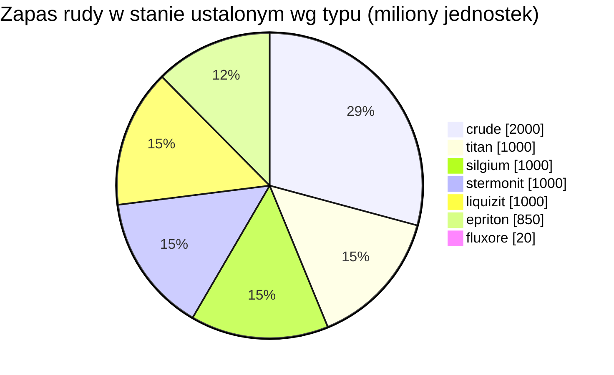

<!-- Generated by tools/generate from the live database (source: zones, mineralconfigs, plantrules, teleportdescriptions, strongholdexitconfig).
     Do not edit by hand; regenerate instead. -->
# Hokkogaros (zone_ASI_A_real)

  <a href="/pl/zones/map/">
    
    <strong>Mapa świata</strong> — gdzie znajduje się ta strefa wśród pozostałych, wraz z połączeniami teleportów. Otwórz pełną mapę.
  </a>

Lokalizacje kolumn teleportacyjnych tej strefy (punkty z etykietą celu — przyciemnione, gdy kolumna jest wyłączona), miejsca lądowania teleportów z innych stref (przerywane okręgi) oraz bramy wyjściowe (romby), jeśli istnieją. Pozycje odpowiadają współrzędnym pól rejestrowanym przez serwer. Przerywane linie łączą pary lokalnych kolumn teleportacyjnych wewnątrz strefy.

Wyspa otwartego PvP (beta) obszaru Daoden (ASI) — gracze mogą atakować bez ograniczeń, obowiązują bloby. Utrzymuje 7 typów rudy.

| Fakt | Wartość |
|---|---|
| ID strefy | 4 |
| Typ | PvP |
| Ochrona | [Beta](/pl/zones/protection/) — otwarte PvP, standardowy teren |
| Rozmiar | 2048×2048 pól |
| Żyzność | 20 |
| Gatunki roślin | 17 (zestaw reguł 4) |
| Typy rud | 7 |
| Łącznie złoża rudy | 54 |
| Maks. bazy dokowania | brak |

## Konfiguracja rudy

Generowanie złóż utrzymywane przez tę strefę. Wydajność poszczególnych rud i wzory generowania znajdują się w sekcji [Rudy](/pl/content/ores/) (sekcja tej strefy jest podlinkowana poniżej).

| Materiał | Złoża | Maks. pól/złoże | Łącznie na złoże | Min. próg |
|---|---|---|---|---|
| [titan](/pl/content/ores/titan/) | 8 | 500 | 125M | 0.5 |
| [crude](/pl/content/ores/crude/) | 8 | 500 | 250M | 0.5 |
| [stermonit](/pl/content/ores/stermonit/) | 8 | 500 | 125M | 0.5 |
| [liquizit](/pl/content/ores/liquizit/) | 8 | 500 | 125M | 0.5 |
| [epriton](/pl/content/ores/epriton/) | 10 | 350 | 85M | 0.5 |
| [silgium](/pl/content/ores/silgium/) | 8 | 500 | 125M | 0.5 |
| [fluxore](/pl/content/ores/fluxore/) | 4 | 300 | 5M | 0.5 |

[Indeks stref](/pl/zones/zone-index/) · [Mapa świata](/pl/zones/map/#beta) · [Poziomy ochrony](/pl/zones/protection/)
