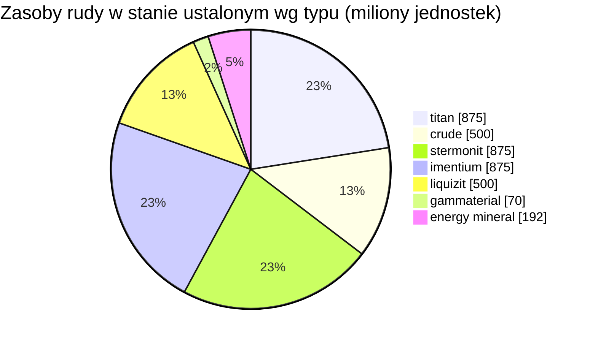

# zone_gamma_z106 — praktyczny przykład

  <a href="/pl/zones/map/">
    
    <strong>Mapa świata</strong> — położenie tej strefy pośród pozostałych wraz z połączeniami teleportów. Otwórz pełną mapę.
  </a>

Gdzie znajdują się kolumny teleportacyjne w tej strefie (kropki z etykietą celu — przyciemnione, gdy
kolumna jest obecnie wyłączona), miejsca lądowania teleportów przybywających z innych stref (przerywane
okręgi) oraz bramy wyjściowe (romby), jeśli istnieją. Pozycje to współrzędne kafelków zapisane
przez serwer.

Strefa wysokiego poziomu **otwartego PvP**: podlegająca terraformowaniu, niska żyzność, warianty
roślin tieru 2 oraz ściślejsza ekonomia rudy. Jest to „endgame'owy” kształt strefy — mniej zasobów,
o które toczy się bardziej zacięta rywalizacja.

| Parametr | Wartość |
|---|---|
| ID strefy | 106 |
| Typ | PvP (otwarta) |
| Ochrona | [Gamma](/pl/zones/protection/) — otwarte PvP, możliwość terraformowania |
| Rozmiar | 2048 × 2048 kafelków |
| Żyzność | 15 |
| Podlega terraformowaniu | tak (limit technologiczny PBS 2) |
| Zestaw reguł roślin | 22 — 17 gatunków („Reguły Roślin Gamma”, mieszanka tieru 2) |
| Typy rud | 7 (titan, crude, stermonit, imentium, liquizit, gammaterial, energy mineral) |
| Całkowita liczba węzłów rudy | 44 |

## Konfiguracja rudy

| Materiał | Węzły | Maks. kafelków/węzeł | Łącznie na węzeł | Min. próg |
|---|---|---|---|---|
| [titan](/pl/content/ores/titan/) | 7 | 600 | 125,000,000 | 0.5 |
| [crude](/pl/content/ores/crude/) | 4 | 600 | 125,000,000 | 0.5 |
| [stermonit](/pl/content/ores/stermonit/) | 7 | 600 | 125,000,000 | 0.5 |
| [imentium](/pl/content/ores/imentium/) | 7 | 600 | 125,000,000 | 0.5 |
| [liquizit](/pl/content/ores/liquizit/) | 4 | 600 | 125,000,000 | 0.5 |
| [gammaterial](/pl/content/ores/gammaterial/) | 7 | 100 | 10,000,000 | 0.5 |
| [energymineral](/pl/content/ores/energymineral/) | 8 | 300 | 24,000,000 | 0.5 |

Wyróżniające się uwagi:

- **Mniej węzłów niż w strefach alpha** (44 vs 64 w Daoden): crude i liquizit spadają
  do zaledwie 4 węzłów każdy. Takie same sumy na węzeł jak w przypadku standardowych rud
  alpha, więc stan ustalony (~3,9 miliarda jednostek łącznie) jest uboższy i wolniej się regeneruje.
- **Dwa egzotyczne typy**: **gammaterial** w malutkich węzłach po 100 kafelków (promień marszu
  10 kafelków — małe, łatwe do zauważenia, ~1,4 mln na węzeł) oraz **energy mineral**
  o wartości 24 mln na węzeł.
- Brak epritonu i rudy flux — rzadkie/ekonomiczne rudy pozostają w tierze alpha.

## Mieszanka roślin

Zestaw reguł 22 dopuszcza 17 gatunków: podstawowe rośliny plus **warianty tieru 2** — wysoki
iron tree t2 oraz wysoki rustbush t2 jako dzikie rośliny zbierackie, a także **rośliny tieru 2
sadzone przez graczy** (wysoki electroplant t2, wysoki slimeroot t2). Rośliny z nasion posiadają
flagę `playerSeeded` — **nigdy** nie odradzają się naturalnie; istnieją wyłącznie w ogrodach
graczy (zobacz [zbieranie surowców → rośliny](/pl/features/gathering/)).

Żyzność wynosi **15**, a nie 20: sześcian 32×32 może pomieścić maksymalnie ~15% roślin
blokujących, więc pokrycie roślinnością jest zauważalnie rzadsze niż w strefach alpha, a losowanie
żyzności ma nieco mniej miejsca na zapełnienie, zanim sześcian osiągnie „nasycenie”.

Reguły dla poszczególnych gatunków (w tym ilości owoców t2) znajdują się w sekcji
[Rośliny](/pl/content/plants/); wydajności poszczególnych rud w sekcji
[Rudy](/pl/content/ores/).

## Co to oznacza dla gracza

- Uboższa, wolniejsza ekonomia: mniejsza liczba węzłów powszechnych rud oznacza, że presja
  wydobywcza ujawnia się szybciej — wyeksploatowany węzeł ropy (crude) potrzebuje więcej czasu,
  aby strefa go odtworzyła.
- Rzadsza roślinność: przy żyzności 15% otwarty teren jest normą, a skupiska roślin są wyjątkiem.
- Cenne zbiory obejmują tutaj dzikie rośliny iron tree / rustbush tieru 2 oraz prowadzenie
  ogrodów graczy z zasianymi electroplant i slimeroot tieru 2.
- Terraformowanie (limit technologiczny PBS 2) oznacza, że sam teren może być przekształcany
  przez graczy (zobacz [Bazy polowe PBS](/pl/features/pbs/)).

<!-- Developer notes: zones row id 106 (zonetype 2 = PvP, protected 0, fertility 15,
     terraformable 1, pbsTechLimit 2, plantruleset 22); mineralconfigs 7 rows (crude
     and liquizit 4 nodes each); plantrules rulesetid 22 = 17 files, note "Gamma
     Plant Rules"; electroplant_seeded_t2.txt / slimeroot_seeded_t2.txt set
     playerSeeded=n1 (inherited via source= from electroplant_hi.txt /
     slimeroot_hi.txt) -> excluded from natural spawns in
     PlantRuleExtensions.GetWinnerPlantTypeBasedOnFertility. -->
