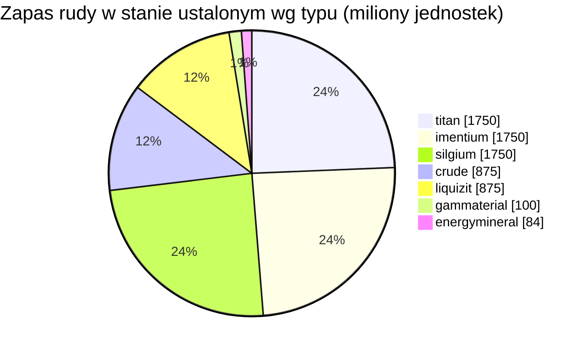

<!-- Generated by tools/generate from the live database (source: zones, mineralconfigs, plantrules, teleportdescriptions, strongholdexitconfig).
     Do not edit by hand; regenerate instead. -->
# zone_gamma_z113

  <a href="/pl/zones/map/">
    
    <strong>Mapa świata</strong> — gdzie znajduje się ta strefa wśród pozostałych, wraz z połączeniami teleportów. Otwórz pełną mapę.
  </a>

Lokalizacje kolumn teleportacyjnych tej strefy (punkty z etykietą celu — przyciemnione, gdy kolumna jest wyłączona), miejsca lądowania teleportów z innych stref (przerywane okręgi) oraz bramy wyjściowe (romby), jeśli istnieją. Pozycje odpowiadają współrzędnym pól rejestrowanym przez serwer.

Otwarta, zdatna do terraformowania wyspa PvP (gamma) obszaru frontier belt — teren może być przekształcany przez graczy. Utrzymuje 7 typów rudy.

| Fakt | Wartość |
|---|---|
| ID strefy | 113 |
| Typ | PvP |
| Ochrona | [Gamma](/pl/zones/protection/) — otwarte PvP, zdatna do terraformowania |
| Rozmiar | 2048×2048 pól |
| Poziom (Tier) | T1 (zarejestrowane przez serwer) |
| Żyzność | 15 |
| Gatunki roślin | 17 (zestaw reguł 11) |
| Typy rud | 7 |
| Łącznie złoża rudy | 57 |
| Limit technologii PBS | 1 |
| Maks. bazy dokowania | 2 |

## Konfiguracja rudy

Generowanie złóż utrzymywane przez tę strefę. Wydajność poszczególnych rud i wzory generowania znajdują się w sekcji [Rudy](/pl/content/ores/) (sekcja tej strefy jest podlinkowana poniżej).

| Materiał | Złoża | Maks. pól/złoże | Łącznie na złoże | Min. próg |
|---|---|---|---|---|
| [titan](/pl/content/ores/titan/) | 10 | 600 | 175M | 0.5 |
| [crude](/pl/content/ores/crude/) | 5 | 600 | 175M | 0.5 |
| [imentium](/pl/content/ores/imentium/) | 10 | 600 | 175M | 0.5 |
| [liquizit](/pl/content/ores/liquizit/) | 5 | 600 | 175M | 0.5 |
| [silgium](/pl/content/ores/silgium/) | 10 | 600 | 175M | 0.5 |
| [gammaterial](/pl/content/ores/gammaterial/) | 10 | 100 | 10M | 0.5 |
| [energymineral](/pl/content/ores/energymineral/) | 7 | 300 | 12M | 0.5 |

[Indeks stref](/pl/zones/zone-index/) · [Mapa świata](/pl/zones/map/#t1) · [Poziomy ochrony](/pl/zones/protection/)
