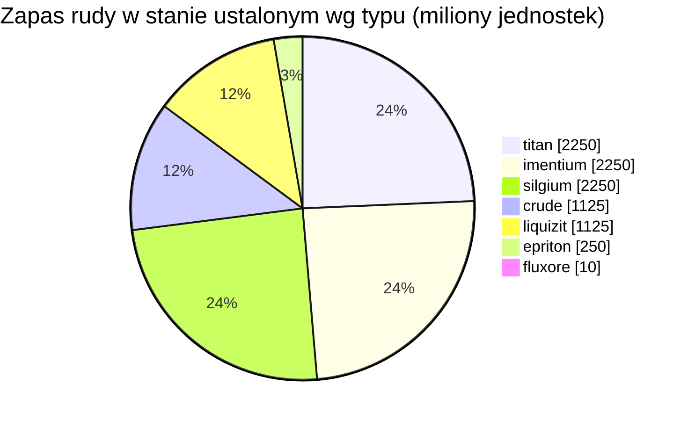

<!-- Generated by tools/generate from the live database (source: zones, mineralconfigs, plantrules, teleportdescriptions, strongholdexitconfig).
     Do not edit by hand; regenerate instead. -->
# zone_gamma_z114

  <a href="/pl/zones/map/">
    
    <strong>Mapa świata</strong> — gdzie znajduje się ta strefa wśród pozostałych, wraz z połączeniami teleportów. Otwórz pełną mapę.
  </a>

Lokalizacje kolumn teleportacyjnych tej strefy (punkty z etykietą celu — przyciemnione, gdy kolumna jest wyłączona), miejsca lądowania teleportów z innych stref (przerywane okręgi) oraz bramy wyjściowe (romby), jeśli istnieją. Pozycje odpowiadają współrzędnym pól rejestrowanym przez serwer.

Wyspa otwartego PvP (beta) obszaru frontier belt — gracze mogą atakować bez ograniczeń, obowiązują bloby. Utrzymuje 7 typów rudy.

| Fakt | Wartość |
|---|---|
| ID strefy | 114 |
| Typ | PvP |
| Ochrona | [Beta](/pl/zones/protection/) — otwarte PvP, standardowy teren |
| Rozmiar | 2048×2048 pól |
| Poziom (Tier) | T0 (zarejestrowane przez serwer) |
| Żyzność | 15 |
| Gatunki roślin | 15 (zestaw reguł 10) |
| Typy rud | 7 |
| Łącznie złoża rudy | 47 |
| Limit technologii PBS | 0 |
| Maks. bazy dokowania | brak |

## Konfiguracja rudy

Generowanie złóż utrzymywane przez tę strefę. Wydajność poszczególnych rud i wzory generowania znajdują się w sekcji [Rudy](/pl/content/ores/) (sekcja tej strefy jest podlinkowana poniżej).

| Materiał | Złoża | Maks. pól/złoże | Łącznie na złoże | Min. próg |
|---|---|---|---|---|
| [titan](/pl/content/ores/titan/) | 10 | 600 | 225M | 0.5 |
| [crude](/pl/content/ores/crude/) | 5 | 600 | 225M | 0.5 |
| [imentium](/pl/content/ores/imentium/) | 10 | 600 | 225M | 0.5 |
| [liquizit](/pl/content/ores/liquizit/) | 5 | 600 | 225M | 0.5 |
| [epriton](/pl/content/ores/epriton/) | 5 | 300 | 50M | 0.5 |
| [silgium](/pl/content/ores/silgium/) | 10 | 600 | 225M | 0.5 |
| [fluxore](/pl/content/ores/fluxore/) | 2 | 200 | 5M | 0.5 |

[Indeks stref](/pl/zones/zone-index/) · [Mapa świata](/pl/zones/map/#t1) · [Poziomy ochrony](/pl/zones/protection/)
