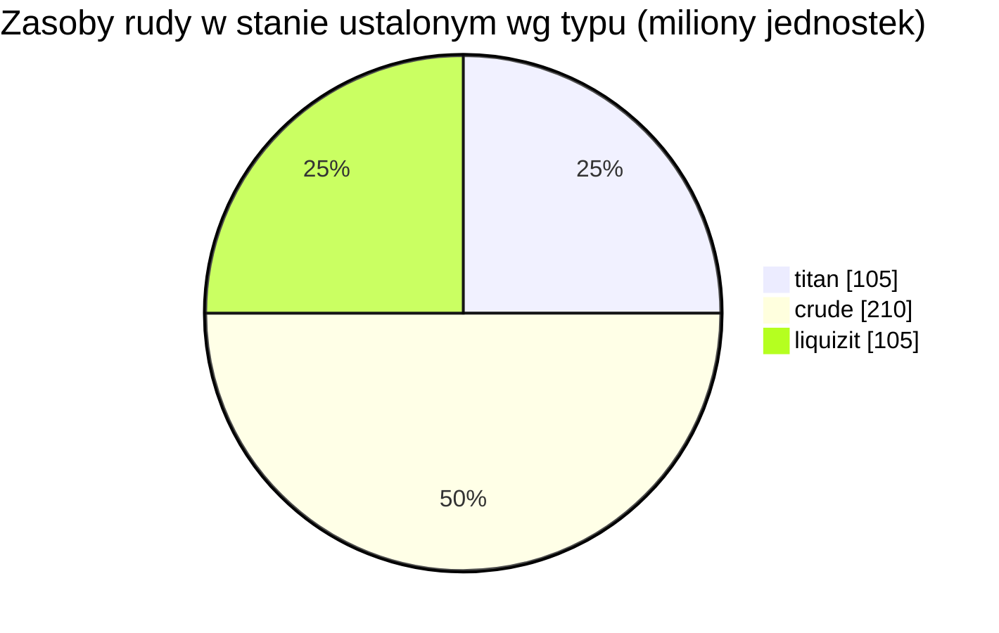

# New Virginia (zone_TM) — praktyczny przykład

  <a href="/pl/zones/map/">
    
    <strong>Mapa świata</strong> — położenie tej strefy pośród pozostałych wraz z połączeniami teleportów. Otwórz pełną mapę.
  </a>

Gdzie znajdują się kolumny teleportacyjne w tej strefie (kropki z etykietą celu — przyciemnione, gdy
kolumna jest obecnie wyłączona), miejsca lądowania teleportów przybywających z innych stref (przerywane
okręgi) oraz bramy wyjściowe (romby), jeśli istnieją. Pozycje to współrzędne kafelków zapisane
przez serwer.
Przerywane linie łączą pary lokalnych (wewnątrzstrefowych) kolumn teleportacyjnych.

Strefa niskiego poziomu **chronionego PvE** — bezpieczne miejsce, w którym nowe postacie zbierają
surowce. Jej konfiguracja reprezentuje najprostszy koniec spektrum: niewiele rodzajów rudy,
duże węzły i podstawowa mieszanka roślin.

| Parametr | Wartość |
|---|---|
| ID strefy | 0 |
| Typ | PvE (chroniona) |
| Ochrona | [Alpha](/pl/zones/protection/) — chroniona, PvP wyłączone |
| Rozmiar | 2048 × 2048 kafelków |
| Żyzność | 20 |
| Zestaw reguł roślin | 0 — 15 gatunków (podstawowy zestaw „tm pve”) |
| Typy rud | 3 (titan, crude, liquizit) |
| Całkowita liczba węzłów rudy | 21 (po 7 na typ) |

## Konfiguracja rudy

| Materiał | Węzły | Maks. kafelków/węzeł | Łącznie na węzeł | Min. próg |
|---|---|---|---|---|
| [titan](/pl/content/ores/titan/) | 7 | 1000 | 15,000,000 | 0.5 |
| [crude](/pl/content/ores/crude/) | 7 | 1257 | 30,000,000 | 0.5 |
| [liquizit](/pl/content/ores/liquizit/) | 7 | 1000 | 15,000,000 | 0.5 |

Wyróżniające się uwagi:

- **Duże, rzadkie węzły** — po 1000–1257 kafelków każdy (promień marszu
  `(int)√(tiles/π)×2` = 34–40 kafelków), więc każdy węzeł jest dużą plamą, a w strefie
  znajduje się tylko 7 każdego typu. Zasób w stanie ustalonym to łącznie ~420 milionów
  jednostek materiału (105 mln titan + 210 mln crude + 105 mln liquizit).
- **Brak rzadkich typów** — brak epritonu i rudy flux, więc nie ma stref zastrzeżonych wokół
  baz ani miejsc odradzania NPC powiązanych ze złożami.
- `minthreshold` wynoszący 0.5 oznacza, że kafelek nadaje się do użytku tylko wtedy, gdy
  wypełnienie szumem węzła wynosi co najmniej połowę wartości maksymalnej — krawędzie
  każdej plamy są cienkie.

Wydajności poszczególnych typów (na co przetwarza się jedna jednostka każdej rudy oraz wzory
generowania węzłów stojące za powyższymi liczbami) znajdują się w sekcji
[Rudy](/pl/content/ores/).

## Mieszanka roślin

Zestaw reguł 0 pozwala na 15 gatunków — podstawowy zestaw startowy: trawa (a/b), sosna,
krzewy (a/b), rango, miedziane drzewo, trzcina, nanopszenica, niskopoziomowe rustbush /
slimeroot / electroplant, bonsai oraz niskopoziomowe żelazne drzewo. Brak ścian, brak devrinolu,
brak surowców zbierackich wysokiego poziomu.

Przy żyzności 20 sześcian 32×32 może pomieścić maksymalnie ~20% roślin blokujących; na całej
mapie 2048×2048 daje to górną granicę około 838 000 kafelków roślin (w praktyce mniej — woda
i wyspy nie są lądem). Wybór gatunków jest ważony przez `fertility` każdej reguły, dlatego
podstawowe trawy i krzewy dominują, podczas gdy zbierackie rośliny niskiego poziomu
pozostają rzadkie.

Pełne reguły dla poszczególnych gatunków (growRate, owoce, zdrowie) znajdują się w sekcji
[Rośliny](/pl/content/plants/).

## Co to oznacza dla gracza

- Bezpieczna ekonomia startowa: trzy powszechne rudy w dużych, łatwych do zeskanowania plamach.
- Zbieralne rośliny są tutaj wariantami niskiego poziomu — rośliny o wysokiej wartości
  (wysokopoziomowe electroplant / iron tree / rustbush / slimeroot) pojawiają się w późniejszych
  strefach.
- Ponieważ strefa jest chroniona, ryzyko PvP to jedyny element nieobecny w pętli zbierania
  surowców (zobacz [poruszanie się](/pl/features/movement/) w sprawie wejścia do strefy).

<!-- Developer notes: zones row id 0 (zonetype 1 = PvE, protected 1, fertility 20,
     plantruleset 0); mineralconfigs 3 rows (titan/crude/liquizit, 7 nodes each);
     plantrules rulesetid 0 = 15 files, note "tm pve". Node radius formula and
     threshold semantics: see generation.md. -->
